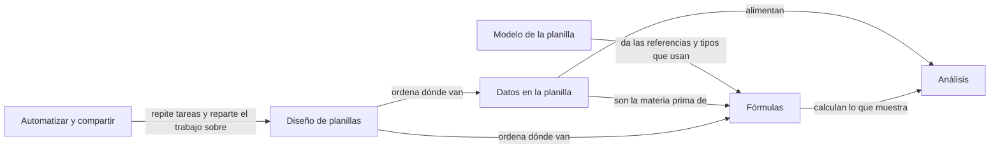

# Planillas de cálculo

Una planilla de cálculo es una grilla de celdas donde cada celda guarda un dato o una fórmula que
calcula con otras celdas, y se recalcula sola cuando algo cambia. Este tema explica cómo usarla
para trabajar en un negocio (costos, stock, ventas, clientes) con Excel y Google Sheets a la par,
sin que se rompa.

La planilla sirve a la vez para guardar datos, calcular y mostrar resultados, y por eso es la
herramienta con la que casi todo negocio empieza. Esa misma libertad es su riesgo: cualquier celda
acepta cualquier cosa, y nada avisa si una fórmula apunta a la fila equivocada. El tema se ocupa de
las dos caras. Cuando la planilla deja de alcanzar, la salida está en
[cuándo pasar a una base](cuando-pasar-a-una-base.md) y en el tema [Bases de datos](../Bases-de-datos/bases-de-datos.md).
El análisis de datos en general (estadística, visualización, tableros) está en [Datos](../Datos/datos.md).

## De qué está hecha una planilla que funciona

Seis partes. El modelo de la planilla es cómo piensa la herramienta (celdas, referencias, tipos);
las fórmulas calculan sobre ese modelo; los datos tienen que estar ordenados para que las fórmulas y
el análisis funcionen; el análisis resume y muestra; el diseño separa lo que se carga de lo que se
calcula para que otro pueda tocarla; y la automatización y el trabajo compartido aparecen cuando la
usan varias personas o se repite una tarea.

- [Modelo de la planilla](Modelo-de-la-planilla/modelo-de-la-planilla.md) — celdas y referencias, tipos de dato (una fecha
  es un número) y cómo leer los errores de fórmula.
- [Fórmulas](Formulas/formulas.md) — funciones lógicas, de búsqueda, sumar y contar con condiciones, texto y fechas, y
  matrices dinámicas; con la ficha de equivalencias entre Excel, Sheets, castellano e inglés.
- [Datos en la planilla](Datos-en-la-planilla/datos-en-la-planilla.md) — una fila por registro, tablas que crecen solas,
  validación y Power Query para importar y limpiar.
- [Análisis](Analisis/analisis-en-planillas.md) — tablas dinámicas, gráficos y escenarios («qué pasa si»).
- [Diseño de planillas](Diseno-de-planillas/diseno-de-planillas.md) — entradas, cálculos y salidas separados, cuánto fallan
  las planillas y cómo se revisan.
- [Automatizar y compartir](Automatizar-y-compartir/automatizar-y-compartir.md) — macros, Apps Script y trabajar varios
  sobre el mismo archivo.

Aparte, la [ficha de aplicaciones](aplicaciones-de-planillas.md) compara Excel, Google Sheets y LibreOffice Calc con sus
límites y versiones al 2026-11-27.

## Las planillas fallan porque fallan las personas

Las auditorías intensivas que reúne Panko encontraron errores en el 94 % de 85 planillas revisadas,
y los experimentos de laboratorio promedian 3,9 % de celdas con fórmula con error, cerca de lo que
la investigación sobre error humano espera (entre 1 % y 5 %). Son muestras chicas, no la tasa de todas
las planillas (que no sean aleatorias es lectura propia: según Panko, son mayormente auditorías de
firmas comerciales de varios días por planilla), y la cifra «88 % de las planillas tienen errores» que
circula no tiene fuente rastreable. Panko lo resume así: "spreadsheet programs are not error-prone.
People are error prone." Lo que reduce errores es el diseño ordenado y revisar celda por celda, como
cuentan [errores en planillas](Diseno-de-planillas/errores-en-planillas.md) y
[revisar una planilla](Diseno-de-planillas/revisar-una-planilla.md).

## Excel y Sheets no son la misma herramienta

Las dos comparten la mayoría de las funciones, pero difieren en lo que más pesa al elegir. Excel
limita por filas (1.048.576) y Sheets por celdas totales (20 millones desde septiembre de 2026). Excel
tiene [Power Query](Datos-en-la-planilla/power-query.md) y [VBA](Automatizar-y-compartir/macros.md);
Sheets tiene [QUERY e IMPORTRANGE](Datos-en-la-planilla/power-query.md) y
[Apps Script](Automatizar-y-compartir/apps-script.md), y vive siempre en la nube.
Una función nueva puede existir en Microsoft 365 y no en Excel 2019: según un resumen de la ayuda de
Microsoft, [BUSCARX](Formulas/funciones-de-busqueda.md) da error al editar la fórmula si el archivo
lo abre alguien con una versión vieja. La [ficha de equivalencias](Formulas/equivalencias-de-funciones.md) dice qué existe dónde.

## Qué leer según lo que estés haciendo

- Si tenés que armar una planilla de costos, stock o precios que otro va a usar: [entradas, cálculo y
  salidas](Diseno-de-planillas/entradas-calculo-salidas.md), [datos ordenados](Datos-en-la-planilla/datos-ordenados.md) y
  [validación de datos](Datos-en-la-planilla/validacion-de-datos.md).
- Si tenés que cruzar dos listas (clientes, productos, precios): [funciones de búsqueda](Formulas/funciones-de-busqueda.md);
  si son archivos que se repiten cada mes, [Power Query](Datos-en-la-planilla/power-query.md).
- Si tenés las ventas en filas y querés ver totales por mes o por producto: [tabla dinámica](Analisis/tabla-dinamica.md), o
  [sumar y contar con condiciones](Formulas/sumar-y-contar-con-condiciones.md) si el resumen tiene que quedar en fórmulas.
- Si una fórmula da error o un número raro: [errores de fórmula](Modelo-de-la-planilla/errores-de-formula.md),
  [tipos de dato](Modelo-de-la-planilla/tipos-de-dato.md) y [revisar una planilla](Diseno-de-planillas/revisar-una-planilla.md).
- Si tenés que decidir un precio o una cantidad que cumpla una meta: [análisis de escenarios](Analisis/analisis-de-escenarios.md).
- Si tenés que elegir entre Excel y Google Sheets: la [ficha de aplicaciones](aplicaciones-de-planillas.md),
  la [ficha de equivalencias de funciones](Formulas/equivalencias-de-funciones.md) y
  [compartir y colaborar](Automatizar-y-compartir/compartir-y-colaborar.md).
- Si tenés que armar una planilla de stock que usan varias personas a la vez: no hay nota de diseño de
  stock todavía; lo más cercano es [cuándo pasar a una base](cuando-pasar-a-una-base.md) (la señal de
  dos personas descontando el mismo producto),
  [compartir y colaborar](Automatizar-y-compartir/compartir-y-colaborar.md),
  [entradas, cálculo y salidas](Diseno-de-planillas/entradas-calculo-salidas.md) y
  [datos ordenados](Datos-en-la-planilla/datos-ordenados.md); y
  [concurrencia](../Bases-de-datos/Transacciones/concurrencia.md) para entender por qué dos descuentos
  simultáneos se pisan.
- Si la planilla se volvió lenta, la editan muchos o se pierden datos: [cuándo pasar a una base](cuando-pasar-a-una-base.md).

## Orden de lectura

Para quien escribe fórmulas simples: [Modelo de la planilla](Modelo-de-la-planilla/modelo-de-la-planilla.md), después
[Datos en la planilla](Datos-en-la-planilla/datos-en-la-planilla.md) y [Fórmulas](Formulas/formulas.md), y
[Diseño de planillas](Diseno-de-planillas/diseno-de-planillas.md) antes de armar una planilla que dure. Análisis y
Automatizar y compartir se leen cuando hace falta. El [glosario](Fundamentos/glosario-de-planillas.md)
queda a mano para cualquier término que aparezca sin explicar.

- [Fundamentos](Fundamentos/fundamentos-de-planillas.md) — historia, enfoques en conflicto, bibliografía y glosario.
