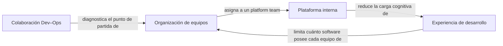

# Platform Engineering

Platform engineering es construir y operar plataformas internas para que los equipos de
desarrollo entreguen software con autonomía, seguridad y menos carga cognitiva.

Lo que se construye es una [Internal Developer Platform](Plataforma-interna/internal-developer-platform.md):
un conjunto de capacidades self-service que un platform team ofrece como producto. La plataforma
no se entiende sola. Según la [ley de Conway](Organizacion-de-equipos/ley-de-conway.md), el sistema
copia la comunicación entre equipos, así que importa quién la construye y para quién; y una
plataforma se justifica, en buena parte, por la fricción que les saca a los desarrolladores.

Se confunde con un equipo "DevOps" que ejecuta los despliegues de los demás. La diferencia es que
el platform team ofrece capacidades que los equipos usan solos, y el otro hace el trabajo por
ellos: es el [anti-patrón del equipo DevOps](Colaboracion-Dev-Ops/anti-patron-equipo-devops.md).
Las prácticas de entrega (integración continua, pipelines, GitOps) están en el tema
[DevOps](../DevOps/devops.md), y los patrones entre servicios, en [Arquitectura](../Arquitectura/arquitectura.md).

## De qué está hecho el platform engineering

Cuatro partes. La organización de equipos decide quién construye y quién consume; la plataforma
interna es lo que el platform team construye para los equipos de producto; la experiencia de
desarrollo es lo que esa plataforma intenta mejorar; y la colaboración Dev–Ops dice desde dónde
parte una organización real. Las prácticas que la plataforma ofrece como capacidades (la
[observabilidad](../DevOps/Operacion/observabilidad.md), el
[policy-as-code](../DevOps/DevSecOps/policy-as-code.md), [GitOps](../DevOps/Despliegue/gitops.md))
se explican en DevOps y acá se enlazan.

- [Organización de equipos](Organizacion-de-equipos/organizacion-de-equipos.md) — la ley de Conway, el tamaño y la estabilidad de los equipos, y Team Topologies con sus tipos de equipo y modos de interacción. Se lee primero: el resto da por sentado que el sistema copia a los equipos.
- [Experiencia de desarrollo](Experiencia-de-desarrollo/experiencia-de-desarrollo.md) — cómo viven los desarrolladores su trabajo, la carga cognitiva y hasta dónde conviene ocultarles lo de abajo.
- [Plataforma interna](Plataforma-interna/plataforma-interna.md) — la IDP y sus partes: capacidades, self-service, APIs, gobernanza, golden paths y portal.
- [Colaboración Dev–Ops](Colaboracion-Dev-Ops/colaboracion-dev-ops.md) — DevOps Topologies, su anti-patrón más común y cómo se diagnostica una organización con entrevistas.

## Lo que falta: el catálogo de servicios

El Service Catalog (registro de servicios, ownership y documentación) no tiene material todavía.
El [developer portal](Plataforma-interna/developer-portal.md) describe el catálogo de software de
Backstage, pero el tema no lo trata como pieza propia.

## De Conway a la plataforma

Para aprenderlo en orden, [Platform engineering desde cero](Fundamentos/recorrido-platform-engineering.md)
recorre las cuatro partes paso a paso. [Fundamentos](Fundamentos/fundamentos-de-platform-engineering.md) reúne lo que cruza
todo el tema.
