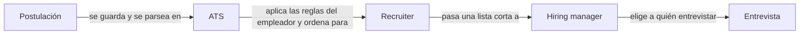

# Selección

La selección es el proceso con que quien contrata filtra y elige entre postulantes: un sistema
que guarda y ordena las postulaciones, personas que las leen y un juicio sobre quién pasa a la
entrevista. Es el lado que recibe las vidrieras, y sus reglas explican por qué las demás partes
del tema son como son.

Recibe las [vidrieras](../Vidrieras/vidrieras.md) que quien busca cortó de su
[material](../Material/material.md), y le devuelve al
[posicionamiento](../Posicionamiento/posicionamiento.md) qué señales pesan de verdad. Se lee
primero porque cambia lo que conviene hacer en las otras tres partes: un CV escrito sin saber quién
lo lee optimiza para un lector imaginario.

## Un embudo de filtros sucesivos

Una postulación pasa por varias manos antes de llegar a una entrevista, y en cada una puede
quedar afuera por razones distintas. El sistema de seguimiento de postulantes (ATS) la guarda,
extrae sus campos y aplica las reglas que configuró el empleador. Después la lee un recruiter, que
filtra, y por último quien va a dirigir el puesto (el hiring manager), que decide a quién
entrevistar.

Según la documentación oficial leída, el software no rechaza un CV por su contenido. Rechaza con
reglas que escribió el empleador, como una pregunta filtro sobre ubicación o permiso de trabajo, y
esas reglas igual descartan gente calificada. En la encuesta *Hidden Workers* (2021), el 88 % de
los empleadores admite que su sistema deja afuera candidatos calificados de habilidades altas. Qué
hace cada lector y con qué fuente está en [quién lee un CV](quien-lee-un-cv.md).

## El CV filtra pero predice poco

Lo que un CV puede afirmar está entre lo que menos predice el desempeño en el puesto. En el
meta-análisis de Sackett y otros (2022), contar años de experiencia predice casi nada, y las
muestras de trabajo y la entrevista estructurada están arriba de la lista. El reclutador, además,
infiere rasgos de personalidad a partir del CV con poca confiabilidad. Los números y lo que
significan están en [qué predice la selección](que-predice-la-seleccion.md).

La consecuencia para el resto del tema es que el CV sirve para pasar un filtro y para señalar
evidencia que está en otro lado: proyectos, código, trabajo verificable.

## Los sesgos que el CV no corrige

La misma vidriera recibe respuestas distintas según el nombre, la edad o cuánto tiempo lleva la
persona sin trabajo. Lo miden los estudios de correspondencia, que mandan CVs ficticios
equivalentes y cuentan cuántos reciben un llamado. Mejorar el CV no cierra esas brechas, y el
sesgo varía mucho de una empresa a otra. Los estudios están en
[sesgos en la selección](sesgos-en-la-seleccion.md).

## La IA cambió las dos puntas

Desde 2023 quien se postula escribe y adapta con IA, y quien contrata recibe más postulaciones y
desconfía más. Corregir el CV con IA ayuda a quien la usa, pero la carta a medida dejó de
distinguir a nadie cuando todos pudieron escribirla en segundos. Los estudios y las encuestas
están en [la IA en la selección](la-ia-en-la-seleccion.md).

## Cuánta evidencia hay detrás de cada afirmación

La evidencia sobre selección es despareja: hay ciencia sólida sobre qué predice y a quién se
discrimina, y casi nada independiente sobre cómo lee un recruiter en la práctica.

| Pregunta | Qué evidencia hay | Firmeza |
|---|---|---|
| ¿Qué predice el desempeño? | Meta-análisis de décadas de estudios (Sackett y otros, 2022) | Alta |
| ¿A quién se discrimina al leer un CV? | Experimentos de campo con decenas de miles de postulaciones | Alta, pero ninguno es de puestos de tecnología |
| ¿Qué hace el ATS? | Documentación oficial de los propios vendedores | Media: es su voz sobre su producto |
| ¿Cuánto tiempo mira un recruiter y qué mira? | Estudios de vendedores sin método publicado | Baja |
| ¿Qué cambió con la IA? | Dos preprints y un artículo de un mercado freelance, más encuestas de vendedores | Media y reciente |

## Qué hay adentro de la selección

- [Quién lee un CV](quien-lee-un-cv.md) — el ATS, el recruiter y el hiring manager: qué hace
  cada uno, qué rechaza el software y qué no.
- [Qué predice la selección](que-predice-la-seleccion.md) — la validez de cada método, por qué el
  CV predice poco y qué infiere de él el reclutador.
- [Sesgos en la selección](sesgos-en-la-seleccion.md) — los estudios de correspondencia por
  nombre, edad y tiempo sin trabajo, y los filtros automáticos.
- [La IA en la selección](la-ia-en-la-seleccion.md) — la avalancha de postulaciones, el CV
  corregido con IA y las señales que se devaluaron.
