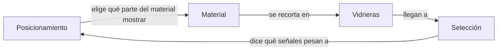

# Presentación profesional

Presentarse profesionalmente es mostrarle a quien contrata, en el CV, en LinkedIn y en un
portfolio, la parte de lo que uno hizo que prueba que puede hacer el puesto. Las vidrieras se
cortan de un mismo material (logros, proyectos, historia) según el puesto y según quién las lee.

El error más común es tratar al CV como el todo y retocarlo en cada búsqueda. El CV es una
vidriera: muestra una selección de un material que existe antes y que se mantiene aparte. Cuando
el material está anotado, cada vidriera sale de recortarlo; cuando no, cada búsqueda obliga a
reconstruir de memoria lo que uno hizo, y los logros se reemplazan por tareas.

El tema termina donde empieza la entrevista: cubre lo que se muestra antes de que alguien converse
con uno. La entrevista, la negociación de la oferta y la carta de presentación quedan afuera, salvo
lo que dicen los [mitos del CV](Fundamentos/mitos-del-cv.md) sobre la carta.

## Del material a la vidriera y al lector

Cuatro partes: quien busca decide a qué apuntar, mantiene un material con todo lo que hizo, corta
de él las vidrieras para cada puesto, y del otro lado alguien las filtra.

- [Selección](Seleccion/seleccion.md) — el otro lado: quién lee, qué predice de verdad el
  desempeño, los sesgos medidos y cómo cambió todo con la IA. Se lee primero, porque explica por
  qué las demás partes son como son.
- [Posicionamiento](Posicionamiento/posicionamiento.md) — a qué puesto apuntar, cómo leer una
  búsqueda y qué historia hilvana lo que uno hizo con lo que quiere hacer.
- [Material](Material/material.md) — lo que hay detrás: el inventario de lo hecho, los logros bien
  redactados (con números solo cuando el número prueba algo), las habilidades y los huecos.
- [Vidrieras](Vidrieras/vidrieras.md) — lo que se muestra: el CV, cómo cambia por país, cómo se
  adapta a un puesto, LinkedIn y el portfolio.

## Por qué el CV filtra pero no prueba

Lo que un CV puede afirmar predice poco. En el meta-análisis de Sackett y otros (2022), los años
de experiencia laboral tienen una validez de .07 sobre el desempeño en el puesto (la validez es la
correlación entre la señal y el desempeño: 0 no predice nada, 1 lo predice todo), y la educación
quedó afuera por falta de datos. Las muestras de trabajo llegan a .33 y la entrevista estructurada
a .42. El CV sirve para pasar un filtro. Lo que convence de que uno sabe hacer el trabajo es la
evidencia de trabajo hecho, y el CV solo puede señalarla. Los detalles están en
[qué predice la selección](Seleccion/que-predice-la-seleccion.md).

De ahí sale la regla que atraviesa el tema: cada línea de una vidriera vale por lo que se puede
verificar detrás. Un logro con un número inventado, una lista de tecnologías sin un proyecto que
las use o un repositorio con estrellas pero sin historia de trabajo dicen menos de lo que parecen.
Marlow y Dabbish (2013), en entrevistas con empleadores que miraban GitHub, encontraron que
confiaban en las huellas de trabajo difíciles de fingir y desconfiaban de la popularidad.

## Cuánta evidencia hay

Poca, y desigual. Hay estudios serios sobre los sesgos de selección, los errores de ortografía,
cómo explicar un hueco laboral y qué predice el desempeño. Ningún experimento compara un logro con
número contra uno sin número, ni un CV adaptado contra uno genérico. Para una página contra dos hay
uno solo, de un vendedor y sin revisión.

Las cifras más repetidas («6 segundos», «el ATS rechaza el 75 %») se atribuyen a empresas que
venden servicios de empleo o de CV, y esas empresas no publicaron su método. El ATS es el software
donde la empresa recibe y filtra las postulaciones (ver
[quién lee un CV](Seleccion/quien-lee-un-cv.md)). Cada nota dice qué tan firme es lo que afirma, y
los [mitos del CV](Fundamentos/mitos-del-cv.md) juntan los más comunes.

## Qué leer según lo que estés haciendo

- Si vas a empezar a buscar trabajo desde cero: primero [Selección](Seleccion/seleccion.md), para
  saber quién lee del otro lado; después el
  [inventario profesional](Material/inventario-profesional.md) y su
  [plantilla](Material/plantilla-de-inventario.md), la
  [historia profesional](Posicionamiento/historia-profesional.md) y la
  [plantilla de CV](Vidrieras/plantilla-de-cv.md).
- Si tenés una búsqueda abierta y querés postularte:
  [leer una búsqueda](Posicionamiento/leer-una-busqueda.md),
  [adaptar por puesto](Vidrieras/adaptar-por-puesto.md) y la
  [revisión antes de mandar](Vidrieras/revision-antes-de-mandar.md).
- Si estás redactando logros y no sabés si ponerles números: [logros](Material/logros.md).
- Si querés cambiar de área (por ejemplo, de infraestructura a IA):
  [huecos y cambios de carrera](Material/huecos-y-cambios-de-carrera.md),
  [historia profesional](Posicionamiento/historia-profesional.md) y el
  [caso de los roles de AI engineering](Posicionamiento/caso-roles-de-ai-engineering.md).
- Si te postulás a otro país o en remoto: [CV por país](Vidrieras/cv-por-pais.md).
- Si querés que te encuentren sin postularte: [LinkedIn](Vidrieras/linkedin.md) y
  [portfolio y GitHub](Vidrieras/portfolio-y-github.md).
- Si alguien te dio un consejo de CV y querés saber si tiene base:
  [mitos del CV](Fundamentos/mitos-del-cv.md) y [quién lee un CV](Seleccion/quien-lee-un-cv.md).
- Si te preocupa usar IA para escribir el CV:
  [la IA en la selección](Seleccion/la-ia-en-la-seleccion.md).

## Fundamentos

- [Fundamentos](Fundamentos/fundamentos-de-presentacion-profesional.md) — lo transversal: [mitos del CV](Fundamentos/mitos-del-cv.md), con el veredicto de cada consejo repetido, y [fuentes](Fundamentos/fuentes-de-presentacion-profesional.md), con el peso de cada clase de fuente y una historia corta del CV.
