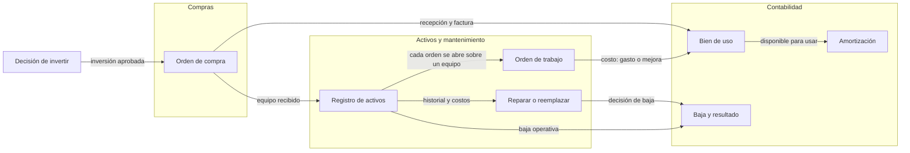

# De la compra a la baja del activo

De la compra a la baja del activo es el recorrido que sigue la vida de un equipo propio: empieza en la decisión de comprarlo o construirlo y termina cuando se lo da de baja, por venta o desguace, con su resultado registrado. Cruza Activos y mantenimiento, Compras y Contabilidad, y lleva dos registros del mismo equipo que tienen que coincidir hasta el final.

Es el único recorrido que dura años y no días. La decisión de invertir, donde empieza, no tiene nota de dominio. Lo que pasa todos los días sobre el equipo, la [orden de trabajo](../Activos-y-mantenimiento/Orden-de-trabajo/orden-de-trabajo.md), es un paso de este recorrido; su ciclo completo es de Activos y mantenimiento. La compra misma pasa por [de la compra al pago](de-la-compra-al-pago.md), y la amortización de cada mes entra al cierre [del registro al balance](del-registro-al-balance.md). Según el Institute of Asset Management, el ciclo de vida empieza cuando surge la necesidad del activo y llega hasta su disposición.

APQC 7.4 lo reparte en tres lugares: 10.0 «Acquire, Construct, and Manage Assets» (de 10.1 «Plan and acquire assets» a 10.4 «Manage asset end-of-life»), 9.4 «Manage fixed-asset project accounting» para aprobar y cerrar la inversión, y 9.3.3 «Perform fixed-asset accounting» para el alta, la amortización y la baja.

## Los nueve pasos y el documento que deja cada uno

| Paso | Dominio | Qué pasa | Documento que deja |
|---|---|---|---|
| 1. Decidir la inversión | Sin nota de dominio (APQC 9.4.1 y 10.1.1.3 «Determine build, buy, or lease decision») | Se justifica y se aprueba comprar, construir o arrendar | Proyecto de inversión aprobado |
| 2. Comprar o construir | Compras: [orden de compra](../Compras-y-abastecimiento/Orden-de-compra/tipos-de-orden.md#los-bordes-subcontratación-y-compra-de-activos) | Una orden puntual, que sigue el recorrido de la compra al pago; o una obra propia | Recepción y factura, o costos de la obra |
| 3. Dar de alta el bien de uso | Contabilidad: [activos fijos y amortización](../Contabilidad/Operaciones/activos-fijos-y-amortizacion.md#capitalizar-o-gastar) | Se capitaliza el costo más lo necesario para dejarlo funcionando; se fijan vida útil, residual y método | Ficha del bien de uso |
| 4. Darlo de alta en el registro de activos | Activos: [registro de activos](../Activos-y-mantenimiento/Registro-de-activos/registro-de-activos.md) | Se registra qué es, dónde está y de qué está hecho, con su [criticidad](../Activos-y-mantenimiento/Registro-de-activos/criticidad.md) | Ficha del equipo |
| 5. Ponerlo en marcha | Activos y Contabilidad | Queda instalado y en condiciones de operar; desde ahí se amortiza | Fecha de disponible para usar |
| 6. Amortizar | Contabilidad: [activos fijos y amortización](../Contabilidad/Operaciones/activos-fijos-y-amortizacion.md#vida-útil-valor-residual-y-los-tres-métodos) | Cada período se carga su parte del costo | Asiento de amortización |
| 7. Mantener | Activos: [orden de trabajo](../Activos-y-mantenimiento/Orden-de-trabajo/orden-de-trabajo.md) y [cierre de la orden](../Activos-y-mantenimiento/Orden-de-trabajo/cierre-de-la-orden.md#el-costo-pasa-a-contabilidad) | Se repara o se mejora; Contabilidad decide si el costo es gasto o sube el activo | Orden cerrada con su costo |
| 8. Decidir reparar o reemplazar | Activos: [reparar o reemplazar](../Activos-y-mantenimiento/Desempeno-de-los-activos/reparar-o-reemplazar.md) | Se compara el costo anual de seguir con el de uno nuevo | Decisión de baja |
| 9. Dar de baja | Contabilidad: [vender o dar de baja](../Contabilidad/Operaciones/activos-fijos-y-amortizacion.md#vender-o-dar-de-baja-un-activo); Activos: el registro | Se vende o se desguaza; se cancelan costo y amortización acumulada | Resultado por la baja |

Durante los pasos 6 y 7 el equipo puede cambiar de lugar. El traslado es un movimiento fechado en el registro operativo ([jerarquía de activos](../Activos-y-mantenimiento/Registro-de-activos/jerarquia-de-activos.md#qué-pasa-con-el-historial-cuando-el-equipo-cambia-de-lugar)). Para la NIC 16, ese costo no suma al activo: «costs incurred in using or redeploying an item are not included in the carrying amount of that item» (párr. 20).

## Dos registros que tienen que coincidir

El activo tiene dos registros con dueños distintos, y pueden separarse en cada traspaso.

- **Al alta: de Compras a Contabilidad y a Activos.** La misma recepción alimenta el bien de uso y la ficha del equipo. Si el alta contable no referencia al equipo, después no se sabe qué ficha es de qué bien (inferencia de la base).
- **A la puesta en marcha: de Activos a Contabilidad.** La NIC 16 dice que la amortización «begins when it is available for use, ie when it is in the location and condition necessary» (párr. 55). Quien sabe esa fecha es mantenimiento o producción, no Contabilidad.
- **Al cerrar cada orden: de Activos a Contabilidad.** La orden junta el costo; Contabilidad decide. El servicio diario va a resultados (párr. 12); la mejora que cumple el criterio de reconocimiento sube el activo (párr. 7).
- **A la baja: de Activos a Contabilidad.** La NIC 16 da de baja un bien «(a) on disposal; or (b) when no future economic benefits» se esperan de él (párr. 67). Dar de baja el equipo en el registro operativo no da de baja el bien de uso: son dos hechos que se registran en dos lugares, y alguien tiene que avisar.

Contabilidad decide qué se capitaliza y el resultado de la baja; Activos y mantenimiento decide cuándo reemplazar y qué hacerle al equipo.

## Dónde se traba

- **Activos fantasma.** Si la baja operativa no llega a Contabilidad, el bien sigue en libros. Una firma de auditoría los describe como «"Ghost assets" that no longer exist but continue to be depreciated», y pide conciliar «the fixed asset register, general ledger and operational asset systems». APQC tiene el paso: 9.3.3.8 «Track fixed-assets including physical inventory».
- **Al revés: equipo sin bien de uso.** Un equipo que se mantiene sin estar en el balance puede ser correcto, como un repuesto rotativo ([registro de activos](../Activos-y-mantenimiento/Registro-de-activos/registro-de-activos.md#el-activo-físico-frente-al-contable)), o un alta contable que faltó (inferencia de la base).
- **Mejora gastada o reparación capitalizada.** Si el cierre de la orden no dice qué se hizo, Contabilidad no puede decidir, y el valor en libros deja de reflejar el equipo (inferencia de la base).
- **Amortización que arranca mal.** Si se amortiza desde la factura y no desde la puesta en marcha, el gasto se adelanta (inferencia sobre el párr. 55).

## Qué se mide del recorrido entero

| Medida | Qué cuenta | Fuente |
|---|---|---|
| Correcciones por inventario físico | Movimientos de activos fijos que salen de inventarios físicos, sobre el total de movimientos; mide cuánto corrige el recuento al registro | APQC, medida 100733 |
| Costo de reparación y mantenimiento por cada 1.000 de valor bruto | Costo de reparar y mantener los activos fijos sobre su valor bruto contable | APQC, medida 103518 |
| Inversión real sobre presupuestada | Gasto de capital real del año sobre el presupuestado | APQC, medida 100009 |
| Tiempo para aprobar una inversión | Días para aprobar un proyecto de capital | APQC, medida 100586 |
| Edad promedio del parque | Amortización acumulada sobre amortización del período, con amortización lineal | Notas de estudio CFA, según su resumen |

La lista de APQC es de 2013 y da fórmulas, sin valores. La medida 103518 se parece al costo sobre valor de reposición de [indicadores de mantenimiento](../Activos-y-mantenimiento/Desempeno-de-los-activos/indicadores-de-mantenimiento.md#las-fórmulas), pero divide por el valor contable bruto, no por lo que costaría reponer el equipo. El [costo del ciclo de vida](../Activos-y-mantenimiento/Desempeno-de-los-activos/reparar-o-reemplazar.md#lo-que-suma-el-costo-del-ciclo-de-vida) y los indicadores de mantenimiento (MTBF, disponibilidad) son de Activos y mantenimiento y se enlazan.

> [!NOTE] Sin fuente todavía: valores de referencia de estas medidas y una cifra con fuente de cuántos activos fantasma tiene un registro típico. Las que circulan salen de páginas de proveedores de software sin datos rastreables.

## Variantes

### Activo en arrendamiento

Con un arrendamiento, el paso 2 es un contrato y no una compra; quien toma el bien lo mantiene igual. La NIIF 16 regula cómo se registra, y la base no tiene nota que la trate: lo más cercano es el [leasing](../Tesoreria/Financiamiento/prestamos.md#leasing) visto como financiamiento, en Tesorería.

### Activo construido por la propia empresa

El paso 2 es una obra (APQC 10.2 «Design and construct assets»). Según la NIC 16, «The cost of a self-constructed asset is determined using the same principles as for an acquired asset» (párr. 22). Cómo se acumulan los costos de la obra hasta el alta no tiene nota de dominio.

> [!NOTE] Sin fuente todavía: la decisión de inversión (presupuesto de capital), el deterioro (NIC 36), la revaluación y la obra en curso. Ningún tema de dominio los desarrolla.

### Equipo en casa del cliente

Un equipo vendido o instalado en casa del cliente se mantiene con el mismo ciclo de orden de trabajo, pero no está en el balance de quien lo mantiene: se lleva en la [base instalada](../Activos-y-mantenimiento/Servicio-de-campo/base-instalada.md). No hay pasos 3, 6 ni 9; la baja es del cliente.

Lo propio de la Argentina (la amortización impositiva frente a la contable, el ajuste por inflación de los bienes de uso) está en [procesos de negocio en la Argentina](procesos-de-negocio-en-argentina.md#de-la-compra-a-la-baja-del-activo).
