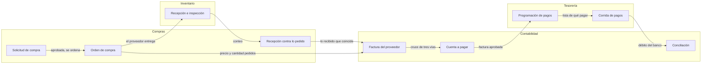

# De la compra al pago

De la compra al pago es el recorrido que empieza cuando un área pide algo con una solicitud de compra y termina cuando el pago al proveedor está registrado y conciliado con el banco. Cruza Compras, Inventario, Contabilidad, Tesorería e Impuestos, y su control central es el cruce de tres vías entre la orden, la recepción y la factura.

El recorrido empieza en la [solicitud de compra](../Compras-y-abastecimiento/Orden-de-compra/solicitud-de-compra.md). Antes queda decidir a quién comprarle y en qué términos, que es [Abastecimiento estratégico](../Compras-y-abastecimiento/Abastecimiento-estrategico/abastecimiento-estrategico.md): si se lo suma, el recorrido se llama source-to-pay. Termina en la [conciliación](../Contabilidad/Control-interno/conciliaciones.md) del pago; el cierre del mes que usa esos saldos es el recorrido [del registro al balance](del-registro-al-balance.md). Los libros de sistemas contables lo llaman ciclo de egresos.

APQC 7.4 no tiene una categoría que lo contenga: lo arma con 4.2.3 «Order materials and services», 4.2.4.4 «Monitor quality of product delivered», 4.4.3.2 «Receive, inspect, and store inbound deliveries», 9.6.1 «Process accounts payable (AP)» y 9.7.2.3 «Process and oversee electronic fund transfers».

## Los ocho pasos y el documento que deja cada uno

| Paso | Dominio | Qué pasa | Documento que deja |
|---|---|---|---|
| 1. Pedir | Compras: [solicitud de compra](../Compras-y-abastecimiento/Orden-de-compra/solicitud-de-compra.md) | Un área pide; quien responde por el gasto aprueba | Solicitud aprobada |
| 2. Ordenar | Compras: [orden de compra](../Compras-y-abastecimiento/Orden-de-compra/orden-de-compra.md) | Se le pide al proveedor qué, cuánto, a qué precio y cuándo | Orden de compra |
| 3. Recibir | Inventario: [recepción](../Inventario-y-depositos/Operacion-del-deposito/recepcion.md) | Se descarga, se cuenta, se inspecciona según el [plan de inspección](../Produccion/Calidad/plan-de-inspeccion.md) y se ubica | Recibo, con lo rechazado en cuarentena |
| 4. Comparar con lo pedido | Compras: [recepción contra lo pedido](../Compras-y-abastecimiento/Seguimiento-de-la-orden/recepcion-contra-lo-pedido.md) | El conteo se compara con la orden dentro de la tolerancia; lo que no coincide va a [diferencias y devoluciones](../Compras-y-abastecimiento/Seguimiento-de-la-orden/diferencias-y-devoluciones.md) | Renglón cumplido o saldo pendiente |
| 5. Registrar la factura | Contabilidad: [compras y cuentas a pagar](../Contabilidad/Operaciones/compras-y-cuentas-a-pagar.md) | La factura se cruza con la orden y la recepción; si coinciden, nace la deuda | Cuenta a pagar, o factura retenida |
| 6. Programar | Tesorería: [programación de pagos](../Tesoreria/Pagos-a-proveedores/programacion-de-pagos.md) | Se elige la fecha: vencimiento o descuento por pronto pago | Lista de qué pagar y cuándo |
| 7. Pagar | Tesorería: [corrida de pagos](../Tesoreria/Pagos-a-proveedores/corrida-de-pagos.md) | Lote aprobado y enviado al banco, con las retenciones de [Impuestos](../Impuestos/Recaudacion-en-la-fuente/agente-de-recaudacion.md) | Pago ejecutado que cancela la factura |
| 8. Conciliar | Contabilidad: [conciliaciones](../Contabilidad/Control-interno/conciliaciones.md) | El débito del banco se reparte entre los pagos del lote | Pago conciliado |

## Lo que tiene que coincidir en cada traspaso

En cada uno de los cuatro traspasos, alguien distinto decide si el documento sigue.

- **De Compras a Inventario: la orden.** El depósito recibe contra una orden; un ingreso sin orden obliga a compararlo a mano.
- **De Inventario a Compras: el conteo.** Inventario dice qué llegó y qué pasó la inspección; Compras decide si eso cumple la orden. Compras termina acá, cuando lo recibido coincide con lo pedido.
- **De Compras a Contabilidad: orden y recepción.** Contabilidad compara la factura con las dos. Según la guía de un proveedor de software, el cruce de dos vías controla cantidad facturada contra pedida y precio contra el de la orden; el de tres vías agrega «Quantity billed is less than or equal to Quantity received»; el de cuatro vías, la cantidad aceptada en la inspección. Un curso de sistemas contables da el mismo control: «Invoice should be compared to PR, PO, and RR».
- **De Contabilidad a Tesorería: la factura aprobada.** Contabilidad dice que la factura se debe; Tesorería decide cuándo y cómo se paga. APQC pone aprobar y procesar pagos en cuentas a pagar (9.6.1.4 y 9.6.1.8); la base le dio a Tesorería el verbo pagar.

La [separación de funciones](../Contabilidad/Control-interno/separacion-de-funciones.md) atraviesa los cuatro: quien pide no recibe, quien da de alta al proveedor no aprueba su factura y quien prepara la corrida no firma en el banco.

## Dónde se traba

Las fallas del recorrido nacen en un traspaso. APQC nombra en 2025 tres demoras entre la factura y el pago: facturas que llegan a la casilla equivocada, facturas con «wrong tax treatment, incorrect pricing or mismatched quantities» que no avanzan hasta que se corrigen, y la demora deliberada para cuidar la caja, que «reflects strategy, not inefficiency». En otra de 2022 suma las facturas que llegan tarde y las que «still require approval».

- **Compra sin orden.** Si se compró [fuera del circuito](../Compras-y-abastecimiento/Orden-de-compra/solicitud-de-compra.md#la-compra-fuera-del-circuito), la factura llega sin una orden contra la cual cruzarla y queda retenida o se paga sin control.
- **Recepción sin registrar o tarde.** La factura llega antes que el recibo y no pasa el cruce. Lo que llegó sin factura queda en [recepciones no facturadas](../Contabilidad/Operaciones/compras-y-cuentas-a-pagar.md#lo-recibido-sin-facturar).
- **Rechazo sin devolución.** La mercadería queda apartada y la deuda no baja, porque nadie emitió la nota de débito.
- **Cuenta bancaria cambiada.** El correo comprometido cambia la cuenta del proveedor antes del pago; eso y el pago duplicado están en [seguridad de los pagos](../Tesoreria/Pagos-a-proveedores/seguridad-de-los-pagos.md).

## Qué se mide del recorrido entero

APQC mide el recorrido con «Procure to pay cycle time in days», el tiempo «required to pay suppliers from purchase order placement until payment complete». Arranca en la orden; sumarle el tiempo para emitirla da el tiempo de la solicitud al pago (criterio de la base).

| Medida | Qué cuenta | Fuente |
|---|---|---|
| Tiempo de la compra al pago | Días de la orden emitida al pago completo | APQC, medida 103094 |
| Tiempo para emitir la orden | Horas del renglón de solicitud a la orden transmitida | APQC, medida 100639 |
| Tiempo de la factura al pago | Días corridos desde que llega la factura hasta que se transmite el pago; 12 días en el percentil 25, 15 en la mediana y 24 en el cuartil superior | APQC, medida 100575, por CFO.com (2025) |
| Renglones que coinciden la primera vez | Renglones de factura que pasan el cruce al primer intento, sobre los procesados | APQC, medida 102149 |
| Costo por factura procesada | Costo total de cuentas a pagar sobre facturas procesadas | APQC, medida 100451 |

La lista de APQC es de 2013 y da nombres y fórmulas, sin valores.

Tres medidas de un dominio se enlazan y no se redefinen. La [compra fuera del circuito](../Compras-y-abastecimiento/Orden-de-compra/solicitud-de-compra.md#la-compra-fuera-del-circuito) y el [costo por orden de compra](../Compras-y-abastecimiento/Fundamentos/fundamentos-de-compras-y-abastecimiento.md#lo-que-la-evidencia-discute-de-lo-que-más-se-repite) son de Compras. Los [días de pago](../Tesoreria/Caja-y-liquidez/capital-de-trabajo.md#el-ciclo-de-conversión-del-efectivo) son de Tesorería y salen del saldo de cuentas a pagar, no de cada factura.

> [!NOTE] Sin fuente todavía: valores de referencia para el tiempo de la compra al pago, para los renglones que coinciden la primera vez y para el costo por factura. Las páginas de APQC responden 403.

## Variantes

### Compra de servicios

Un servicio no se cuenta en el depósito: el paso 3 lo reemplaza la [hoja de aceptación de servicios](../Compras-y-abastecimiento/Orden-de-compra/tipos-de-orden.md#la-orden-de-servicios), que referencia la orden. La factura se cruza contra la hoja aceptada, que hace de tercera vía (lectura de la base).

### Contrato marco y órdenes contra contrato

El [contrato marco](../Compras-y-abastecimiento/Abastecimiento-estrategico/contrato-marco.md) fija precio y condiciones una vez, y cada entrega sale como una [orden contra contrato](../Compras-y-abastecimiento/Orden-de-compra/tipos-de-orden.md#orden-abierta-y-orden-contra-contrato) con su propia recepción y su propia factura. La orden no se negocia, pero se sigue aprobando.

### Compra chica con fondo fijo o tarjeta

La compra chica saltea la orden. Con [fondo fijo o rendición](../Contabilidad/Operaciones/gastos-y-rendiciones.md), el gasto se registra cuando la persona rinde el comprobante; con tarjeta corporativa (APQC 9.6.3), el control pasa al límite y al resumen. No hay cruce de tres vías.

### Importación

Entre la orden y la recepción se suman el viaje, los documentos y la aduana, en [comercio exterior](../Cadena-de-suministro-y-logistica/Comercio-exterior/comercio-exterior.md). La deuda en moneda extranjera se registra como dice [moneda extranjera](../Contabilidad/Operaciones/moneda-extranjera.md).

Lo propio de la Argentina (la constatación del comprobante electrónico, la factura de crédito electrónica MiPyME, las retenciones al pagar y el ECHEQ) está en [procesos de negocio en la Argentina](procesos-de-negocio-en-argentina.md#de-la-compra-al-pago).
