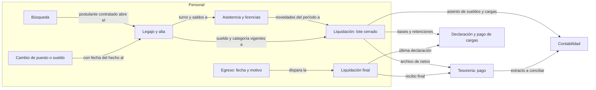

# De la contratación a la baja

De la contratación a la baja (hire-to-retire) es el recorrido de una relación laboral entera, desde el puesto aprobado y la búsqueda hasta la liquidación final pagada y el legajo cerrado, con un ciclo que se repite cada período: asistencia, liquidación, asiento, pago y cargas declaradas.

El recorrido empieza en la [búsqueda](../Administracion-de-personal-y-nomina/Legajo/busquedas-y-postulantes.md) aprobada, tomada solo como registro. A quién elegir, cuánto pagar, cómo incorporar y cuándo despedir son decisiones de [Gestión de personas](../Liderazgo-y-direccion/Gestion-de-personas/gestion-de-personas.md) ([contratar](../Liderazgo-y-direccion/Gestion-de-personas/contratar.md), [rotación y salidas](../Liderazgo-y-direccion/Gestion-de-personas/rotacion-y-salidas.md)); el recorrido registra lo que esas decisiones dejan. Termina cuando la liquidación final está pagada, las cargas del último período están declaradas y el legajo está cerrado con fecha y motivo. APQC lo nombra entre sus procesos de punta a punta, «cross-functional processes that comprise all the steps to accomplish a specific outcome or goal». Cruza [Administración de personal y nómina](../Administracion-de-personal-y-nomina/administracion-de-personal-y-nomina.md), dueña de cada paso, [Contabilidad](../Contabilidad/contabilidad.md), [Tesorería](../Tesoreria/tesoreria.md) e [Impuestos](../Impuestos/impuestos.md), y deja sus asientos en [del registro al balance](del-registro-al-balance.md).

APQC 7.4: 7.2.1 «Manage employee requisitions», 7.2.4 «Manage new hire/re-hire», 7.3.1 «Manage employee orientation and deployment», 7.5.2 «Manage and administer benefits», 7.5.4 «Administer payroll», 7.6.1 «Manage promotion and demotion process», 7.6.2 «Manage separation», 7.6.3 «Manage retirement», 7.6.4 «Manage leave of absence», 7.7.3 «Manage and maintain employee data», 9.5.1 «Report time», 9.5.2 «Manage pay» y 9.5.3 «Manage and process payroll taxes».

## Entrar, cobrar cada período y salir

El recorrido tiene tres tramos. Entrar y salir pasan una vez. El ciclo del medio se repite en cada período de liquidación, y cada vuelta deja un asiento, un pago y una declaración.

| Paso | Dominio | Qué pasa | Documento que deja |
|---|---|---|---|
| 1. Búsqueda | Personal (registro); Gestión de personas decide | Se abre con el [puesto](../Administracion-de-personal-y-nomina/Legajo/puesto-y-estructura.md) aprobado y termina con un postulante contratado ([búsquedas y postulantes](../Administracion-de-personal-y-nomina/Legajo/busquedas-y-postulantes.md#de-postulante-a-legajo)) | búsqueda cubierta |
| 2. Alta | Personal | Legajo abierto, alta ante la seguridad social antes del primer día, datos para pagar y retener ([ingreso y egreso](../Administracion-de-personal-y-nomina/Legajo/ingreso-y-egreso.md#lo-que-deja-hecho-el-alta), [modalidades](../Administracion-de-personal-y-nomina/Legajo/modalidades-de-contratacion.md)) | legajo y constancia de alta |
| 3. Asistencia y licencias | Personal | Marcaciones contra el turno, licencias aprobadas, horas extra ([tiempo y asistencia](../Administracion-de-personal-y-nomina/Tiempo-y-asistencia/tiempo-y-asistencia.md)) | novedades del período |
| 4. Liquidación | Personal | Cálculo, control, aprobación y cierre del lote ([liquidación de sueldos](../Administracion-de-personal-y-nomina/Liquidacion-de-sueldos/liquidacion-de-sueldos.md#el-ciclo-de-cada-período)) | lote cerrado y [recibos](../Administracion-de-personal-y-nomina/Liquidacion-de-sueldos/recibo-de-sueldo.md) |
| 5. Asiento y provisión | Contabilidad | El sueldo se devenga cuando se trabaja; lo trabajado y no liquidado al cierre, con un [ajuste](../Contabilidad/Estados-contables/ajustes-de-cierre.md) ([operaciones](../Contabilidad/Operaciones/operaciones.md#cómo-se-registran-los-sueldos)) | asiento de sueldos y cargas |
| 6. Pago | Tesorería | Transferencia en lote, prevista en la [proyección de caja](../Tesoreria/Caja-y-liquidez/proyeccion-de-caja.md) ([medios de cobro y pago](../Tesoreria/Caja-y-liquidez/medios-de-cobro-y-pago.md#transferencias-y-archivos-al-banco), [el pago de sueldos](../Administracion-de-personal-y-nomina/Liquidacion-de-sueldos/liquidacion-de-sueldos.md#el-pago-de-sueldos)) | archivo de pago y extracto |
| 7. Cargas | Personal declara; Impuestos y Tesorería | Aportes, contribuciones y retención declarados y depositados, como [agente de recaudación](../Impuestos/Recaudacion-en-la-fuente/agente-de-recaudacion.md) ([cargas y declaraciones](../Administracion-de-personal-y-nomina/Cargas-y-declaraciones/cargas-y-declaraciones.md)) | declaración periódica y pago |
| 8. Cambios en la vida laboral | Personal (registro); Gestión de personas decide | Promoción, cambio de puesto o aumento con su fecha del hecho; si es hacia atrás, [reliquidación](../Administracion-de-personal-y-nomina/Liquidacion-de-sueldos/retroactivos-y-reliquidaciones.md) | cambio del [legajo](../Administracion-de-personal-y-nomina/Legajo/legajo.md#la-historia-del-legajo-con-sus-dos-fechas) |
| 9. Egreso | Personal | Fecha, motivo, constancia y baja ante la seguridad social ([lo que cierra la baja](../Administracion-de-personal-y-nomina/Legajo/ingreso-y-egreso.md#lo-que-cierra-la-baja)) | legajo cerrado |
| 10. Liquidación final | Personal, Tesorería, Contabilidad | Lo trabajado, lo proporcional, las vacaciones no gozadas y, según el motivo, preaviso e indemnización ([liquidación final](../Administracion-de-personal-y-nomina/Liquidacion-de-sueldos/liquidacion-final.md)) | recibo final, pago y constancias |

## Lo que pasa de un dominio a otro

Cada traspaso es un dato que tiene que coincidir del otro lado. La columna de quién decide es lectura de esta base sobre las notas de cada dominio.

| Traspaso | Qué tiene que coincidir | Quién decide |
|---|---|---|
| Postulante → legajo | La fecha de ingreso del legajo con la del alta declarada | Personal; la oferta la decide Gestión de personas |
| Asistencia → liquidación | Las novedades aprobadas hasta el corte con las que entran al lote; lo que llega tarde va a una reliquidación | quien [aprueba la licencia](../Administracion-de-personal-y-nomina/Tiempo-y-asistencia/licencias-y-ausencias.md#quién-pide-y-quién-aprueba) o la hora extra; Personal cierra el corte |
| Lote → Contabilidad | Total del lote con el asiento: gasto, sueldos a pagar y cada pasivo por cargas | Contabilidad registra; el lote lo aprobó alguien distinto de quien liquidó |
| Lote → Tesorería | Suma del archivo de pago con el total de netos, y cada cuenta con la del legajo | Tesorería ejecuta; el cambio de cuenta de un empleado conviene aprobarlo como el de un proveedor (inferencia sobre [seguridad de los pagos](../Tesoreria/Pagos-a-proveedores/seguridad-de-los-pagos.md)) |
| Lote → declaración | Bases declaradas con el total de las liquidaciones del período | Personal declara; Tesorería paga al vencimiento |
| Baja → liquidación final | El motivo del legajo con los conceptos que se pagan | Personal, con el motivo que fijó Gestión de personas |

## Dónde se traba el recorrido

- **La novedad llega tarde.** Como criterio de la base, conviene buscar un error de nómina primero en los datos de entrada y después en el cálculo ([entrada del tema](../Administracion-de-personal-y-nomina/administracion-de-personal-y-nomina.md); [Fundamentos](../Administracion-de-personal-y-nomina/Fundamentos/fundamentos-de-administracion-de-personal.md) reúne los casos de Queensland Health y Phoenix).
- **La persona empieza antes del alta.** Trabaja sin registrar y su primer recibo sale con una fecha de ingreso que no coincide con la declarada ([cómo fallan el alta y la baja](../Administracion-de-personal-y-nomina/Legajo/ingreso-y-egreso.md#cómo-fallan-el-alta-y-la-baja)).
- **La baja no llega a la nómina.** La persona sigue en el lote del mes siguiente, o se la da de baja ante la seguridad social antes de liquidarle lo que se le debe (mismo lugar). Del lado contable, la guía de cierre del Departamento de Justicia de EE. UU. avisa que un asiento recurrente de sueldos puede no corresponder después de una baja.
- **El retroactivo y las cargas ya declaradas.** Se paga la diferencia como concepto en el recibo del mes abierto ([retroactivos y reliquidaciones](../Administracion-de-personal-y-nomina/Liquidacion-de-sueldos/retroactivos-y-reliquidaciones.md#lo-que-arrastra-un-retroactivo)); cómo se rectifica la declaración de los meses afectados no tiene fuente todavía.
- **El asiento se carga a mano.** Si el asiento no sale del lote cerrado, el gasto y los pasivos dejan de coincidir con lo liquidado y lo declarado (inferencia de esta base).
- **Lo retenido no se deposita.** Lo retenido al empleado es plata de terceros. Si el agente no lo ingresa, responde con la suya ([agente de recaudación](../Impuestos/Recaudacion-en-la-fuente/agente-de-recaudacion.md#por-qué-una-retención-no-hecha-se-vuelve-deuda-propia)).

## Qué se mide del recorrido entero

Las medidas de APQC salen de sus listas para comparar empresas, de 2012 (nómina) y 2017 (búsquedas). La base no leyó sus valores de referencia.

| Medida | Definición | Fuente |
|---|---|---|
| Tiempo de cobertura | Días desde la aprobación de la búsqueda hasta la aceptación de la oferta (APQC 100565); el recorrido completo, desde que se identifica la necesidad hasta que la persona empieza en el puesto, es la medida 104723 | APQC |
| Exactitud de la liquidación | Pagos con error sobre el total de pagos de nómina, en porcentaje (APQC 101739); se mira junto con el porcentaje de pagos que llevan un retroactivo (102383) | APQC |
| Costo por recibo | Costo total del proceso de nómina por pago emitido (APQC 103948) o por empleado pagado (103950) | APQC |
| Plazo de la liquidación final | Días hábiles desde la fecha de egreso hasta que la liquidación final está pagada, comparados con el plazo legal | definición de esta base; lo más cercano en APQC son los días para sacar de la nómina a quien se fue (100546) |
| Del corte al pago | Días hábiles desde el corte de novedades hasta el pago (suma de las medidas APQC 100532 y 100536; la suma es criterio de la base) | APQC |

La OIT pide la liquidación final «within a reasonable period of time» y deja los días a cada país ([liquidación final](../Administracion-de-personal-y-nomina/Liquidacion-de-sueldos/liquidacion-final.md#el-plazo-para-pagarla)).

## Variantes

### Personal por hora o por turnos

El período se acorta a la semana o la quincena, y la asistencia pesa más que el legajo: cada marcación y cada hora extra cambia el recibo. El detalle está en [jornada y turnos](../Administracion-de-personal-y-nomina/Tiempo-y-asistencia/jornada-y-turnos.md), [registro de asistencia](../Administracion-de-personal-y-nomina/Tiempo-y-asistencia/registro-de-asistencia.md) y [frecuencias y período de liquidación](../Administracion-de-personal-y-nomina/Liquidacion-de-sueldos/liquidacion-de-sueldos.md#frecuencias-y-período-de-liquidación).

### Personal de una agencia o de un tercero

Quien trabaja por una agencia está en la nómina de la agencia. La empresa recibe una factura, y el recorrido pasa a ser [de la compra al pago](de-la-compra-al-pago.md).

> [!NOTE]
> Sin fuente todavía: la contratación por agencia o empresa de servicios eventuales, con lo que la empresa usuaria tiene que controlar del empleador.

### Contratista independiente

No entra al legajo ni a la nómina. Factura y cobra como un proveedor, por [de la compra al pago](de-la-compra-al-pago.md). Si es independiente o empleado lo decide la realidad del vínculo, no el nombre del contrato ([modalidades de contratación](../Administracion-de-personal-y-nomina/Legajo/modalidades-de-contratacion.md#empleado-o-independiente-lo-decide-la-realidad-del-vínculo)).

Lo propio de la Argentina (alta temprana, F.931, Ganancias de cuarta categoría, cuenta sueldo, liquidación final con sus plazos y la Ley 27.802) está en [Procesos de negocio en la Argentina](procesos-de-negocio-en-argentina.md#de-la-contratación-a-la-baja).
