# De la planificación a la producción

De la planificación a la producción (plan-to-produce) es el recorrido que va del pronóstico de demanda y el plan de ventas y operaciones al producto terminado: baja el plan a órdenes, compra y entrega los materiales, fabrica, controla, ingresa lo bueno al depósito y cierra cada orden con su costo real y sus variaciones.

El recorrido empieza con el [pronóstico de demanda](../Cadena-de-suministro-y-logistica/Planificacion/pronostico-de-demanda.md) que entra al ciclo mensual del [plan de ventas y operaciones](../Cadena-de-suministro-y-logistica/Planificacion/plan-de-ventas-y-operaciones.md) (S&OP). Arranca en el pronóstico porque su error se arrastra hasta la planta y porque APQC pone la demanda (4.1.2) junto al plan de materiales y el plan maestro. La revisión de Seeling y otros también hace del plan de demanda un paso del S&OP. El disparador, de todos modos, es el S&OP. Termina cuando calidad acepta el terminado, el depósito lo tiene disponible y su orden queda cerrada y costeada. Lo de antes (diseñar el producto) es de [Producto y proceso](../Produccion/Producto-y-proceso/producto-y-proceso.md); lo de después, vender el terminado, es [del pedido al cobro](del-pedido-al-cobro.md). Cruza [Cadena de suministro](../Cadena-de-suministro-y-logistica/cadena-de-suministro-y-logistica.md), [Producción](../Produccion/produccion.md), [Compras](../Compras-y-abastecimiento/compras-y-abastecimiento.md), [Inventario](../Inventario-y-depositos/inventario-y-depositos.md) y [Contabilidad](../Contabilidad/contabilidad.md).

Piezas del PCF 7.4 de APQC: 4.1.2 «Manage demand for products», 4.1.3 «Create materials plan», 4.1.4 «Create and manage master production schedule», 4.2.3 «Order materials and services», 4.3 «Produce/Assemble/Test product» (4.3.1 a 4.3.4), 4.4.3.7 «Manage physical finished goods inventory», 9.1.2.4 «Perform product costing» y 9.1.2.5 «Perform variance analysis».

Los libros de sistemas de información contable lo llaman ciclo de producción, y Romney y Steinbart le dan cuatro actividades: diseño, planificación y programación, operaciones y costos. El nombre plan-to-produce sale de los catálogos de los proveedores de software y no figura en ningún marco neutral. Leído contra SCOR v13, el recorrido toca Plan, Source y Make (lectura de la base; la versión de siete procesos, con Transform, solo consta en una fuente secundaria). Qué versión se leyó está en [marcos de la cadena de suministro](../Cadena-de-suministro-y-logistica/Fundamentos/marcos-de-la-cadena-de-suministro.md#scor-qué-versión-se-leyó).

## Los once pasos, del pronóstico a la orden costeada

```mermaid
flowchart LR
  subgraph Cadena
    PR[Pronóstico] -->|alimenta el plan de demanda de| SOP[S&OP]
  end
  subgraph Producción
    MPS[Plan maestro] -->|se explota en| MRP[MRP]
    LIB[Orden liberada] -->|se ejecuta y se declara| DEC[Declaración]
    DEC -->|somete lo producido a| QC[Inspección final]
    CIE[Cierre de la orden]
  end
  subgraph Compras
    SC[Solicitud y orden de compra]
  end
  subgraph Inventario
    ENT[Entrega de material]
    ING[Ingreso del terminado]
  end
  subgraph Contabilidad
    VAR[Variaciones del período]
  end
  SOP -->|fija cuánto por familia y mes al| MPS
  MRP -->|propone compras como| SC
  MRP -->|propone órdenes planificadas que se liberan como| LIB
  SC -->|el material recibido queda disponible para| ENT
  LIB -->|pide componentes con un vale a| ENT
  ENT -->|carga material a la orden en| DEC
  QC -->|libera lo aceptado al| ING
  ING -->|habilita el| CIE
  CIE -->|pasa el costo a terminados y deja| VAR
```

| Paso | Dominio | Qué pasa | Documento que deja |
|---|---|---|---|
| 1. [Pronóstico de demanda](../Cadena-de-suministro-y-logistica/Planificacion/pronostico-de-demanda.md) | Cadena | Se estima la demanda por artículo, lugar y período | El pronóstico |
| 2. [Plan de ventas y operaciones](../Cadena-de-suministro-y-logistica/Planificacion/plan-de-ventas-y-operaciones.md) | Cadena | Ventas, operaciones y finanzas acuerdan un plan único | El plan agregado aprobado, por familia y mes |
| 3. [Plan maestro](../Produccion/Planificacion-de-la-produccion/plan-maestro-de-produccion.md) | Producción | Se baja a artículos y semanas y se prueba contra la [capacidad](../Produccion/Planificacion-de-la-produccion/planificacion-de-capacidad.md) | El plan maestro con su parte firme |
| 4. [MRP](../Produccion/Planificacion-de-la-produccion/mrp.md) | Producción | Se explota la lista de materiales y se netea contra el stock | Órdenes planificadas y solicitudes de compra |
| 5. Compra de materiales | Compras | La [solicitud](../Compras-y-abastecimiento/Orden-de-compra/solicitud-de-compra.md) se vuelve [orden de compra](../Compras-y-abastecimiento/Orden-de-compra/orden-de-compra.md); sigue en [de la compra al pago](de-la-compra-al-pago.md) | La orden de compra y la recepción |
| 6. [Liberación](../Produccion/Ejecucion-en-planta/orden-de-produccion.md#qué-se-controla-al-liberarla) | Producción | Se controla material, capacidad, versión y lote; se [programa](../Produccion/Ejecucion-en-planta/programacion-de-planta.md) | La orden de producción liberada |
| 7. [Entrega de material](../Produccion/Ejecucion-en-planta/consumo-y-declaracion.md#entregar-el-material-a-la-orden) | Inventario | Los componentes [reservados](../Inventario-y-depositos/Operacion-del-deposito/reserva.md) salen hacia la orden | El vale de salida (en Romney y Steinbart, «materials requisition») |
| 8. Ejecución y [declaración](../Produccion/Ejecucion-en-planta/consumo-y-declaracion.md#la-declaración-de-producción) | Producción | Se registran horas, consumos, bueno, rechazo y merma | El parte de producción |
| 9. [Inspección final](../Produccion/Calidad/plan-de-inspeccion.md#los-cuatro-puntos-donde-se-controla) | Producción (Calidad) | Se acepta el lote o se abre una [no conformidad](../Produccion/Calidad/no-conformidad.md) | El registro de ensayo y la liberación del lote |
| 10. Ingreso del terminado | Inventario | Lo aceptado pasa de [cuarentena a disponible](../Inventario-y-depositos/Existencias/estados-del-stock.md) con su [lote](../Inventario-y-depositos/Existencias/lote-y-serie.md) | El movimiento de ingreso |
| 11. [Cierre y costo real](../Produccion/Costos-de-produccion/costo-real-de-la-orden.md) | Producción y Contabilidad | La orden se congela, el costo pasa a terminados y salen las [variaciones](../Produccion/Costos-de-produccion/costo-real-de-la-orden.md#las-variaciones-de-la-orden-y-las-del-período) | La orden cerrada y el asiento del costo |

En Romney y Steinbart, la orden «authorizes production of a specified quantity of a product» y el vale «authorizes movement of materials to the factory floor». Cómo los registra un sistema está en [Ejecución en planta](../Produccion/Ejecucion-en-planta/ejecucion-en-planta.md#de-la-orden-propuesta-al-producto-terminado).

## Lo que pasa de un dominio a otro

Cada traspaso tiene un documento, algo que tiene que coincidir y alguien que decide. La tabla es lectura de la base sobre las notas de cada dominio.

| Traspaso | Documento | Qué tiene que coincidir | Quién decide |
|---|---|---|---|
| Cadena → Producción | Plan agregado | La suma del plan maestro por artículo con el plan por familia | El programador maestro, dentro de las barreras de tiempo |
| Producción → Compras | Solicitud de compra | Cantidad y fecha de necesidad con el plazo del proveedor | Compras elige proveedor y precio; el plan solo dice cuánto y cuándo |
| Compras → Inventario → Producción | Recepción y vale de salida | Lo recibido y aceptado con lo que el MRP contó como disponible | El depósito, con el estado del stock |
| Producción → Inventario | Declaración | Cantidad buena y lote con lo que entra al depósito | Calidad libera; el depósito ubica |
| Producción → Contabilidad | Orden cerrada | Consumos y horas con el estándar de lo producido | Quien costea cierra la orden; la planta solo la termina |

## Dónde se traba el recorrido

- **Se produce de más o de menos.** Es la amenaza de la planificación en Romney y Steinbart («Over- or Under-Production»), y sus controles cruzan dominios: pronóstico y stock exactos, órdenes autorizadas.
- **El plan supone lo que no hay.** El MRP calcula con plazos fijos y capacidad infinita, y depende de que la lista, el stock y los plazos de compra sean exactos, como cuenta [planificación de la producción](../Produccion/Planificacion-de-la-produccion/planificacion-de-la-produccion.md#cómo-falla-la-planificación). Un plazo de proveedor incumplido aparece recién al liberar (inferencia de la base).
- **Se libera sin material.** La orden espera en la planta, sube la producción en proceso y, por la [ley de Little](../Produccion/Ejecucion-en-planta/ejecucion-en-planta.md#la-ley-de-little-ordena-la-planta), el tiempo de ciclo.
- **El disponible cuenta lo que no está aceptado.** Si el material en cuarentena de recepción o el terminado sin inspeccionar figuran como disponibles, el MRP y la promesa al cliente usan stock que calidad puede rechazar (inferencia de la base).
- **El plan cambia en cada corrida.** El [nerviosismo del MRP](../Produccion/Planificacion-de-la-produccion/mrp.md#por-qué-el-mrp-es-nervioso) mueve órdenes ya pedidas a Compras y amplifica la variación hacia los proveedores ([efecto látigo](../Cadena-de-suministro-y-logistica/Planificacion/efecto-latigo.md)).
- **Se declara tarde y no se cierra.** El costo queda abierto y las variaciones caen en otro mes (lectura de la base). Romney y Steinbart listan la amenaza «Inaccurate Recording and Processing of Production Activity Data».

## Qué se mide del recorrido entero

| Medida | Qué mide | Dónde |
|---|---|---|
| Exactitud del pronóstico | Cuánto se equivocó la entrada del recorrido; APQC la pone en 4.1.2.7 | [error de pronóstico](../Cadena-de-suministro-y-logistica/Planificacion/error-de-pronostico.md) |
| Cumplimiento del programa | Qué parte de lo programado salió en su fecha y cantidad | abajo |
| Tiempo de ciclo de fabricación | De la liberación de la orden al terminado | abajo |
| Variaciones de costo | Uso, eficiencia, precio y volumen contra el estándar | [costo real de la orden](../Produccion/Costos-de-produccion/costo-real-de-la-orden.md#las-variaciones-de-la-orden-y-las-del-período) |
| OEE | Qué parte del tiempo planificado un equipo produjo bien a la velocidad ideal | [eficiencia global del equipo](../Produccion/Ejecucion-en-planta/eficiencia-global-del-equipo.md) |

**Cumplimiento del programa** (schedule attainment). APQC tiene una medida «Average production schedule attainment during a planning period for primary products» (ID 100251), asignada a 4.3.2 y, según el resumen del buscador, en porcentaje. Junta todos los traspasos: falla si no llegó el material, si no alcanzó la capacidad o si calidad rechazó (lectura de la base).

> [!NOTE] Sin fuente todavía: la fórmula de APQC del cumplimiento del programa (su página no se pudo leer). Como inferencia de la base, se calcula por período como las órdenes terminadas en su fecha y su cantidad sobre las programadas, sin contar lo producido de más. [Programación de planta](../Produccion/Ejecucion-en-planta/programacion-de-planta.md#cumplimiento-del-programa) tiene el mismo hueco.

**Tiempo de ciclo de fabricación.** APQC lo mide como «Manufacturing cycle time in hours» (ID 100854) y, según su resumen, es el tiempo promedio de fabricación de los productos principales, en horas, de principio a fin; APQC define el tiempo de ciclo en general como el tiempo transcurrido total, esperas incluidas. Se mide con dos fechas por orden, la de liberación y la de terminación, y se lee junto con la producción en proceso: por la ley de Little, liberar más órdenes sin más salida solo alarga el ciclo.

## Variantes del recorrido

### Fabricar para stock

Es el caso de arriba: el plan maestro sigue al pronóstico y su error se paga en stock o en faltantes. Ver [fabricar para stock o contra pedido](../Produccion/Planificacion-de-la-produccion/fabricar-para-stock-o-contra-pedido.md).

### Fabricar contra pedido

El pedido de venta entra antes, en el plan maestro, y la orden queda atada a él; el recorrido se cruza con [del pedido al cobro](del-pedido-al-cobro.md) en la [fecha prometida](../Relacion-con-clientes/Pedido-de-venta/fecha-prometida.md). El pronóstico planifica solo lo que está antes del punto de desacople.

### Por procesos

En alimentos, química o farmacia la orden es un lote con su receta, se declara con merma y subproductos y el costo se reparte por proceso. Ver [orden discreta, repetitiva y por procesos](../Produccion/Ejecucion-en-planta/orden-de-produccion.md#orden-discreta-repetitiva-y-por-procesos) y [sistemas de costeo](../Contabilidad/Contabilidad-de-gestion/sistemas-de-costeo.md#por-órdenes-o-por-procesos-qué-se-acumula).

### Con subcontratación

Un tercero hace una operación con material propio y se le paga el servicio: suma un traspaso con Compras y otro con Inventario. Ver [subcontratación](../Produccion/Ejecucion-en-planta/subcontratacion.md#dónde-corta-con-compras-e-inventario).

Lo que la Argentina le pide a la planta y al producto está en [Producción en la Argentina](../Produccion/produccion-en-argentina.md); el recorrido no tiene pasos propios del país.
