# Del pedido al cobro

Del pedido al cobro es el recorrido que empieza cuando la empresa acepta un pedido de venta y termina cuando el cobro está aplicado a sus facturas y conciliado con el banco. Pasa por seis dominios (Relación con clientes, Inventario, Cadena de suministro, Contabilidad, Impuestos y Tesorería), y casi todas sus fallas nacen en un traspaso entre ellos.

El recorrido arranca en el [pedido de venta](../Relacion-con-clientes/Pedido-de-venta/pedido-de-venta.md) aceptado. Lo anterior no es parte de él: el método de vender y el embudo están en [Ventas](../Ventas/ventas.md), y el [interesado](../Relacion-con-clientes/Seguimiento-comercial/interesado.md), la [oportunidad](../Relacion-con-clientes/Seguimiento-comercial/oportunidad.md) y el [presupuesto](../Relacion-con-clientes/Presupuesto/presupuesto.md) están en Relación con clientes. Por eso quote-to-cash y lead-to-cash son alias de esta nota y no recorridos aparte. Termina en la conciliación; el cierre del mes que usa esos saldos es el recorrido [del registro al balance](del-registro-al-balance.md). Los libros de sistemas contables lo llaman ciclo de ingresos, con cuatro actividades: «Sales order entry», «Shipping», «Billing» y «Cash collections» (Romney y Steinbart, cap. 12).

APQC 7.4 no tiene una categoría que lo contenga: lo arma con 3.5.4 «Manage sales orders», 4.1.2.4 «Determine available to promise», 9.2.1 «Process customer credit», 4.4.3.4 «Pick, pack, and ship product for delivery», 4.4.4.1 «Plan, transport, and deliver outbound product», 9.2.2 «Invoice customer», 9.2.3 «Process accounts receivable (AR)», 9.2.4 «Manage and process collections», 9.2.5 «Manage and process adjustments/deductions» y 9.7.2.1 «Manage and reconcile cash positions».

## Los nueve pasos y el documento que deja cada uno

```mermaid
flowchart LR
  subgraph RC[Relación con clientes]
    P[Pedido de venta]
  end
  subgraph TE[Tesorería]
    CR[Control de crédito]
    GC[Gestión de la cobranza]
    AC[Aplicación del cobro]
  end
  subgraph IN[Inventario]
    R[Reserva]
    PR[Preparación]
  end
  subgraph CA[Cadena de suministro]
    D[Despacho]
    E[Prueba de entrega]
  end
  subgraph CI[Contabilidad e Impuestos]
    F[Factura]
    CC[Cuenta a cobrar]
    CO[Conciliación]
  end
  P -->|pasa el monto a| CR
  CR -->|libera el pedido a| R
  R -->|ordena preparar a| PR
  PR -->|entrega el bulto a| D
  D -->|lleva la mercadería y el remito a| E
  E -->|confirma lo entregado a| F
  F -->|registra la deuda en| CC
  CC -->|muestra lo vencido a| GC
  GC -->|obtiene el pago que va a| AC
  AC -->|cancela facturas en| CC
  AC -->|deja el cobro para| CO
```

| Paso | Dominio | Qué pasa | Documento que deja |
|---|---|---|---|
| 1. Pedido aceptado | Relación con clientes | Se confirma qué, cuánto, a qué precio y para qué [fecha prometida](../Relacion-con-clientes/Pedido-de-venta/fecha-prometida.md) | Pedido de venta |
| 2. Control de crédito | Tesorería | Se compara el pedido con el límite y la mora del cliente; si no pasa, el pedido se [bloquea](../Relacion-con-clientes/Pedido-de-venta/cambios-y-cancelaciones.md#bloquear-un-pedido) | Pedido liberado o bloqueado ([crédito a clientes](../Tesoreria/Credito-y-cobranzas/credito-a-clientes.md)) |
| 3. Reserva | Inventario | Se aparta el stock contra lo [disponible para prometer](../Inventario-y-depositos/Existencias/disponible-para-prometer.md) | [Reserva](../Inventario-y-depositos/Operacion-del-deposito/reserva.md) |
| 4. Preparación | Inventario | Se toma del estante, se embala y se controla | Lista de picking, bulto listo ([preparación de pedidos](../Inventario-y-depositos/Operacion-del-deposito/preparacion-de-pedidos.md)) |
| 5. Despacho y entrega | Cadena de suministro | Sale el envío y el cliente firma lo que recibió | [Despacho](../Cadena-de-suministro-y-logistica/Despacho-y-entrega/despacho.md), remito, [prueba de entrega](../Cadena-de-suministro-y-logistica/Despacho-y-entrega/prueba-de-entrega.md) |
| 6. Factura | Impuestos y Contabilidad | Se emite el [comprobante fiscal](../Impuestos/Cumplimiento/comprobante-fiscal.md) y se reconoce el ingreso | Factura |
| 7. Cuenta a cobrar | Contabilidad | La deuda entra al auxiliar del cliente | Saldo en la [cuenta corriente](../Contabilidad/Registro/cuentas-corrientes.md) ([ingresos y cuentas a cobrar](../Contabilidad/Operaciones/ingresos-y-cuentas-a-cobrar.md)) |
| 8. Gestión de la cobranza | Tesorería | Se reclama lo vencido y se resuelven disputas y deducciones | Recordatorios, acuerdos ([gestión de la cobranza](../Tesoreria/Credito-y-cobranzas/gestion-de-la-cobranza.md)) |
| 9. Cobro, aplicación y conciliación | Tesorería y Contabilidad | Entra la plata, se asigna a las facturas que cancela y se compara con el banco | Recibo, [aplicación de cobros](../Tesoreria/Credito-y-cobranzas/aplicacion-de-cobros.md), [conciliación](../Contabilidad/Control-interno/conciliaciones.md) |

El orden de los pasos 5 y 6 depende de la política: se factura lo entregado o lo pedido. La cobranza activa solo aparece si el cliente no paga a tiempo.

## Qué pasa de mano en cada traspaso

Cada traspaso entrega un documento que el dominio siguiente toma como verdad. Casi todos los controles que Romney y Steinbart proponen para el ciclo de ingresos comparan los documentos de un traspaso, como «Reconciliation of shipping documents with sales orders, picking lists, and packing slips» o «Periodic reconciliation of invoices with sales orders, picking tickets, and shipping documents».

| Traspaso | Qué tiene que coincidir | Quién decide si no coincide |
|---|---|---|
| Pedido → crédito | El pedido más la exposición del cliente contra su límite | Tesorería, no el vendedor ([separación de funciones](../Contabilidad/Control-interno/separacion-de-funciones.md)) |
| Pedido → reserva y preparación | Artículos y cantidades de la lista de picking contra el pedido | Relación con clientes decide si entrega en partes |
| Preparación → entrega | Lo despachado y lo recibido contra el pedido y el remito | Cadena registra la diferencia en la prueba de entrega |
| Entrega → factura | Cantidades entregadas y precio del pedido contra lo facturado | Contabilidad corrige con nota de crédito o de débito, nunca editando |
| Factura → cuenta a cobrar | El auxiliar de clientes contra la cuenta de control | Contabilidad |
| Cobro → facturas | El monto cobrado contra las facturas que dice cancelar | Tesorería; la diferencia va a deducción o a una cuenta con nombre |

El libro separa además la facturación del despacho, y la autorización de la nota de crédito de la carga de pedidos. La nota de crédito que nace de un reclamo sigue su propio recorrido, [del reclamo a la resolución](del-reclamo-a-la-resolucion.md).

## Dónde se traba el recorrido

Romney y Steinbart listan, entre otras, estas amenazas: «Uncollectible accounts», «Shipping errors», «Failure to bill», «Billing errors» e «Inaccurate or invalid credit memos». Leídas como traspasos, son estas (la agrupación es lectura de la base):

- **El bloqueo que nadie mira.** El pedido queda retenido por crédito sin motivo a la vista y la entrega se atrasa, a veces por un saldo ya pagado cuyo cobro no se aplicó.
- **Lo entregado no es lo facturado.** Una entrega parcial facturada completa, o un precio distinto del pedido, vuelve como deducción: el cliente paga menos y la cobranza averigua por qué. APQC mide el síntoma con el porcentaje de líneas de factura que el cliente ajusta antes de pagar (102155).
- **El remito sin factura.** Sin una regla que compare entregas con facturas, lo entregado y no facturado no avisa a nadie.
- **El cobro sin aplicar.** Mientras la plata no cancela facturas, el cliente figura moroso, la cobranza le reclama a quien pagó y el próximo pedido se bloquea.
- **La deducción cerrada sin motivo.** Si la diferencia va a una cuenta de redondeo, la falla de origen no vuelve al dominio que la causó.

## Qué se mide del recorrido entero

Las medidas de un dominio se enlazan: el [pedido perfecto](../Cadena-de-suministro-y-logistica/Despacho-y-entrega/nivel-de-servicio-logistico.md#otif-pedido-perfecto-y-tasa-de-cumplimiento-de-la-entrega) y el OTIF son de Cadena, y el [DSO, el DSO mejor posible y el índice de eficacia de cobranza](../Tesoreria/Credito-y-cobranzas/gestion-de-la-cobranza.md#dso-dso-mejor-posible-y-días-de-atraso) son de Tesorería. El pedido perfecto ya cruza dominios: según el fragmento de APQC que cita esa nota, su encuesta suma la factura correcta. El DSO es el tramo de días de cobro del [ciclo de conversión del efectivo](../Tesoreria/Caja-y-liquidez/capital-de-trabajo.md#el-ciclo-de-conversión-del-efectivo).

Lo que mide el recorrido entero es su tiempo, partido en tramos para ver dónde se va:

| Medida | Definición | Fuente |
|---|---|---|
| Tiempo del pedido al cobro | Días desde el pedido aceptado hasta el cobro aplicado | APQC tiene la medida «Cycle time in days to perform the order-to-cash (O2C) processes»; la fórmula no se pudo leer |
| Tiempo de ciclo del pedido | «Cycle time in days from a customer's placing a primary product/service order to the product/service's delivery» | APQC 100496 |
| Entre la factura y la entrega | «Cycle time in calendar days from the transmission of an invoice/bill to shipping/providing the good/service» | APQC 100558 |
| De la factura al cobro | «Cycle time in calendar days from invoicing a customer to the receipt of payment» | APQC 100581 |
| Facturas correctas a la primera | «Percentage of invoice line items processed error free the first time» | APQC 102142 |
| Cobros aplicados solos | «Percentage of receipts automatically matched to open items in the accounts receivable sub ledger» | APQC 102463 |

Los tres tramos de tiempo, el del medio con su signo (la factura puede salir antes o después de la entrega), suman aproximadamente el tiempo del pedido al cobro. Leerlos juntos es lectura de la base: un tiempo total largo con el tramo de la factura al cobro corto dice que el problema está antes de facturar, no en la cobranza.

> [!NOTE] Sin fuente todavía: la fórmula de la medida de punta a punta de APQC y valores de referencia de cualquiera de estas medidas (las listas abiertas dan solo el nombre y la fórmula).

## Variantes del recorrido

### Venta minorista: cobrar antes o al entregar

El control de crédito desaparece y el cobro pasa adelante: el cliente paga en el [checkout](../Comercio-electronico/Checkout-y-conversion/checkout-y-conversion.md) o en la caja, y lo que queda por cobrar se le debe a quien procesa el pago ([pagos](../Comercio-electronico/Pagos/pagos.md)). El riesgo ya no es la mora sino el [contracargo](../Comercio-electronico/Pagos/fraude-y-contracargos.md). Si se cobra antes de entregar, hay un anticipo y el ingreso espera a la entrega ([cobrar antes de entregar](../Contabilidad/Operaciones/ingresos-y-cuentas-a-cobrar.md#cobrar-antes-de-entregar-anticipos-e-ingresos-diferidos)).

### Mayorista con cuenta corriente

Es la forma completa del recorrido, con crédito, factura a plazo y cobranza. Lo propio del canal está en [comercio B2B](../Comercio-electronico/Comercio-B2B/comercio-b2b.md), [pedido B2B](../Comercio-electronico/Comercio-B2B/pedido-b2b.md) y [cuenta corriente y crédito](../Comercio-electronico/Comercio-B2B/cuenta-corriente-y-credito.md).

### Suscripción: un pedido que factura solo

El pedido se acepta una vez y genera facturas periódicas sin un pedido nuevo cada vez ([el pedido recurrente](../Relacion-con-clientes/Pedido-de-venta/tipos-de-pedido.md#el-pedido-recurrente)). Los pasos de inventario se achican o desaparecen, y el paso que manda es la factura recurrente con su cobro automático. Si se cobra por adelantado, el ingreso se devenga mes a mes ([ingresos y cuentas a cobrar](../Contabilidad/Operaciones/ingresos-y-cuentas-a-cobrar.md#cobrar-antes-de-entregar-anticipos-e-ingresos-diferidos)). El modelo de negocio está en [SaaS](../Emprender/Modelo-de-negocio/saas.md); el abono de servicios profesionales va con [del proyecto al cobro](del-proyecto-al-cobro.md).

> [!NOTE] Sin fuente todavía: los estados de una suscripción y su renovación, que tampoco tiene la nota de tipos de pedido.

En la Argentina, el recorrido suma el CAE de la factura, las percepciones al facturar, las retenciones al cobrar, el ECHEQ y la factura de crédito electrónica MiPyME: [del pedido al cobro en la Argentina](procesos-de-negocio-en-argentina.md#del-pedido-al-cobro).
