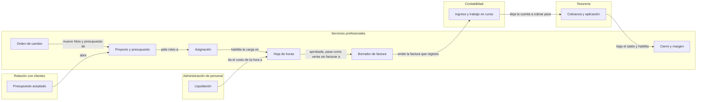

# Del proyecto al cobro

Del proyecto al cobro (project-to-cash) es el recorrido de una firma de servicios que va del presupuesto aceptado o el contrato firmado al cobro aplicado: abre el proyecto, asigna personas, registra y aprueba horas y gastos, factura por hora, hito o abono, reconoce el ingreso, cobra y cierra el proyecto con su margen.

Empieza cuando el cliente acepta el [presupuesto](../Relacion-con-clientes/Presupuesto/presupuesto.md) o firma el contrato, que son de [Relación con clientes](../Relacion-con-clientes/relacion-con-clientes.md); lo de antes es el embudo de [Ventas](../Ventas/ventas.md). Termina con el último cobro aplicado y el proyecto cerrado con su margen. Es la versión de servicios [del pedido al cobro](del-pedido-al-cobro.md): vende horas de personas, que no se pueden guardar, en lugar de mercadería que sale del depósito. Cruza [Servicios profesionales y proyectos](../Servicios-profesionales-y-proyectos/servicios-profesionales-y-proyectos.md), [Administración de personal](../Administracion-de-personal-y-nomina/administracion-de-personal-y-nomina.md), [Contabilidad](../Contabilidad/contabilidad.md) y [Tesorería](../Tesoreria/tesoreria.md).

Piezas del PCF 7.4 de APQC: 5.2.2 «Create and manage resource plan», 5.3.1 «Initiate service delivery», 5.3.2 «Execute service delivery», 5.3.3 «Complete service delivery», 9.5.1 «Report time», 9.6.2 «Process expense reimbursements», 9.2.2 «Invoice customer», 9.2.3 «Process accounts receivable (AR)», 9.2.4 «Manage and process collections» y 9.1.4.1 «Assess customer and product profitability».

APQC publica mapas de punta a punta como order-to-cash; no se encontró uno de proyectos, y los nombres project-to-cash y contract-to-cash vienen de los proveedores de software de servicios. En el PCF, «Report time» (9.5.1) está dentro de «Process payroll» (9.5) y no hay un proceso propio para la hora imputada a un proyecto. Esta base sí separa la hora que se le paga a la persona de la que se le cobra al cliente, y ese corte es uno de los traspasos del recorrido.

## Los diez pasos, del sí del cliente al margen

| Paso | Dominio | Qué pasa | Documento que deja |
|---|---|---|---|
| 1. [Alta del proyecto](../Servicios-profesionales-y-proyectos/Proyecto-del-cliente/proyecto-del-cliente.md#de-la-venta-aceptada-al-proyecto) | Servicios | Se leen los términos firmados y se fija la regla de cobro | El proyecto activo con sus líneas de contrato |
| 2. [Presupuesto del proyecto](../Servicios-profesionales-y-proyectos/Proyecto-del-cliente/presupuesto-del-proyecto.md) | Servicios | Se aprueban horas, costo e ingreso por fase o rol, y los [hitos](../Servicios-profesionales-y-proyectos/Proyecto-del-cliente/hitos-y-entregables.md) | El presupuesto aprobado |
| 3. [Asignación](../Servicios-profesionales-y-proyectos/Asignacion-de-personas/reserva-de-personas.md) | Servicios | Se pide por rol y se reserva a personas con nombre | La reserva firme |
| 4. Registro de [horas](../Servicios-profesionales-y-proyectos/Registro-de-horas/hoja-de-horas.md) y [gastos](../Servicios-profesionales-y-proyectos/Registro-de-horas/gastos-del-proyecto.md) | Servicios | Cada persona imputa su trabajo a proyecto y tarea | La hoja de horas enviada |
| 5. [Aprobación](../Servicios-profesionales-y-proyectos/Registro-de-horas/hoja-de-horas.md#los-estados-y-quién-aprueba) | Servicios | La hora pasa a ser del proyecto: costo y, por hora, venta sin facturar | La hora aprobada |
| 6. [Facturación](../Servicios-profesionales-y-proyectos/Facturacion-del-proyecto/facturacion-del-proyecto.md#del-trabajo-aprobado-al-borrador-de-factura) | Servicios | Se arma el borrador y se decide cuánto se cobra | La factura |
| 7. Ingreso y [trabajo en curso](../Servicios-profesionales-y-proyectos/Facturacion-del-proyecto/trabajo-en-curso.md) | Contabilidad | Se reconoce el ingreso por avance y se separa de lo facturado | El asiento de [ingreso y cuenta a cobrar](../Contabilidad/Operaciones/ingresos-y-cuentas-a-cobrar.md) |
| 8. [Cobranza](../Tesoreria/Credito-y-cobranzas/gestion-de-la-cobranza.md) y [aplicación](../Tesoreria/Credito-y-cobranzas/aplicacion-de-cobros.md) | Tesorería | Se reclama lo vencido y cada cobro se asigna a sus facturas | El recibo aplicado |
| 9. [Órdenes de cambio](../Servicios-profesionales-y-proyectos/Proyecto-del-cliente/orden-de-cambio.md) | Servicios | Cambia el alcance o el precio con aprobación de las dos partes | La orden aprobada y la revisión del presupuesto |
| 10. [Cierre](../Servicios-profesionales-y-proyectos/Proyecto-del-cliente/proyecto-del-cliente.md#el-cierre-financiero) y [margen](../Servicios-profesionales-y-proyectos/Rentabilidad-de-la-firma/costo-y-margen-del-proyecto.md) | Servicios | Se cierra a cargos, se factura el remanente y se libera a las personas | El proyecto cerrado y su margen |

Las órdenes de cambio no tienen un lugar fijo en la secuencia: aparecen en cualquier momento entre el alta y el cierre. La NIIF 15 las define igual que la base: «A contract modification is a change in the scope or price (or both) of a contract that is approved by the parties» (párrafo 18).

## Lo que pasa de un dominio a otro

La tabla es lectura de la base sobre las notas de cada dominio.

| Traspaso | Documento | Qué tiene que coincidir | Quién decide |
|---|---|---|---|
| Relación con clientes → Servicios | Presupuesto aceptado o contrato | Precio, modelo de cobro e hitos con las líneas del proyecto | Quien vendió entrega; el jefe del proyecto abre |
| Administración de personal → Servicios | Liquidación del período | El costo cargado de cada persona o rol con el que usa el proyecto | La firma fija la regla del [costo de la hora](../Servicios-profesionales-y-proyectos/Rentabilidad-de-la-firma/costo-y-margen-del-proyecto.md#el-costo-de-la-hora-y-la-tarifa-son-dos-datos) |
| Servicios → Contabilidad | Factura y horas aprobadas | Lo facturado y lo trabajado al cierre del mes | Contabilidad clasifica el saldo como activo o pasivo del contrato |
| Contabilidad → Tesorería | Cuenta a cobrar | El saldo del cliente con sus facturas abiertas | Tesorería aplica y reclama |
| Tesorería → Servicios | Cobro aplicado | Lo cobrado de cada factura del proyecto | El jefe del proyecto cierra |

Dos traspasos piden cuidado. La hora imputada no es la de [asistencia](../Administracion-de-personal-y-nomina/Tiempo-y-asistencia/registro-de-asistencia.md): una dice en qué proyecto se trabajó y la otra cuánto se le paga a la persona, como explica [registro de horas](../Servicios-profesionales-y-proyectos/Registro-de-horas/registro-de-horas.md#la-hora-imputada-no-es-la-asistencia). Y facturar no es reconocer el ingreso: la NIIF 15 reconoce un servicio a lo largo del tiempo cuando «the customer simultaneously receives and consumes the benefits provided by the entity's performance as the entity performs» (párrafo 35), y la diferencia con lo facturado se presenta como activo o pasivo del contrato (párrafo 105). En un contrato por hora, el párrafo B16 permite reconocer lo que se tiene derecho a facturar.

## Dónde se traba el recorrido

- **La hora se carga tarde.** Sin hora aprobada no hay borrador, y la factura del mes sale incompleta o tarde. La evidencia sobre la demora está en [calidad del registro](../Servicios-profesionales-y-proyectos/Registro-de-horas/calidad-del-registro.md#cargar-a-diario-o-al-final-de-la-semana).
- **Se trabaja fuera del contrato.** Un cambio pedido de palabra se hace y no tiene hito ni línea donde facturarse, como cuenta [orden de cambio](../Servicios-profesionales-y-proyectos/Proyecto-del-cliente/orden-de-cambio.md#qué-mueve-una-orden-aprobada).
- **El borrador castiga sin motivo.** La hora pasada a no cobrable sigue costando y nadie sabe por qué se perdió: precio, trabajo de más o cliente. Ver [realización](../Servicios-profesionales-y-proyectos/Rentabilidad-de-la-firma/realizacion.md#dónde-se-pierde-en-el-registro).
- **El cobro no cierra contra la factura.** Llega neto de retenciones o sin aviso de pago y queda sin aplicar; el saldo del cliente y la antigüedad de la deuda quedan mal ([aplicación de cobros](../Tesoreria/Credito-y-cobranzas/aplicacion-de-cobros.md)).
- **El costo de la hora llega viejo.** Si el proyecto usa un costo fijado antes de un aumento de sueldos, el margen del mes se ve mejor de lo que es (inferencia de la base).
- **El proyecto se termina y no se cierra.** Quedan horas por aprobar, trabajo en curso sin dar de baja y saldos prepagos sin devolver. El estado «cerrado a cargos» de [proyecto del cliente](../Servicios-profesionales-y-proyectos/Proyecto-del-cliente/proyecto-del-cliente.md#los-estados-del-proyecto) separa el fin del trabajo del fin de la plata.

## Qué se mide del recorrido entero

| Medida | Qué mide | Dónde |
|---|---|---|
| Días de la hora al cobro (*lock-up*) | Días de trabajo en curso más días de cuentas a cobrar | [trabajo en curso](../Servicios-profesionales-y-proyectos/Facturacion-del-proyecto/trabajo-en-curso.md#cuánto-tiempo-tarda-en-volverse-plata) |
| DSO | La segunda mitad: de la factura al cobro | [gestión de la cobranza](../Tesoreria/Credito-y-cobranzas/gestion-de-la-cobranza.md#dso-dso-mejor-posible-y-días-de-atraso) |
| Realización | Qué parte del valor a tarifa de lista se factura y se cobra | [realización](../Servicios-profesionales-y-proyectos/Rentabilidad-de-la-firma/realizacion.md) |
| Utilización | Horas facturables sobre horas de referencia | [utilización](../Servicios-profesionales-y-proyectos/Rentabilidad-de-la-firma/utilizacion.md) |
| Horas sin facturar | Valor de las horas aprobadas que todavía no están en una factura | abajo |
| Horas cargadas tarde | Parte de las horas cargadas después del cierre del período | abajo |

Los días de la hora al cobro son la medida del recorrido entero. Según una firma contable británica, el *lock-up* mide «the time taken to convert work done into cash received» y suma los días de trabajo en curso y los de deudores. Es práctica de estudios del Reino Unido y tiene una sola fuente. Donde no se mide así, se leen juntos los días de trabajo en curso y el DSO.

Las dos últimas son criterio de la base, sin definición publicada. **Horas sin facturar**: al cierre de cada mes, el valor a tarifa de las horas aprobadas en líneas por hora que no entraron en ninguna factura; separa lo que falta facturar de lo que el contrato todavía no deja facturar. **Horas cargadas tarde**: las horas imputadas con fecha de carga posterior al cierre de su período, sobre el total del período; anticipa los dos problemas de arriba, el dato reconstruido de memoria y la factura incompleta.

> [!NOTE] Sin fuente todavía: valores de referencia de los días de la hora al cobro, de las horas sin facturar y de las horas cargadas tarde. La página del benchmark de SPI Research no publica valores de referencia del lock-up, y no se encontró ninguno de las otras dos; su informe completo es pago.

## Variantes del recorrido

### Por hora

Cada hora aprobada es venta sin facturar y la factura sale en la fecha de corte, con la tarifa de cada hora y el tope pactado. El riesgo está en la carga y el borrador. Ver [facturación por hora](../Servicios-profesionales-y-proyectos/Facturacion-del-proyecto/facturacion-por-hora.md).

### Precio cerrado por hitos

La hora es solo costo y la factura la dispara el hito aceptado, a veces con anticipo y retención de garantía. El trabajo en curso crece entre hitos y el margen depende de las horas reales contra las presupuestadas. Ver [facturación por hito](../Servicios-profesionales-y-proyectos/Facturacion-del-proyecto/facturacion-por-hito.md).

### Abono o bolsa de horas

Se factura antes de trabajar: el abono se gana con el tiempo y la bolsa, con cada hora consumida. El cobro adelanta al ingreso y lo que queda es un pasivo del contrato. Ver [abono y bolsa de horas](../Servicios-profesionales-y-proyectos/Facturacion-del-proyecto/abono-y-bolsa-de-horas.md).

Lo propio de la Argentina (la factura de servicios con su período, el anticipo que obliga a facturar y las retenciones que sufre el cobro) está en [Procesos de negocio en la Argentina](procesos-de-negocio-en-argentina.md#del-proyecto-al-cobro).
