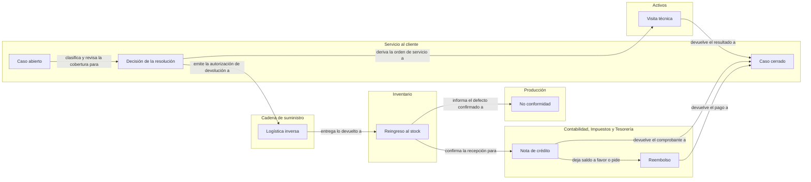

# Del reclamo a la resolución

Del reclamo a la resolución es el recorrido que empieza cuando un cliente reclama y se abre un caso, y termina cuando el caso se cierra con la solución aplicada y registrada: un cambio, una reparación, una devolución con nota de crédito o un reembolso. El caso es el hilo, y cada resolución deja un documento en otro dominio (Inventario, Cadena de suministro, Producción, Activos, Contabilidad o Tesorería) que tiene que volver antes de cerrarlo.

El recorrido arranca en el [reclamo](../Servicio-al-cliente/Caso/reclamo.md), que es un tipo de [caso](../Servicio-al-cliente/Caso/caso.md). Lo anterior es la venta, contada [del pedido al cobro](del-pedido-al-cobro.md): de ahí salen la factura, la entrega y el número de serie que el reclamo va a necesitar. Cruza Servicio al cliente, Relación con clientes, Inventario y Contabilidad siempre, y Cadena de suministro, Producción, Activos y Tesorería según la resolución. La calidad es un paso: el reclamo que confirma un defecto abre una [no conformidad](../Produccion/Calidad/no-conformidad.md), y su detalle es de Producción.

APQC 7.4 lo arma con 6.2.2 «Manage customer service problems, requests, and inquiries», 6.2.3 «Manage customer complaints», 6.2.4 «Process returns», 6.3.2 «Process warranty claims», 6.3.4 «Service products», 6.5.2 «Measure customer satisfaction with customer-complaint handling and resolution», 4.4.2.4 «Manage flow of returned products», 4.4.2.5 «Manage disposition of returned products», 4.3.3.5 «Track and analyze non-conformance trends», 9.2.2.5 «Resolve customer billing inquiries» y 9.2.5 «Manage and process adjustments/deductions».

## Los pasos, del caso abierto al caso cerrado

| Paso | Dominio | Qué pasa | Documento que deja |
|---|---|---|---|
| 1. Recepción del reclamo | Servicio al cliente | Se abre el caso, se acusa recibo y se le da un número al cliente | [Caso](../Servicio-al-cliente/Caso/caso.md) con su número |
| 2. Clasificación | Servicio al cliente | Se fija tipo, categoría y prioridad, y con eso el reloj del acuerdo | Caso clasificado ([clasificación y prioridad](../Servicio-al-cliente/Caso/clasificacion-y-prioridad.md), [tiempos de respuesta y resolución](../Servicio-al-cliente/Niveles-de-servicio/tiempos-de-respuesta-y-resolucion.md)) |
| 3. Revisión y decisión | Servicio al cliente | Se busca la venta de origen y la serie, se revisa la cobertura y se elige cambio, reparación, devolución o reembolso | Decisión registrada y autorización de devolución ([garantía y reparación](../Servicio-al-cliente/Caso/garantia-y-reparacion.md)) |
| 4. Viaje de vuelta | Cadena de suministro | La mercadería vuelve identificada con la autorización | Envío de devolución ([logística inversa](../Cadena-de-suministro-y-logistica/Despacho-y-entrega/logistica-inversa.md)) |
| 5. Reingreso al stock | Inventario | Se recibe, se inspecciona y queda en un estado no disponible hasta la disposición | Recepción y movimiento a cuarentena, disponible o bloqueado ([recepción](../Inventario-y-depositos/Operacion-del-deposito/recepcion.md), [estados del stock](../Inventario-y-depositos/Existencias/estados-del-stock.md)) |
| 6. No conformidad, si hay defecto | Producción | Se registra el defecto y, si se repite o es grave, se abre una [acción correctiva](../Produccion/Calidad/accion-correctiva.md) | [No conformidad](../Produccion/Calidad/no-conformidad.md) |
| 7. Reparación o visita | Activos y mantenimiento | El técnico repara en el taller o en el lugar del cliente | Orden de servicio cerrada ([derivación al técnico](../Servicio-al-cliente/Escalamiento/derivacion-al-tecnico.md), [visita técnica](../Activos-y-mantenimiento/Servicio-de-campo/visita-tecnica.md)) |
| 8. Nota de crédito o reemplazo | Impuestos, Contabilidad y Relación con clientes | Se revierte la venta, total o parcial, o se entrega otra unidad | [Nota de crédito](../Impuestos/Cumplimiento/comprobante-fiscal.md#la-factura-no-se-borra-nota-de-crédito-y-nota-de-débito) con su asiento ([ingresos y cuentas a cobrar](../Contabilidad/Operaciones/ingresos-y-cuentas-a-cobrar.md#la-factura-la-nota-de-crédito-y-el-cobro)) o entrega nueva del reemplazo, que apunta al [pedido de venta](../Relacion-con-clientes/Pedido-de-venta/pedido-de-venta.md) de origen |
| 9. Reembolso | Tesorería | Se devuelve la plata o se deja el saldo a favor en la cuenta corriente | Pago al cliente o crédito aplicado ([aplicación de cobros](../Tesoreria/Credito-y-cobranzas/aplicacion-de-cobros.md)) |
| 10. Cierre y análisis | Servicio al cliente | Se comunica la decisión, se cierra con causa y resolución, y los reclamos repetidos se juntan en un problema | Caso cerrado; [problema y causa raíz](../Servicio-al-cliente/Escalamiento/problema-y-causa-raiz.md) |

No todos los pasos ocurren en cada reclamo: uno por mala atención va del 3 al 10. El lado del caso, en los nueve pasos de ISO 10002, está en la nota del reclamo.

## Qué vuelve al caso en cada traspaso

El caso decide y los demás dominios ejecutan, y el caso queda como el registro que une sus documentos ([dónde termina el caso](../Servicio-al-cliente/Caso/garantia-y-reparacion.md#dónde-termina-el-caso-y-empieza-el-vecino)). Para cerrarlo, cada documento tiene que volver.

| Traspaso | Qué tiene que coincidir | Quién decide |
|---|---|---|
| Caso → autorización de devolución | Cliente, venta de origen, serie y cantidad (nunca más que lo entregado) | Servicio al cliente, contra la política de garantía |
| Autorización → recepción | Lo que llegó contra lo autorizado, por renglón | Inventario registra; si no coincide, vuelve al caso |
| Recepción → disposición | El estado de lo recibido: vuelve a la venta, se repara, se rescatan partes o se da de baja | Inventario, con Calidad si hay defecto ([la disposición](../Cadena-de-suministro-y-logistica/Despacho-y-entrega/logistica-inversa.md#la-disposición-qué-se-hace-con-lo-devuelto)) |
| Recepción → nota de crédito | La nota cita la factura original y cubre lo recibido o lo autorizado | Contabilidad, separada de quien carga pedidos |
| Caso → orden de servicio | El equipo, la falla y si está en garantía (la reparación en garantía va a precio cero) | Servicio al cliente deriva; el servicio de campo ejecuta |
| Orden de servicio → caso | El resultado de la visita | El caso pasa a resuelto; el cliente confirma el cierre |

Del lado contable, Romney y Steinbart listan la amenaza «Inaccurate or invalid credit memos» y dos controles: separar la autorización de la nota de crédito de la carga de pedidos y de las cuentas de clientes, y «Configuration of system to block credit memos unless there is either corresponding documentation of return of damaged goods or specific authorization by management».

## Dónde se traba el recorrido

Estas fallas nacen en un traspaso. Salvo la de la nota de crédito, que es la amenaza de Romney y Steinbart, son lectura de las notas enlazadas o de esta base:

- **El caso se cierra al derivar.** Se da por resuelto al autorizar la devolución o al mandar al técnico, y nadie sigue si llegó el producto, si se reparó o si se acreditó la plata ([garantía y reparación](../Servicio-al-cliente/Caso/garantia-y-reparacion.md), [derivación al técnico](../Servicio-al-cliente/Escalamiento/derivacion-al-tecnico.md)). Si falla, el cliente vuelve como caso nuevo y la reapertura no se cuenta.
- **La nota de crédito sin devolución.** Se acredita lo que nunca volvió, o se acredita dos veces.
- **La devolución sin nota de crédito.** El producto volvió y el cliente sigue debiendo; al pagar, descuenta la devolución por su cuenta y aparece una [deducción](../Tesoreria/Credito-y-cobranzas/gestion-de-la-cobranza.md#disputas-y-deducciones) en la cobranza.
- **Lo devuelto vuelve a disponible sin inspección.** El reingreso al stock saltea la cuarentena y la unidad fallada se vuelve a vender.
- **El defecto no llega a Producción.** El caso se cierra con un cambio y la no conformidad no se abre, así que la misma falla vuelve en el próximo lote.

## Qué se mide del recorrido entero

La [resolución al primer contacto](../Servicio-al-cliente/Calidad-del-servicio/metricas-de-atencion.md#resolución-al-primer-contacto-y-sus-cuatro-definiciones) y las [reaperturas](../Servicio-al-cliente/Calidad-del-servicio/metricas-de-atencion.md#reaperturas-pendientes-y-abandono) son de Servicio al cliente, y el tiempo de resolución contra lo prometido es del [acuerdo de nivel de servicio](../Servicio-al-cliente/Niveles-de-servicio/tiempos-de-respuesta-y-resolucion.md). Resolver en la primera visita es de [Activos](../Activos-y-mantenimiento/Servicio-de-campo/visita-tecnica.md#resolver-en-la-primera-visita). Las medidas del recorrido entero son estas:

| Medida | Definición | Fuente |
|---|---|---|
| Tiempo de resolución de punta a punta | Días desde que se abre el caso hasta que vuelve el último documento de la resolución: nota de crédito emitida, reembolso pagado, reemplazo entregado o equipo reparado | Definición de esta base; ninguna fuente abierta la da |
| Tiempo de proceso de la devolución | «Return processing cycle time in days» | APQC 103155 (sin fórmula publicada) |
| Valor de lo devuelto | «Value of returned products as a percentage of sales» | APQC 104208 |
| Costo de la garantía | «Warranty costs (repair and replacement) as a percentage of sales»; según el resumen de la página de la medida, suma mano de obra, materiales y diagnóstico de lo devuelto | APQC 104217 |
| Acciones correctivas a tiempo | «Percentage of corrective actions for customer complaints that are completed within 15 days» | APQC 101913 |

El tiempo de punta a punta se separa del tiempo del acuerdo a propósito, y esa lectura es de la base. El reloj del acuerdo se pausa mientras se espera al cliente y puede darse por cumplido cuando el equipo marca el caso resuelto, aunque el cliente siga esperando su plata o su equipo. Si los dos números se alejan, el atraso está en un traspaso.

> [!NOTE] Sin fuente todavía: el mapa y las medidas Issue-to-Resolution de APQC (solo para socios) y valores de referencia del costo de la garantía con su método.

## Variantes del recorrido

### Reclamo con devolución de mercadería

Es la variante completa de Inventario: autorización, viaje de vuelta, reingreso al stock con su estado y nota de crédito o reemplazo. En una tienda, el envío de vuelta y su costo están en [devoluciones](../Comercio-electronico/Operaciones-del-comercio/devoluciones.md). Si el cliente la rechaza en la puerta, la vuelta arranca en la [prueba de entrega](../Cadena-de-suministro-y-logistica/Despacho-y-entrega/prueba-de-entrega.md), a veces sin caso abierto.

### Reclamo que pide una visita técnica

La mercadería no se mueve. El caso deriva al técnico y queda abierto hasta que vuelve el resultado. Lo que se factura sale de la orden, no de la visita: [servicio de campo](../Activos-y-mantenimiento/Servicio-de-campo/servicio-de-campo.md#del-caso-del-cliente-a-la-factura).

### Reclamo sobre la factura

No toca el stock ni al técnico. El cliente discute un precio, una cantidad o un impuesto, y el caso pasa a Contabilidad, que corrige con nota de crédito o de débito, nunca editando la factura. Si el cliente ya descontó la diferencia al pagar, la tramita la cobranza como [disputa o deducción](../Tesoreria/Credito-y-cobranzas/gestion-de-la-cobranza.md#disputas-y-deducciones). APQC la pone en 9.2.2.5 «Resolve customer billing inquiries». Muchos reclamos de factura nacen en un traspaso del pedido al cobro, entre lo entregado y lo facturado (lectura de esta base).

En la Argentina, el recorrido suma la garantía legal de la Ley 24.240, el arrepentimiento, los plazos de respuesta por sector, la Ventanilla Federal Única y la nota de crédito electrónica: [del reclamo a la resolución en la Argentina](procesos-de-negocio-en-argentina.md#del-reclamo-a-la-resolución).
