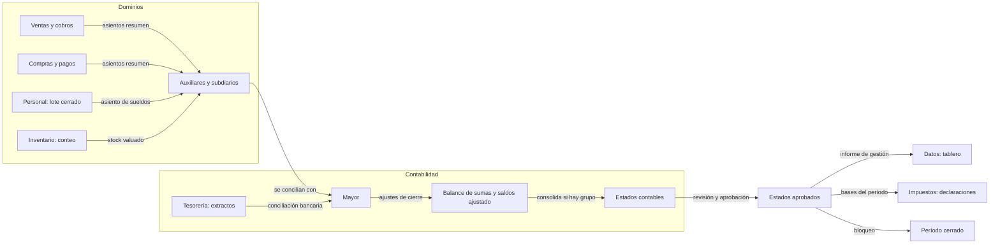

# Del registro al balance

Del registro al balance (record-to-report) es el recorrido que lleva lo que cada dominio registró en el período hasta los estados contables emitidos y el período cerrado: cada área cierra lo suyo, la contabilidad ajusta y concilia, alguien revisa y aprueba, se informa adentro y afuera, se declaran los impuestos que dependen del cierre y el período se bloquea.

Empieza donde terminan los otros recorridos. [Del pedido al cobro](del-pedido-al-cobro.md), [de la compra al pago](de-la-compra-al-pago.md), [de la contratación a la baja](de-la-contratacion-a-la-baja.md) y [de la compra a la baja del activo](de-la-compra-a-la-baja-del-activo.md) dejan cada día documentos y asientos en los auxiliares. El recorrido los toma en la fecha de corte y termina con los estados aprobados, el informe de gestión entregado, las declaraciones del período presentadas y el período bloqueado. Después viene el período siguiente y, una vez por año, la auditoría externa ([auditoría y fraude](../Contabilidad/Control-interno/auditoria-y-fraude.md)). Cruza [Contabilidad](../Contabilidad/contabilidad.md), que es dueña de cómo se registra cada ajuste, [Tesorería](../Tesoreria/tesoreria.md), [Impuestos](../Impuestos/impuestos.md) y [Datos](../Datos/Visualizacion-y-BI/visualizacion-y-bi.md), y recibe los cierres de Inventario, Administración de personal y Activos.

APQC 7.4: 9.3.1 «Manage financial policies and procedures», 9.3.2 «Perform general accounting» (9.3.2.4 ajustes, 9.3.2.5 operaciones entre empresas del grupo, 9.3.2.6 conciliación del mayor, 9.3.2.7 consolidación, 9.3.2.8 balance de sumas y saldos), 9.3.3.6 «Calculate and record depreciation expense», 9.3.4 «Perform financial reporting», 9.1.2.1 «Perform inventory accounting», 9.7.2.1 «Manage and reconcile cash positions», 9.8 «Manage internal controls» y 9.9.2 «Process taxes», con 9.9.2.2 «Prepare tax returns».

## Los pasos del cierre

APQC reparte el cierre fuera de 9.3: el ajuste de fin de período de la nómina es 9.5.2.7 y el devengamiento de cuentas a pagar, 9.6.1.5. Por eso hace falta un recorrido que junte lo que cierra cada dominio (lectura de esta base).

| Paso | Dominio | Qué pasa | Documento que deja |
|---|---|---|---|
| 1. Registro diario | el de cada recorrido | Cada documento entra a su [auxiliar](../Contabilidad/Registro/cuentas-corrientes.md) y pasa al mayor ([registro contable](../Contabilidad/Registro/registro-contable.md)) | auxiliares, libro de IVA, diario |
| 2. Corte | Contabilidad | Se comunica la fecha desde la que lo que llega va al período siguiente | calendario de cierre |
| 3. Cierre de cada dominio | Inventario, Personal, Tesorería, Contabilidad | Conteo y [costo de lo vendido](../Contabilidad/Operaciones/costo-de-lo-vendido.md); [lo recibido sin facturar](../Contabilidad/Operaciones/compras-y-cuentas-a-pagar.md#lo-recibido-sin-facturar); lote de [sueldos](../Administracion-de-personal-y-nomina/Liquidacion-de-sueldos/liquidacion-de-sueldos.md) cerrado; [conciliación bancaria](../Contabilidad/Control-interno/conciliaciones.md) y del auxiliar contra su control; [amortización](../Contabilidad/Operaciones/activos-fijos-y-amortizacion.md); [diferencia de cambio](../Contabilidad/Operaciones/moneda-extranjera.md#al-registrar-y-al-cerrar) | conteo, lote, conciliaciones |
| 4. Ajustes de cierre | Contabilidad | Devengamientos, diferimientos y previsiones sin documento que los dispare ([ajustes de cierre](../Contabilidad/Estados-contables/ajustes-de-cierre.md)) | asientos de ajuste |
| 5. Balance de sumas y saldos | Contabilidad | Se comprueba que débitos y créditos cierran ([asiento y libros](../Contabilidad/Registro/asiento-y-libros.md#el-balance-de-sumas-y-saldos)) | balance ajustado |
| 6. Consolidación | Contabilidad | Si hay grupo, se concilian los saldos entre empresas y se eliminan ([conciliaciones](../Contabilidad/Control-interno/conciliaciones.md#entre-empresas-del-mismo-grupo), [estados consolidados](../Contabilidad/Estados-contables/normas-contables.md#los-estados-consolidados)) | estados consolidados |
| 7. Revisión y aprobación | quien no los preparó ([separación de funciones](../Contabilidad/Control-interno/separacion-de-funciones.md)) | Estados preliminares revisados por errores y variaciones inusuales (guía del Departamento de Justicia), por ejemplo contra el mes anterior y el [presupuesto](../Contabilidad/Contabilidad-de-gestion/presupuesto.md) (lectura de la base) | estados aprobados |
| 8. Emisión | Contabilidad | El juego completo con sus notas ([estados contables](../Contabilidad/Estados-contables/estados-contables.md)) | estados contables |
| 9. Informe de gestión | Datos y Contabilidad de gestión | Desvíos y resultados por centro, con cada métrica definida en un solo lugar ([tablero](../Datos/Visualizacion-y-BI/tablero.md), [capa semántica](../Datos/Visualizacion-y-BI/capa-semantica.md)) | informe de gestión |
| 10. Declaraciones del período | Impuestos | IVA y retenciones del mes; al cierre anual, el impuesto a la renta desde el [resultado impositivo](../Impuestos/Impuestos-a-la-renta/resultado-impositivo.md) ([declaración y pago](../Impuestos/Cumplimiento/declaracion-y-pago.md)) | declaraciones juradas |
| 11. Bloqueo | Contabilidad | El período no acepta más asientos; un error se corrige con un [asiento nuevo](../Contabilidad/Registro/asiento-y-libros.md#corregir-con-un-asiento-nuevo) en el período abierto. Al cierre anual, las [cuentas de resultado](../Contabilidad/Estados-contables/ajustes-de-cierre.md#el-cierre-de-las-cuentas-de-resultado) vuelven a cero | período cerrado |

## Quién entrega qué, y en qué día

Una guía del Departamento de Justicia de EE. UU. para quienes reciben subsidios, que dice seguir recomendaciones del AICPA, ordena el cierre por días respecto del fin del período. Los pasos «are built upon one another», así que el atraso de uno atrasa el informe. La columna del dominio es lectura de esta base; la guía no asigna tareas por área.

| Día | Tarea según la guía | Dominio |
|---|---|---|
| −4 | Distribuir el calendario de cierre; revisar que los asientos recurrentes sigan valiendo; estados preliminares | Contabilidad |
| −2 | Revisar contratos con pagos pendientes; actualizar bienes de uso y amortización | Contabilidad, Compras |
| −1 | Conciliación bancaria preliminar; control del inventario | Contabilidad con extractos de Tesorería; Inventario |
| 0 | Emitir los informes de fin de período y correr el cierre | Todos |
| +1 | Conciliar el mayor con esos informes; completar devengamientos; cerrar cuentas a cobrar y a pagar | Contabilidad |
| +2 | Completar los estados y registrar los ajustes que falten | Contabilidad |

Los traspasos que tienen que coincidir antes de aprobar son siempre una suma contra otra:

- Auxiliar de clientes o de proveedores contra su cuenta de control. Lo concilia Contabilidad.
- Libro de IVA contra las cuentas de IVA del mayor. Conviene conciliarlo antes de declarar ([registros fiscales](../Impuestos/Cumplimiento/registros-fiscales.md#cómo-se-relaciona-con-la-contabilidad)); que lo haga quien liquida el impuesto es lectura de la base.
- Extracto del banco contra la cuenta Banco. Lo concilia Contabilidad y no quien custodia la plata; la [posición de caja](../Tesoreria/Caja-y-liquidez/posicion-de-caja.md) de Tesorería se apoya en el resultado.
- Total del lote de sueldos contra el asiento de sueldos y cargas ([operaciones](../Contabilidad/Operaciones/operaciones.md#cómo-se-registran-los-sueldos)).
- Stock contado contra stock en libros; el ajuste lo aprueba alguien que no tiene la mercadería a cargo ([ajustes y mermas](../Inventario-y-depositos/Control-del-stock/ajustes-y-mermas.md)).
- Saldo de cada empresa del grupo contra el de la otra.

## Dónde se traba el cierre

- **El corte no se comunica.** Según APQC, hay que comunicar el corte a los líderes y empleados de cada área, desde las ventas hasta cuentas a pagar, para que sepan cuándo la contabilidad deja de registrar. Una factura de compra que llega después del corte obliga a un devengamiento, o el gasto cae en el mes equivocado (inferencia de esta base).
- **Todo se hace el último día.** APQC y la guía del Departamento de Justicia proponen adelantar conciliaciones y asientos recurrentes; la guía advierte que un asiento fijo de sueldos puede no corresponder después de una baja.
- **El ajuste que falta.** El balance de sumas y saldos sigue cuadrando, y solo la conciliación de cada cuenta lo muestra ([ajustes de cierre](../Contabilidad/Estados-contables/ajustes-de-cierre.md#cómo-fallan-los-ajustes)).
- **Planes de cuentas distintos.** Según los datos de APQC, adoptar un plan de cuentas estándar ahorra unos dos días, y las empresas con cuentas nombradas distinto entre sitios tardan más en consolidar ([plan de cuentas](../Contabilidad/Registro/plan-de-cuentas.md)).
- **Partidas conciliatorias que se arrastran.** Una diferencia sin explicar pasa al mes siguiente y se mezcla con las nuevas (inferencia de esta base).
- **El período queda abierto.** Un asiento con fecha de un mes ya informado cambia un estado que ya se entregó y una declaración ya presentada ([controles sobre los sistemas](../Contabilidad/Control-interno/controles-sobre-sistemas.md); inferencia de esta base).

## Qué se mide del cierre

| Medida | Definición | Fuente |
|---|---|---|
| Días de cierre | Días calendario desde el balance de sumas y saldos hasta los estados consolidados del mes (APQC 100162) | APQC; mediana de 6,4 días, cuartil superior de 4,8 o menos, inferior de 10 o más, en 2.300 organizaciones (CFO.com, 2018) |
| Días hasta el informe de gestión | Desde el balance de sumas y saldos inicial hasta el informe de gestión del período (APQC 100625) | APQC |
| Días de cierre anual (por sitio) | Desde el balance de sumas y saldos hasta los estados consolidados del ejercicio (APQC 100613) | APQC |
| Asientos manuales | Porcentaje de líneas de asiento de origen manual, recurrente o no (APQC 100848); se mira junto con el porcentaje de líneas de corrección o ajuste (106325) | APQC |
| Partidas conciliatorias viejas | Cantidad e importe de partidas conciliatorias abiertas con más de 30 días, por cuenta | definición de esta base |

> [!NOTE]
> Sin fuente todavía: una medida publicada de la antigüedad de las partidas conciliatorias, y valores de APQC posteriores a 2018 para los días de cierre.

## Variantes

### Cierre mensual de gestión y cierre anual legal

La guía del Departamento de Justicia recomienda el cierre mensual porque un período corto tiene menos operaciones y menos riesgo de error. Que sirva para decidir y admita estimaciones es lectura de esta base. El anual suma el cierre de las cuentas de resultado, las [normas contables](../Contabilidad/Estados-contables/normas-contables.md), la auditoría externa y la declaración anual del impuesto a la renta.

### Varias empresas

Cada empresa cierra lo suyo y el grupo agrega la [conciliación entre empresas](../Contabilidad/Control-interno/conciliaciones.md#entre-empresas-del-mismo-grupo) y las eliminaciones (APQC 9.3.2.5 y 9.3.2.7), que esperan a que todas cierren.

### Cierre continuo

El cierre continuo («continuous accounting») reparte durante el mes las conciliaciones y los devengamientos, que el cierre clásico junta al final. Lo promueven los proveedores de software de cierre; la fuente leída es una columna de la CEO de uno de ellos, sin datos.

> [!NOTE]
> Sin fuente todavía: evidencia independiente de que el cierre continuo acorta los días de cierre.

Lo propio de la Argentina (IVA Simple, Ingresos Brutos y F.931 con el cierre del mes, RT 54 y ajuste por inflación) está en [Procesos de negocio en la Argentina](procesos-de-negocio-en-argentina.md#del-registro-al-balance).
