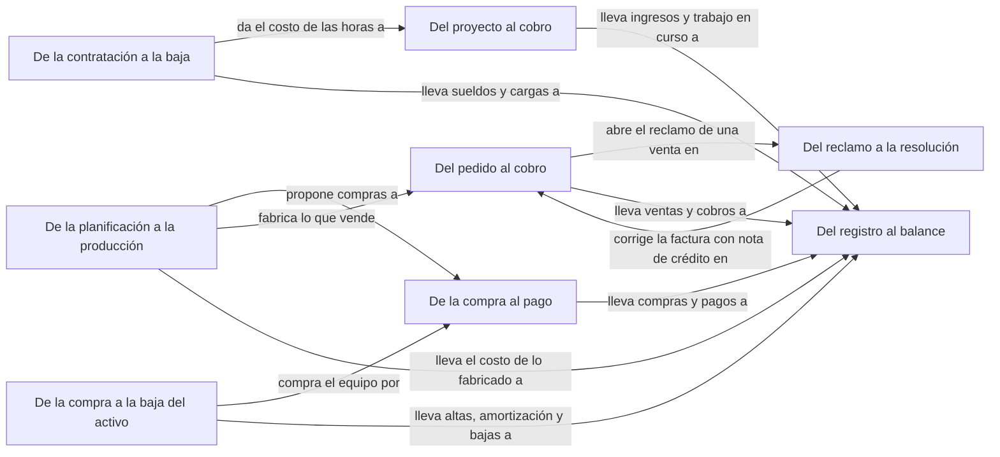

# Procesos de negocio

Un proceso de negocio de punta a punta es una cadena de pasos que cruza varios dominios de la empresa y termina en un resultado del negocio, como cobrar un pedido o pagarle a un proveedor. Este tema cuenta los ocho recorridos que atraviesan los dominios de una empresa que ya opera: qué pasos tienen, qué documento pasa de un dominio a otro, dónde se traban y qué se mide del recorrido entero. El detalle de cada paso vive en su dominio.

Los otros doce temas del área «Gestión de la empresa» cortan la empresa por dominio: cada uno es dueño de un objeto y un verbo, como el pedido de venta en [Relación con clientes](../Relacion-con-clientes/relacion-con-clientes.md) o la cuenta a pagar en [Contabilidad](../Contabilidad/contabilidad.md). Este tema corta en la otra dirección. No es dueño de ningún documento: es dueño del orden de los pasos, de los traspasos (qué documento cambia de mano y qué tiene que coincidir) y de las medidas que solo tienen sentido para el recorrido entero, como el tiempo del pedido al cobro o los días de cierre. Por eso casi cada oración de una nota de proceso enlaza a una nota de dominio. Los límites con cada tema están en el [alcance](ALCANCE.md).

Los dos cortes existen afuera. APQC clasifica todo lo que hace una empresa por función en su Process Classification Framework, que según sus reglas no implica orden, y arma aparte los procesos de punta a punta tomando piezas de varias categorías. Los libros de sistemas de información contable agrupan las mismas operaciones en ciclos de transacciones: ingresos, egresos, producción, personal y nómina, y mayor general e informes. Cómo se relacionan los marcos con los recorridos está en [marcos de procesos](Fundamentos/marcos-de-procesos.md), y de dónde viene la mirada por procesos, en [fundamentos](Fundamentos/fundamentos-de-procesos-de-negocio.md).

## Los ocho recorridos y cómo se enganchan

Casi todos los recorridos terminan en plata que entra o sale, y todos desembocan en el cierre. La planificación a la producción dispara compras; el reclamo vuelve sobre una venta; el proyecto usa las horas que también paga la nómina.

### Lo que trae plata: el ciclo de ingresos

- [Del pedido al cobro](del-pedido-al-cobro.md) (order-to-cash): del pedido de venta aceptado al cobro aplicado y conciliado, pasando por el crédito, la reserva, la preparación, el despacho, la factura y la cobranza. Variantes: minorista, mayorista en cuenta corriente y suscripción.
- [Del proyecto al cobro](del-proyecto-al-cobro.md) (project-to-cash): el mismo resultado para una firma que vende trabajo de personas: del contrato al cobro, con las horas, la facturación por hora, hito o abono, y el margen del proyecto.
- [Del reclamo a la resolución](del-reclamo-a-la-resolucion.md) (issue-to-resolution): del caso abierto al caso cerrado, con lo que la solución deja en otros dominios: la devolución, el reingreso al stock, la nota de crédito, la visita técnica.

### Lo que cuesta plata: el ciclo de egresos

- [De la compra al pago](de-la-compra-al-pago.md) (procure-to-pay): de la solicitud de compra al pago conciliado, con el cruce de tres vías entre la orden, la recepción y la factura.
- [De la compra a la baja del activo](de-la-compra-a-la-baja-del-activo.md) (acquire-to-retire): la vida de un equipo propio, de la decisión de invertir a la baja, con el mantenimiento como un paso y dos registros (el técnico y el contable) que tienen que coincidir.

### Lo que se transforma: el ciclo de producción

- [De la planificación a la producción](de-la-planificacion-a-la-produccion.md) (plan-to-produce): del pronóstico y el plan de ventas y operaciones al producto terminado, controlado, ingresado y costeado.

### La gente: el ciclo de personal y nómina

- [De la contratación a la baja](de-la-contratacion-a-la-baja.md) (hire-to-retire): del puesto aprobado a la liquidación final pagada, con el ciclo que se repite cada período: asistencia, liquidación, asiento, pago y cargas.

### El cierre: mayor general e informes

- [Del registro al balance](del-registro-al-balance.md) (record-to-report): lo que cada dominio registró en el período, hasta los estados contables emitidos y el período bloqueado, con el calendario de quién entrega qué y en qué día.

El nombre de cada ciclo sale de los libros de sistemas de información contable; qué recorrido va en cada ciclo es lectura de esta base. El quinto ciclo de esos libros, el de financiamiento, no tiene recorrido acá: tomar y devolver deuda es de [Tesorería](../Tesoreria/Financiamiento/financiamiento.md).

Lo propio de la Argentina (la factura electrónica, las percepciones y retenciones, el cierre detrás de los vencimientos, el alta laboral, la garantía legal) está en [procesos de negocio en la Argentina](procesos-de-negocio-en-argentina.md), un apartado por recorrido.

## Qué dominios cruza cada recorrido

| Recorrido | Dominios que cruza |
|---|---|
| Del pedido al cobro | Relación con clientes, Inventario, Cadena de suministro, Contabilidad, Impuestos, Tesorería |
| De la compra al pago | Compras, Inventario, Contabilidad, Tesorería, Impuestos |
| Del registro al balance | Contabilidad, Tesorería, Impuestos, Datos, y el cierre de todos los demás |
| De la planificación a la producción | Cadena de suministro, Producción, Compras, Inventario, Contabilidad |
| De la contratación a la baja | Administración de personal y nómina, Contabilidad, Tesorería, Impuestos |
| Del reclamo a la resolución | Servicio al cliente, Relación con clientes, Inventario, Contabilidad, y según el caso Cadena, Producción o Activos |
| Del proyecto al cobro | Servicios profesionales y proyectos, Administración de personal, Contabilidad, Tesorería |
| De la compra a la baja del activo | Activos y mantenimiento, Compras, Contabilidad |

La lista sale de la decisión que fijó los ocho recorridos; cada nota dice en qué paso entra cada dominio.

## Ideas que cruzan todo el tema

- **Las fallas nacen en los traspasos.** Cada dominio hace bien lo suyo y el recorrido igual se atrasa: el pedido bloqueado por un cobro que no se aplicó, la factura del proveedor que espera una recepción que nadie cargó, el cierre que espera la conciliación de otra área. El subtítulo del libro de Rummler y Brache le da nombre, el «espacio en blanco» del organigrama, que se suele leer como los traspasos entre áreas ([fundamentos](Fundamentos/fundamentos-de-procesos-de-negocio.md#del-organigrama-al-proceso)).
- **Lo que viaja es un documento, y se corrige con otro.** El pedido, el remito, la factura, el recibo, la hoja de horas o la orden de trabajo pasan de un dominio a otro, y el siguiente los toma como verdad. Un error no se edita: se compensa con una nota de crédito, un contraasiento o una nueva versión. Cómo se modela eso en un sistema es del tema Software de gestión (todavía no armado).
- **Los controles son comparaciones entre documentos.** El cruce de tres vías, la conciliación de lo entregado con lo facturado o del cobro con las facturas son siempre un documento contra otro en un traspaso. La [separación de funciones](../Contabilidad/Control-interno/separacion-de-funciones.md) pide que dos personas distintas estén a cada lado.
- **Se mide el tiempo de punta a punta, partido en tramos.** Cada recorrido tiene una medida total (del pedido al cobro, de la solicitud al pago, días de cierre) y tramos que dicen dónde se va el tiempo. Las medidas propias de un dominio, como los días de cobro o la utilización, se enlazan en lugar de redefinirse.
- **Todo termina en el cierre.** Ningún recorrido termina del todo hasta que lo que dejó se concilia y entra a los estados del período: por eso [del registro al balance](del-registro-al-balance.md) depende de los otros siete.

## Qué leer según lo que estés haciendo

- Si tenés que diseñar la facturación o la cuenta corriente de clientes: [del pedido al cobro](del-pedido-al-cobro.md); el pedido, en [pedido de venta](../Relacion-con-clientes/Pedido-de-venta/pedido-de-venta.md), y el cobro, en [aplicación de cobros](../Tesoreria/Credito-y-cobranzas/aplicacion-de-cobros.md).
- Si tenés que diseñar las cuentas a pagar o los pagos a proveedores: [de la compra al pago](de-la-compra-al-pago.md); la orden, en [orden de compra](../Compras-y-abastecimiento/Orden-de-compra/orden-de-compra.md), y el pago, en [corrida de pagos](../Tesoreria/Pagos-a-proveedores/corrida-de-pagos.md).
- Si tenés que acelerar o rediseñar el cierre del mes: [del registro al balance](del-registro-al-balance.md); los asientos, en [ajustes de cierre](../Contabilidad/Estados-contables/ajustes-de-cierre.md).
- Si tenés que llevar un plan de producción hasta la orden costeada: [de la planificación a la producción](de-la-planificacion-a-la-produccion.md); el MRP, en [MRP](../Produccion/Planificacion-de-la-produccion/mrp.md).
- Si tenés que integrar sueldos con la contabilidad y los pagos: [de la contratación a la baja](de-la-contratacion-a-la-baja.md); la liquidación, en [liquidación de sueldos](../Administracion-de-personal-y-nomina/Liquidacion-de-sueldos/liquidacion-de-sueldos.md).
- Si tenés que diseñar la mesa de ayuda con devoluciones y notas de crédito: [del reclamo a la resolución](del-reclamo-a-la-resolucion.md); el caso, en [caso](../Servicio-al-cliente/Caso/caso.md).
- Si tenés que facturar horas o hitos de una firma de servicios: [del proyecto al cobro](del-proyecto-al-cobro.md); la facturación, en [facturación del proyecto](../Servicios-profesionales-y-proyectos/Facturacion-del-proyecto/facturacion-del-proyecto.md).
- Si tenés que llevar el registro de bienes de uso con su mantenimiento: [de la compra a la baja del activo](de-la-compra-a-la-baja-del-activo.md); la amortización, en [activos fijos y amortización](../Contabilidad/Operaciones/activos-fijos-y-amortizacion.md).
- Si tenés que decidir qué recorridos tiene que cubrir un sistema de gestión, o chequear que no falte nada: esta entrada y [marcos de procesos](Fundamentos/marcos-de-procesos.md), con los códigos APQC de cada recorrido. Las categorías de producto son del tema Software de gestión (todavía no armado).
- Si el sistema es para una empresa en la Argentina: [procesos de negocio en la Argentina](procesos-de-negocio-en-argentina.md).
- Si tenés que vender antes del pedido (el embudo, la propuesta): no es de acá; es de [Ventas](../Ventas/ventas.md) y de [Relación con clientes](../Relacion-con-clientes/relacion-con-clientes.md).

Los términos con su nombre en inglés están en el [glosario de procesos de negocio](Fundamentos/glosario-de-procesos-de-negocio.md).

## Orden de lectura

Para quien construye software de gestión: esta entrada, después [del pedido al cobro](del-pedido-al-cobro.md) y [de la compra al pago](de-la-compra-al-pago.md), que son los dos recorridos que casi toda empresa tiene, y [del registro al balance](del-registro-al-balance.md), donde terminan todos. Los otros cinco se leen según el rubro: la planificación a la producción en una fábrica, el proyecto al cobro en una firma de servicios, la compra a la baja del activo donde hay equipos que cuidar, el reclamo a la resolución donde hay posventa, y la contratación a la baja en cualquier empresa con empleados.

- [Fundamentos](Fundamentos/fundamentos-de-procesos-de-negocio.md): de dónde viene la mirada por procesos (la cadena de valor, la reingeniería, el espacio en blanco del organigrama, los ciclos de transacciones), lo que la evidencia discute, los [marcos de procesos](Fundamentos/marcos-de-procesos.md) y el [glosario](Fundamentos/glosario-de-procesos-de-negocio.md).
