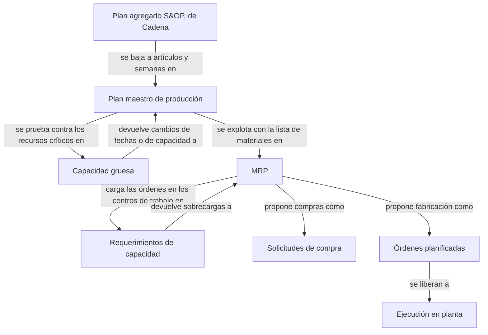

# Planificación de la producción

La planificación de la producción decide cuánto fabricar de cada artículo y cuándo, y qué componentes comprar o fabricar para eso. Baja el plan agregado por familia y mes a un plan maestro por artículo y semana, lo explota en componentes con el MRP y controla en cada paso si la capacidad alcanza, hasta dejar órdenes propuestas para la planta y para compras.

Es la segunda de las cinco partes de [Producción](../produccion.md). Recibe de [Producto y proceso](../Producto-y-proceso/producto-y-proceso.md) la [lista de materiales](../Producto-y-proceso/lista-de-materiales.md), que dice qué explotar, y la [ruta de fabricación](../Producto-y-proceso/ruta-de-fabricacion.md), que dice cuántas horas carga cada artículo en cada centro de trabajo. Le entrega a [Ejecución en planta](../Ejecucion-en-planta/ejecucion-en-planta.md) las órdenes que hay que fabricar y a [Compras y abastecimiento](../../Compras-y-abastecimiento/compras-y-abastecimiento.md) lo que hay que comprar.

## Dónde empieza: el plan agregado es de Cadena

El pronóstico, el plan de ventas y operaciones (S&OP) y el plan de distribución son de [Cadena de suministro y logística](../../Cadena-de-suministro-y-logistica/Planificacion/planificacion.md), que cuenta la jerarquía de planes con sus horizontes. El [plan de ventas y operaciones](../../Cadena-de-suministro-y-logistica/Planificacion/plan-de-ventas-y-operaciones.md) fija cuánto producir por familia y por mes. Este tema empieza un escalón más abajo, en el plan maestro, que lo baja a artículos y semanas (decisión del alcance del tema).

Unas diapositivas de un curso abierto lo muestran como una desagregación: el plan agregado da «Outputs, inventories by time period / In standard units» y se convierte en el «MASTER PRODUCTION SCHEDULE / Individual product production, by period / Capacity requirements». APQC pone las dos piezas de acá en 4.1.4 «Create and manage master production schedule» y 4.1.3 «Create materials plan»; el reparto proceso por proceso está en [marcos de la producción](../Fundamentos/marcos-de-la-produccion.md).

## La cascada: cada plan con su control de capacidad

Los cursos enseñan la planificación como una cascada. Cada nivel de materiales tiene al lado un control de capacidad del mismo grano. Unas diapositivas de la Universidad de Tesalia, que siguen el capítulo 3 de *Factory Physics* de Hopp y Spearman, lo dicen así: el plan maestro «works with rough-cut capacity planning to ensure the MPS is capacity-feasible» (traducción de la base).

| Paso | Qué decide | Grano | Dónde está |
|---|---|---|---|
| Plan agregado | cuánto por familia | familia y mes | [plan de ventas y operaciones](../../Cadena-de-suministro-y-logistica/Planificacion/plan-de-ventas-y-operaciones.md), de Cadena |
| Plan maestro | cuánto de cada artículo final y cuándo; qué se puede prometer | artículo y semana | [plan maestro de producción](plan-maestro-de-produccion.md) |
| Capacidad gruesa | si el plan maestro entra en los recursos críticos | recurso crítico y semana | [planificación de capacidad](planificacion-de-capacidad.md) |
| MRP | cuánto de cada componente y cuándo lanzarlo | componente y período | [MRP](mrp.md) |
| Capacidad detallada | si las órdenes del MRP entran en cada centro de trabajo | centro de trabajo y día | [planificación de capacidad](planificacion-de-capacidad.md) |
| Órdenes | qué se fabrica y qué se compra | orden | [orden de producción](../Ejecucion-en-planta/orden-de-produccion.md) y [solicitud de compra](../../Compras-y-abastecimiento/Orden-de-compra/solicitud-de-compra.md) |

Las fuentes no ubican igual los dos controles de capacidad. Las diapositivas del MIT ponen el plan maestro, la capacidad gruesa y la detallada en el mismo plazo intermedio; las de Tesalia atan la gruesa al plan maestro y la detallada al MRP. La tabla sigue a las de Tesalia.

Que el lazo vuelva hacia arriba es lo que distingue al MRP de lazo cerrado del original. Según el material de ASCM, los primeros sistemas hacían «a simplifying assumption that there was infinite capacity (thus the open loop)», y el avance fue agregar «capacity checks at the master scheduling and MRP stages to ensure feasibility». Esa historia, hasta el MRP II, sigue en [planificación de capacidad](planificacion-de-capacidad.md).

## Horizonte de cada plan

Cuánto mira hacia adelante cada plan depende de la empresa; las fuentes dan órdenes de magnitud, no normas.

- Plan agregado: «six months to five years», recalculado de «1/month to 1/year» y con detalle de «part family», según el MIT. El detalle está en la nota de [planificación](../../Cadena-de-suministro-y-logistica/Planificacion/planificacion.md) de Cadena.
- Plan maestro: tiene que cubrir al menos el plazo acumulado de fabricación y compra, para que el MRP alcance a lanzar a tiempo los componentes más lejanos (inferencia de la base). El manual de un sistema de 1972 pone de ejemplo un plan de 18 meses con una parte firme de 6, y discute el costo de un cambio suponiendo un plazo total de fabricación de seis meses. El horizonte se mide en semanas o en días: el tiempo se divide en «time buckets — days, weeks, or whatever is convenient» (MIT).
- MRP y capacidad detallada: el mismo horizonte que el plan maestro, recalculado cada vez que cambia algo (inferencia de la base); la crítica de la capacidad detallada es que solo sirve en el horizonte muy cercano (Tesalia).
- Programa de planta: días u horas (criterio de la base), en [Ejecución en planta](../Ejecucion-en-planta/ejecucion-en-planta.md).

> [!NOTE] Sin fuente todavía: horizontes típicos del plan maestro y del MRP en un libro de texto (Vollmann y otros, *Manufacturing Planning and Control*) o en el diccionario de ASCM.

## Quién planifica qué

- El plan agregado lo acuerdan ventas, operaciones y finanzas en el S&OP (Cadena).
- El plan maestro tiene un dueño con nombre propio, el programador maestro («master scheduler»). En el material de ASCM, un pedido que no entra en lo disponible y obliga a cambiar el plan cerca de la fecha «would be subject to master scheduler approval». El manual de 1972 pone los cambios grandes en un grupo de dirección que decide con el sistema y después le informa al sistema que los cambios «should be made firm».
- El MRP lo calcula el sistema; un planificador revisa sus propuestas y sus mensajes de acción, y decide cuáles convierte en órdenes. Las diapositivas de SMU lo resumen: un MRP «Uses little mathematics, primarily bookkeeping».
- La orden al proveedor la emite Compras a partir de la propuesta: el plan dice cuánto y cuándo; a quién y a qué precio, no.

En una pyme, las tres últimas son la misma persona con una planilla (criterio de la base).

## Dónde toma la posta la ejecución

La planificación termina cuando una orden planificada se libera. En las diapositivas de Tesalia, la salida del MRP es un conjunto de trabajos («job pool») hecho de lanzamientos planificados, que pasan a la planta con la función de liberación de trabajos. Un sistema comercial lo automatiza con una barrera de liberación: dentro de cierta cantidad de días desde hoy, el proceso libera solo las órdenes planificadas como órdenes de la planta o como solicitudes de compra.

Desde ahí, la [orden de producción](../Ejecucion-en-planta/orden-de-produccion.md) es de [Ejecución en planta](../Ejecucion-en-planta/ejecucion-en-planta.md): sus estados, los controles al liberarla, el consumo y la [secuencia en la máquina](../Ejecucion-en-planta/programacion-de-planta.md). En ISA-95, el plan es del nivel 4, donde está el ERP, y la ejecución del nivel 3, donde está el MES (ver [marcos de la producción](../Fundamentos/marcos-de-la-produccion.md)).

## Cómo falla la planificación

- El plan supone capacidad infinita. El MIT dice que el MRP resuelve un problema formulado sobre un modelo «deterministic» e «infinite capacity», y que por eso «it requires constant manual intervention to compensate for poor schedules». Ver [planificación de capacidad](planificacion-de-capacidad.md).
- Los datos de entrada están mal. Un solucionario de un curso lista los requisitos: «A good schedule of what is to be made / An accurate BOM / Accurate inventory records / Accurate purchases data / Lead times that will be met». Un error en la lista de materiales se repite en cada orden que la usa (criterio de la base).
- El plan cambia todo el tiempo. Cada corrida mueve órdenes ya lanzadas: es el nerviosismo, explicado en [MRP](mrp.md), y la razón de las barreras de tiempo del [plan maestro](plan-maestro-de-produccion.md).
- Se planifica igual lo que se vende de stock y lo que se hace por pedido. El plan maestro cambia de objeto según la estrategia: ver [fabricar para stock o contra pedido](fabricar-para-stock-o-contra-pedido.md).

Las escuelas que discuten esta forma de planificar (tirar con kanban, la teoría de las restricciones, DDMRP) están en [fundamentos de producción](../Fundamentos/fundamentos-de-produccion.md).

## Qué hay en Planificación de la producción

Se lee en este orden: primero la estrategia, porque decide qué se planifica en el plan maestro.

- [Fabricar para stock o contra pedido](fabricar-para-stock-o-contra-pedido.md): las cinco posiciones del punto de desacople del pedido y qué cambia en el plan maestro, la lista de materiales y la promesa al cliente.
- [Plan maestro de producción](plan-maestro-de-produccion.md): el MPS, sus períodos, las barreras y zonas de tiempo, el consumo del pronóstico, el disponible para prometer con un ejemplo y el programa de ensamble final.
- [MRP](mrp.md): neteo, explosión, desfase, lotificación, stock y plazo de seguridad, órdenes firmes, mensajes de acción, rastreo de la demanda y nerviosismo, con una tabla resuelta.
- [Planificación de capacidad](planificacion-de-capacidad.md): capacidad gruesa y detallada con sus ejemplos, carga infinita y finita, y el MRP II.
