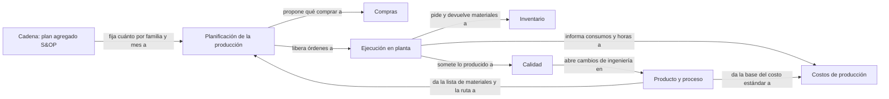

# Producción

Producción, como dominio de negocio, es lo que una empresa registra y decide para transformar materiales en productos: de qué está hecho cada producto y cómo se fabrica, cuánto fabricar y cuándo, cómo se ordena y se sigue el trabajo en la planta, cuánto cuesta lo fabricado y cómo se controla que salga bien. Es lo que llevan el módulo de fabricación de un ERP, un sistema de ejecución de planta (MES) y uno de gestión de la calidad, pero existe antes del software: una ficha técnica por producto, un tablero con las órdenes de la semana y una planilla de controles hacen lo mismo.

El tema mira lo que se transforma. Lo que pasa antes y alrededor es de otros dominios. El pronóstico y el plan agregado, que dice cuánto producir por familia y por mes, son de [Cadena de suministro y logística](../Cadena-de-suministro-y-logistica/cadena-de-suministro-y-logistica.md). El stock de materiales y de terminados, con sus lugares y estados, es de [Inventario y depósitos](../Inventario-y-depositos/inventario-y-depositos.md). La orden al proveedor es de [Compras y abastecimiento](../Compras-y-abastecimiento/compras-y-abastecimiento.md). El método de costeo y el registro en los libros son de [Contabilidad](../Contabilidad/contabilidad.md), y el cuidado de las máquinas, de [Activos y mantenimiento](../Activos-y-mantenimiento/activos-y-mantenimiento.md).

Las fuentes cortan parecido, pero no igual. APQC 7.4 pone la producción en 4.3 «Produce/Assemble/Test product», con cuatro procesos: programar, producir, probar la calidad y llevar la trazabilidad de los lotes. El plan maestro y el plan de materiales quedan en 4.1, junto con el pronóstico. ISA-95 separa la planificación del negocio (nivel 4, donde está el ERP) de la gestión de las operaciones de la planta (nivel 3, donde está el MES). El corte de la base le da a cada dominio un objeto y un verbo: este tema es dueño de lo que se transforma y del verbo transformar, desde el plan maestro hasta el producto controlado. Los límites con cada vecino están en el [alcance](ALCANCE.md).

## Las cinco partes de la producción

El tema se divide en la definición del producto para fabricarlo, el plan, el trabajo en la planta, el costo y la calidad.

- [Producto y proceso](Producto-y-proceso/producto-y-proceso.md): de qué está hecho cada producto y cómo se fabrica. La lista de materiales, la ruta con sus operaciones y centros de trabajo, y los cambios de ingeniería que las modifican. Son los datos maestros de los que dependen las otras cuatro partes.
- [Planificación de la producción](Planificacion-de-la-produccion/planificacion-de-la-produccion.md): cuánto fabricar y cuándo. Si se fabrica para stock o contra pedido, el plan maestro que baja el plan agregado a artículos y semanas, el MRP que calcula los componentes y la capacidad que dice si el plan entra en la planta.
- [Ejecución en planta](Ejecucion-en-planta/ejecucion-en-planta.md): cómo se ordena y se sigue el trabajo. La orden de producción y sus estados, el consumo de materiales y la declaración de lo producido, la secuencia en que pasan los trabajos por las máquinas, la subcontratación de una operación y la eficiencia global del equipo (OEE).
- [Costos de producción](Costos-de-produccion/costos-de-produccion.md): cuánto cuesta lo fabricado. El costo estándar que sale de la lista y la ruta, el costo real que junta cada orden y las variaciones entre los dos.
- [Calidad](Calidad/calidad.md): que lo fabricado cumpla. El plan de inspección, el control estadístico del proceso, la no conformidad, la acción correctiva y la trazabilidad del lote fabricado.

Lo propio de la Argentina (las habilitaciones para fabricar alimentos, medicamentos, productos médicos y cosméticos, la trazabilidad obligatoria, la certificación de productos y los regímenes de promoción) está en [Producción en la Argentina](produccion-en-argentina.md).

## Ideas que cruzan todo el tema

- Todo sale de dos datos maestros. La [lista de materiales](Producto-y-proceso/lista-de-materiales.md) dice qué lleva un producto y la [ruta de fabricación](Producto-y-proceso/ruta-de-fabricacion.md) dice por dónde pasa y cuánto tarda. Con ellas el [MRP](Planificacion-de-la-produccion/mrp.md) calcula los componentes, la [planificación de capacidad](Planificacion-de-la-produccion/planificacion-de-capacidad.md) calcula las horas y el [costo estándar](Costos-de-produccion/costo-estandar-del-producto.md) se acumula nivel por nivel. Un error en la lista se multiplica en las compras, el programa y el costo.
- El plan supone una capacidad que la planta puede no tener. El MRP clásico calcula con plazos fijos y capacidad infinita, y por eso un plan que cierra en el papel puede no entrar en las máquinas. La [programación de planta](Ejecucion-en-planta/programacion-de-planta.md) es donde ese supuesto choca con la realidad. Las escuelas que discuten el MRP (tirar con kanban, la teoría de las restricciones, DDMRP) están en [fundamentos de producción](Fundamentos/fundamentos-de-produccion.md).
- La orden es el centro del registro. La [orden de producción](Ejecucion-en-planta/orden-de-produccion.md) junta lo planificado y lo real: qué se iba a fabricar, qué se consumió, cuántas horas llevó, cuánto salió bien. De ella salen el costo real, la genealogía del lote y los datos para la OEE.
- La calidad cierra el círculo. Una [no conformidad](Calidad/no-conformidad.md) que se repite lleva a una [acción correctiva](Calidad/accion-correctiva.md), y la acción suele terminar en un [cambio de ingeniería](Producto-y-proceso/cambios-de-ingenieria.md) de la lista o la ruta.
- Todo movimiento deja un documento. Una entrega de material, una declaración de producción o un rechazo se registran como hechos que no se editan, igual que los movimientos de stock. Cómo se guarda en una base está en [registro de movimientos](../Bases-de-datos/Modelos-de-datos/registro-de-movimientos.md).

## Qué leer según lo que estés haciendo

- Si tenés que diseñar el maestro de productos de una fábrica: [lista de materiales](Producto-y-proceso/lista-de-materiales.md) y [ruta de fabricación](Producto-y-proceso/ruta-de-fabricacion.md); el artículo como registro, [artículo](../Inventario-y-depositos/Existencias/articulo.md), de Inventario.
- Si el producto se configura por pedido o se diseña para cada cliente: [fabricar para stock o contra pedido](Planificacion-de-la-produccion/fabricar-para-stock-o-contra-pedido.md) y la lista de planificación en [lista de materiales](Producto-y-proceso/lista-de-materiales.md).
- Si tenés que controlar cómo cambia un producto y qué pasa con lo que ya está fabricado: [cambios de ingeniería](Producto-y-proceso/cambios-de-ingenieria.md).
- Si tenés que pasar del plan de ventas y operaciones a órdenes: [planificación de la producción](Planificacion-de-la-produccion/planificacion-de-la-produccion.md), [plan maestro de producción](Planificacion-de-la-produccion/plan-maestro-de-produccion.md) y [MRP](Planificacion-de-la-produccion/mrp.md); el S&OP, en [plan de ventas y operaciones](../Cadena-de-suministro-y-logistica/Planificacion/plan-de-ventas-y-operaciones.md), de Cadena.
- Si tenés que saber si el plan entra en la planta: [planificación de capacidad](Planificacion-de-la-produccion/planificacion-de-capacidad.md).
- Si tenés que diseñar la orden de producción de un sistema: [orden de producción](Ejecucion-en-planta/orden-de-produccion.md) y [consumo y declaración](Ejecucion-en-planta/consumo-y-declaracion.md); los movimientos de stock, en [registro de movimientos](../Bases-de-datos/Modelos-de-datos/registro-de-movimientos.md).
- Si tenés que decidir en qué orden pasan los trabajos o atacar un cuello de botella: [programación de planta](Ejecucion-en-planta/programacion-de-planta.md).
- Si mandás material a un tercero para que haga una operación: [subcontratación](Ejecucion-en-planta/subcontratacion.md); la orden al proveedor, en [Compras y abastecimiento](../Compras-y-abastecimiento/compras-y-abastecimiento.md).
- Si te piden un tablero de la planta: [eficiencia global del equipo](Ejecucion-en-planta/eficiencia-global-del-equipo.md); la disponibilidad desde mantenimiento, en [indicadores de mantenimiento](../Activos-y-mantenimiento/Desempeno-de-los-activos/indicadores-de-mantenimiento.md).
- Si tenés que calcular cuánto cuesta un producto o explicar por qué una orden costó más: [costo estándar del producto](Costos-de-produccion/costo-estandar-del-producto.md) y [costo real de la orden](Costos-de-produccion/costo-real-de-la-orden.md); el método, en [sistemas de costeo](../Contabilidad/Contabilidad-de-gestion/sistemas-de-costeo.md), de Contabilidad.
- Si tenés que armar los controles de calidad de una línea: [plan de inspección](Calidad/plan-de-inspeccion.md) y [control estadístico de procesos](Calidad/control-estadistico-de-procesos.md); lo que llega del proveedor, en [recepción](../Inventario-y-depositos/Operacion-del-deposito/recepcion.md), de Inventario.
- Si salió algo mal o un cliente devolvió un lote: [no conformidad](Calidad/no-conformidad.md), [acción correctiva](Calidad/accion-correctiva.md) y [trazabilidad de lotes](Calidad/trazabilidad-de-lotes.md); el reclamo, en [Servicio al cliente](../Servicio-al-cliente/servicio-al-cliente.md).
- Si tenés que ubicar un proceso en un marco (APQC, ISA-95, SCOR) o separar lo del ERP de lo del MES: [marcos de la producción](Fundamentos/marcos-de-la-produccion.md).
- Si el sistema es para una fábrica en la Argentina: [Producción en la Argentina](produccion-en-argentina.md); lo fiscal, en [Impuestos en la Argentina](../Impuestos/impuestos-en-argentina.md).
- Si tenés que decidir a quién comprarle los materiales: no es de acá; es de [Compras y abastecimiento](../Compras-y-abastecimiento/compras-y-abastecimiento.md).

Los términos con su nombre en inglés están en el [glosario de producción](Fundamentos/glosario-de-produccion.md).

## Orden de lectura

Para quien construye software de gestión y no conoce el dominio: esta entrada, después [Producto y proceso](Producto-y-proceso/producto-y-proceso.md), porque todo depende de la lista y la ruta, y [Ejecución en planta](Ejecucion-en-planta/ejecucion-en-planta.md), que es lo que casi todo sistema tiene que registrar. [Planificación de la producción](Planificacion-de-la-produccion/planificacion-de-la-produccion.md) explica de dónde salen las órdenes; [Costos de producción](Costos-de-produccion/costos-de-produccion.md) y [Calidad](Calidad/calidad.md) se leen cuando el sistema tiene que costear o controlar lo fabricado.

- [Fundamentos](Fundamentos/fundamentos-de-produccion.md): de dónde viene el campo (del MRP al ERP, el sistema de Toyota, la teoría de las restricciones, lean), los [marcos](Fundamentos/marcos-de-la-produccion.md) que lo ordenan, las escuelas que discuten cómo planificar, la evidencia en contra de las ideas más repetidas y dónde se produce el saber.
