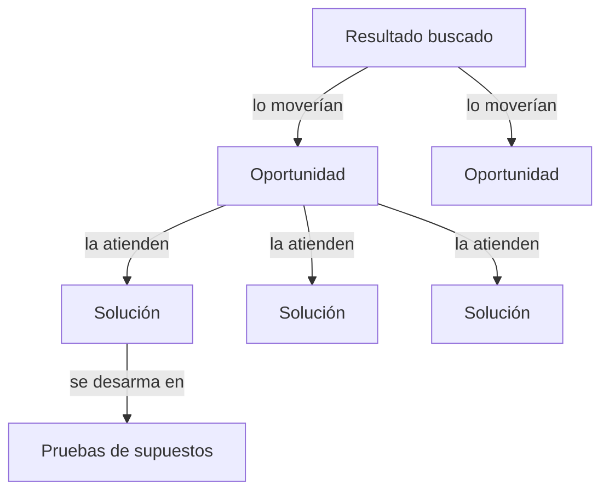

# Árbol de oportunidades

El árbol de oportunidades es la representación de Teresa Torres que va del resultado de producto que se busca a las necesidades de los clientes que lo moverían, a las soluciones posibles y a las pruebas de sus supuestos.

Torres lo define como "a simple way of visually representing how you plan to reach a desired outcome". Es la herramienta de representación del [descubrimiento](descubrimiento.md): ordena lo que el trío escucha en el [descubrimiento continuo](descubrimiento-continuo.md) y lo conecta con la [prueba de supuestos](prueba-de-supuestos.md).

## Los cuatro niveles

"The root of the tree is your desired outcome": un [resultado](../Estrategia/resultados-y-entregables.md) de producto, y no un resultado de negocio (el [impacto](../Estrategia/resultados-y-entregables.md#tres-niveles-entregable-resultado-e-impacto)) ni una sola métrica de tracción. Debajo van las oportunidades, que Torres define como "customer needs, pain points, and desires that, if addressed, will drive your desired outcome". Debajo de cada oportunidad, las soluciones; y abajo de todo, las pruebas de los supuestos de cada solución.

Lo que más cuesta es distinguir oportunidad de solución. La prueba que da Torres: si hay más de una forma de abordarlo, es una oportunidad. "Los clientes no saben cuánto les queda por pagar" es una oportunidad; "un aviso con el saldo" es una de sus soluciones (el ejemplo es de esta base).

## Cómo se arma, en nueve pasos

Torres lo describe así en Product Talk (2023):

1. Confirmá los prerrequisitos: una teoría de quién es el cliente objetivo, un resultado definido y 3 o 4 entrevistas basadas en historias.
2. Poné el resultado arriba.
3. Mapeá el espacio de oportunidades sintetizando las entrevistas.
4. Elegí una oportunidad objetivo, sin esperar a tener un mapa perfecto.
5. Generá ideas de solución solo para esa oportunidad.
6. Elegí tres soluciones.
7. Desarmá cada una en supuestos y priorizalos.
8. Probá los supuestos más riesgosos.
9. Decidí: descartar la solución, refinarla para la entrega o cambiar de oportunidad.

Los pasos 7 y 8 son la [prueba de supuestos](prueba-de-supuestos.md); las categorías de supuestos de Torres se parecen a los [cuatro riesgos](cuatro-riesgos.md) de Cagan (comparación en esa nota). Lo que sobrevive al paso 9 pasa a [priorización](../Planificacion-y-entrega/priorizacion.md) (orden de trabajo según esta base, no una fuente). Las entrevistas del paso 1 se conducen como dice [entrevista de usuario](../../UX/Investigacion/entrevista-de-usuario.md), del tema UX.

## Los errores que Torres advierte

La página los da como advertencias dispersas. Juntos:

- Armarlo sin buenas entradas: "Opportunity solution trees are nearly impossible to create when you don't have good inputs". Sin entrevistas, el árbol se llena de suposiciones del equipo.
- Confundir soluciones con oportunidades.
- Idear soluciones para todo el árbol en lugar de para la oportunidad objetivo.
- Poner demasiado esfuerzo en evaluar oportunidades, o descartarlas demasiado pronto.
- Reaccionar a una sola entrevista.
- Hacer un árbol para toda la empresa. Va uno por trío y por resultado.

LogRocket suma, según un resumen del buscador, que un árbol muy detallado es esfuerzo desperdiciado: conviene profundizar en dos o tres oportunidades, y el árbol no es un artefacto para reusar durante meses. Torres, según el buscador, desaconseja agregar una capa de segmentos de clientes, porque suele sumar complejidad innecesaria.

## De dónde sale

Torres lo desarrolló en unos tres años de coaching a equipos. El motivo, en sus palabras: "I still saw teams entertaining solutions that weren't connected to the opportunities they were finding". Lo apoya en tres ideas: las representaciones mentales de Ericsson, la pregunta de Bernie Roth "what would that do for you" y el trabajo de Jonassen sobre problemas mal estructurados (Product Talk, 2016).

## Lo que el árbol no prueba

> [!IMPORTANT]
> No hay estudio que mida si usar el árbol mejora los resultados de un equipo; es una herramienta de escuela. Un enfoque distinto es el de [Shape Up](../Planificacion-y-entrega/shape-up.md), donde el "shaping" acota el trabajo antes del ciclo; que defina problema y solución juntos y que no use un árbol es lectura de esta base. La comparación entre los dos no se investigó todavía.

## Qué leer

En la web, Torres, [Opportunity Solution Trees](https://www.producttalk.org/opportunity-solution-tree/); en el libro, *Continuous Discovery Habits*, los capítulos sobre el árbol. Conviene prestar atención a los nueve pasos y a la lista de errores, sobre todo a la diferencia entre oportunidad y solución y a que va un árbol por trío.
