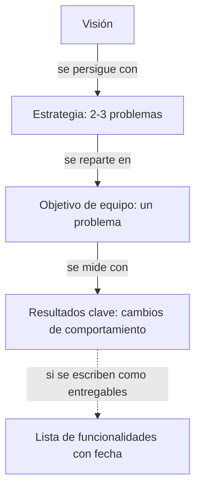

# Estrategia de producto

La estrategia de producto es el plan para llegar a la visión cumpliendo los objetivos del negocio: elige pocos problemas que atacar ahora, dice qué no se hace y baja a objetivos de equipo que se juzgan por resultados.

La definición es de Cagan: "Product Strategy is the plan to achieve the product vision, while satisfying the objectives of the business." Se ubica entre la [visión](vision-de-producto.md), que casi no cambia, y el trabajo de cada equipo, que cambia todo el tiempo. Cagan la piensa en horizonte trimestral. Es parte de la vertical [Estrategia](estrategia.md).

## El núcleo de Rumelt: diagnóstico, política guía y acción coherente

Cagan toma su idea de estrategia de Richard Rumelt. Según el resumen de Farnam Street de *Good Strategy Bad Strategy*, una estrategia tiene tres partes. El diagnóstico nombra el desafío real: "Underperformance is a result. The true challenges are the reasons for the underperformance." La política guía es "like a signpost, marking the direction forward but not defining the details of the trip". La acción coherente son "feasible coordinated policies, resource commitments, and actions".

La mala estrategia, en el mismo resumen, "is long on goals and short on policy or action". Usa palabras grandes para tapar la falta de contenido ("a flurry of fluff masking an absence of substance"), ignora "the power of choice and focus" y confunde el síntoma con el desafío. Una lista de metas no es una estrategia. Ni el artículo de HBR ni el libro se leyeron directo.

## Foco: lo que la estrategia deja afuera

Cagan arma la estrategia con cuatro componentes: foco, insights, acción y gestión. Desarrolla sobre todo el foco y lo apoya en Rumelt: "Good strategy works by focusing energy and resources on one, or a very few, pivotal objectives." Su diagnóstico de la práctica es severo: "Generating activity is not a problem; in fact it is easy." Ve líderes que nombran "at least 20-30" prioridades cuando hay "2-3 truly important things".

Del foco salen tres reglas sobre qué no hacer. No repartir la capacidad por igual entre las áreas que piden. No perseguir cada pedido de un cliente. No reaccionar a cada movimiento de un competidor. La falla más común, según Cagan, está antes: "most product organizations I meet don't even have a product strategy", y en su lugar hay listas de "50 major objectives or initiatives".

> [!NOTE]
> Sin fuente todavía: el componente de insights, que Cagan llama la parte más difícil de la estrategia. Sus páginas "Product Strategy – Insights" y "– Actions" no se abrieron.

## Estrategia de negocio y estrategia de producto

Cagan separa las dos. La de negocio define objetivos y portafolio, y fija presupuesto y métricas. "The product strategy speaks to how you hope to deliver on the business strategy", y la escriben los líderes de producto. El artículo es de 2009 y puede no reflejar lo que Cagan escribió después.

ISPMA reparte distinto. Pone la estrategia de producto en el grupo "Core", responsabilidad directa del product manager, y la estrategia corporativa en "Strategic Management", donde el product manager solo aporta. Además incluye en la estrategia de producto el posicionamiento, la propuesta de valor, el foco de mercado, los canales y las alianzas: "All of these elements are highly interdependent." En esta base el [posicionamiento](../../Marketing/Propuesta/posicionamiento.md) es de Marketing y se enlaza desde acá.

## Dos formulaciones más: cascada de Perri y DHM de Biddle

Perri, según las notas de Larson, llama a esto "strategy deployment". Una buena estrategia "is a decision-making framework, not a detailed plan" y debería durar años. Baja en cuatro niveles: visión, intención estratégica, iniciativas de producto y opciones. En cada nivel se alinea el porqué y el de abajo decide el cómo. Perri nombra tres brechas que la cascada tiene que cerrar: de conocimiento, de alineación y de efectos.

Gibson Biddle propone el modelo DHM: la estrategia como apuestas que se pueden probar sobre cómo "Delight customers in Hard-to-copy, Margin-enhancing ways". Solo se leyó en resúmenes de terceros; no hay material propio de Biddle verificado.

## De la estrategia a los OKR, y dónde se rompe

La cascada termina en objetivos de equipo. Cagan propone escribir cada objetivo como "a problem to solve rather than a feature to build" y presenta los OKR como una técnica para empoderar al equipo: el equipo recibe el problema y elige cómo resolverlo. El [equipo empoderado](../Organizacion/equipo-empoderado.md) depende de esa forma de escribir los objetivos.

La falla más citada está en los resultados clave. Cagan observa que los equipos "end up listing activities or deliverables as their key results". Un ejemplo propio: el resultado clave "más comercios completan el alta" pasa a escribirse "lanzar el nuevo alta". Con eso el OKR vuelve a ser una lista de [entregables](resultados-y-entregables.md) y el equipo vuelve a ser de funcionalidades. Según el buscador, Cagan dejó de recomendar los OKR donde los equipos son de funcionalidades; esa parte de la página no se verificó.

> [!IMPORTANT]
> La crítica a los OKR con resultados clave que son entregables tiene varias voces, ninguna con estudio. Perdoo, que vende software de OKR, sostiene que muchos ejemplos del libro de Doerr *Measure What Matters* miden salidas y no resultados (solo se leyó por resumen). Cutler advierte que los OKR montados sobre un roadmap fijo "can lock teams in" aun cuando la evidencia dice que el plan no sirve. Cagan dice que los resultados solo funcionan dentro del modelo de producto, es decir, que el problema es el modelo de equipo y no la técnica (para los OKR, según el buscador). Las tres son posiciones de practicantes; el problema de fondo, que una métrica usada como meta se desvía, está en [resultados y entregables](resultados-y-entregables.md#goodhart-cuando-el-resultado-se-vuelve-meta).

## Shape Up: apuesta por ciclo y no por cascada

Shape Up, el método de Basecamp, no baja de la visión a objetivos trimestrales. Las personas que deciden se juntan en una "betting table" y apuestan por un ciclo de seis semanas, y el equipo recibe "full responsibility" para definir las tareas. Singer lo dice así: "We don't rethink our roadmap every two weeks." El capítulo leído no menciona objetivos ni OKR.

La crítica, de resúmenes de terceros, es que cada ciclo es una apuesta suelta y la dirección de largo plazo puede fragmentarse; la da un solo comentarista. El método completo está en [Shape Up](../Planificacion-y-entrega/shape-up.md).

## Cuánta evidencia hay

No se encontró ningún estudio con método que muestre que tener una estrategia de producto escrita, con visión, estrategia y OKR en cascada, mejore los resultados. Lo que hay son posiciones: Rumelt sobre estrategia en general, Cagan y Perri sobre producto. La estrategia es una disciplina de foco recomendada por la escuela, y ninguna fuente la muestra como práctica probada.

Para leer: la serie "Product Strategy" de SVPG, Overview y Focus, y después Rumelt, "The Perils of Bad Strategy" en HBR, con su núcleo de tres partes y el argumento de por qué una lista de metas no es una estrategia.
