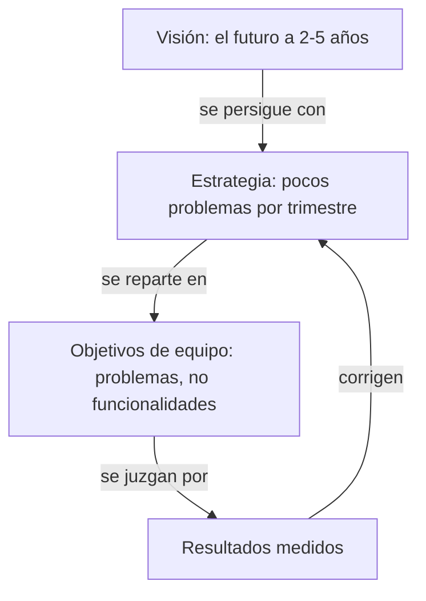

# Estrategia

La estrategia de producto fija a dónde va el producto y qué no va a hacer: una visión del futuro a años, una elección de pocos problemas que atacar ahora y los resultados con los que se juzga si se avanzó.

Es la primera parte del ciclo de [Producto](../producto.md). Le entrega al [descubrimiento](../Descubrimiento/descubrimiento.md) los resultados que tiene que mover, y la [medición](../Medicion/medicion-de-producto.md) le devuelve si se movieron. La [planificación](../Planificacion-y-entrega/planificacion-y-entrega.md) traduce la estrategia en un orden de trabajo, y el [roadmap](../Planificacion-y-entrega/roadmap.md) es la forma en que se comunica. Si el producto junta a dos o más lados, las reglas cambian, y eso está en [Plataformas](../Plataformas/plataformas.md).

## Tres capas que bajan de lo estable a lo que cambia

Cagan separa la visión de la estrategia y las dos de los objetivos de cada equipo. La [visión](vision-de-producto.md) "describes the future that the company is trying to create", con un horizonte de 2 a 5 años en software, y "doesn't usually change much at all". La [estrategia](estrategia-de-producto.md) es "the plan to achieve the product vision, while satisfying the objectives of the business", suele revisarse por trimestre y "changes frequently". De la estrategia salen los objetivos de cada equipo, que Cagan formula como "a problem to solve rather than a feature to build".

Perri arma la misma cascada con cuatro niveles (visión, intención estratégica, iniciativas de producto y opciones), según las notas de Larson sobre su libro. En cada nivel se alinea el porqué y el nivel de abajo decide el cómo.

## Medir lo que cambia y no lo que se entrega

La capa de abajo es la que más se discute. La escuela de equipos empoderados sostiene que un equipo se juzga por los [resultados](resultados-y-entregables.md) que mueve, es decir, por cambios en lo que hacen los usuarios, y no por las funcionalidades que entrega. Esa distinción decide cómo se escriben los objetivos, cómo se arma el roadmap y qué se le delega al [equipo](../Organizacion/equipo-empoderado.md). Cuando los objetivos se escriben como entregables, la cascada se rompe: Cagan observa que los equipos "end up listing activities or deliverables as their key results".

## Cómo falla una estrategia

Las fallas se repiten en las tres capas. Una visión falla por vaga, por partida en visiones chicas, por detallada como una especificación o por abandonada demasiado pronto. Una estrategia falla por falta de foco: Cagan dice que "most product organizations I meet don't even have a product strategy" y que muchas tienen listas de "50 major objectives or initiatives". Los objetivos fallan cuando miden entregables y no resultados.

## Dónde otros marcos cortan distinto

El marco formal de ISPMA no separa una visión de producto: la visión es corporativa ("consists of vision, mission, values, and goals"), y la estrategia de producto cubre "about one to five years". Además, ISPMA mete adentro de la estrategia de producto el posicionamiento, la propuesta de valor, los canales y las alianzas. En esta base el [posicionamiento](../../Marketing/Propuesta/posicionamiento.md) vive en Marketing y acá se enlaza. Shape Up, el método de Basecamp, reemplaza la cascada larga por apuestas de seis semanas, y esa disputa está en [estrategia de producto](estrategia-de-producto.md#shape-up-apuesta-por-ciclo-y-no-por-cascada).

> [!IMPORTANT]
> No se encontró ningún estudio con método que muestre que tener una estrategia escrita (visión, estrategia y objetivos en cascada) mejore los resultados. Todo lo que sostiene esta parte es opinión de practicantes: Cagan, Perri y Rumelt. La única evidencia cuantitativa sobre el "modelo de producto" es correlacional y viene de consultoras y vendedores de herramientas (ver [la evidencia del modelo de producto](../Fundamentos/fuentes-de-producto.md#la-evidencia-del-modelo-de-producto)).

## Lo que hay en Estrategia

- [Visión de producto](vision-de-producto.md): el futuro que se busca a años, cómo se escribe y los cuatro modos en que falla.
- [Estrategia de producto](estrategia-de-producto.md): elegir pocos problemas y decir qué no se hace, y la cascada hasta los OKR con su falla cuando los resultados clave son entregables.
- [Resultados y entregables](resultados-y-entregables.md): outcome contra output, la build trap y la feature factory, con el problema de Goodhart. Se lee antes que el resto del tema.

## Qué falta

Falta una nota:

- Estrategia de plataforma: qué cambia en la visión y la estrategia cuando el producto tiene dos o más lados. Hasta que exista, el punto de partida es [Plataformas](../Plataformas/plataformas.md).
