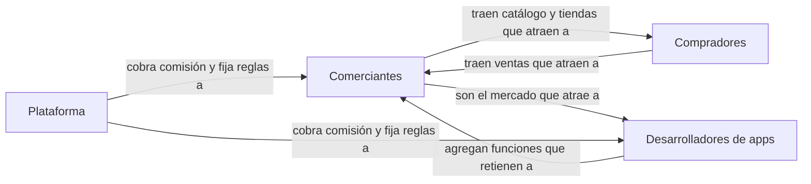

# Plataformas

Una plataforma es un producto que junta a dos o más grupos que se necesitan entre sí, como comerciantes, compradores y desarrolladores de apps, y cobra por facilitar lo que pasa entre ellos. Su valor depende de cuántos y quiénes hay del otro lado, y eso cambia las reglas de la estrategia.

Es una de las tres partes de [Producto](../producto.md) que cruzan el ciclo. No reemplaza a la [estrategia](../Estrategia/estrategia.md): le cambia las preguntas. Una plataforma decide también a qué grupo atraer primero, a cuál cobrarle y a quién deja construir encima. El precio por lado toca a [Monetización](../Monetizacion/monetizacion.md), y la métrica que resume el valor entregado, a [Medición](../Medicion/medicion-de-producto.md).

## Qué distingue a una plataforma de un producto con muchos usuarios

Una plataforma tiene lados: grupos distintos que obtienen valor unos de otros. En una plataforma de tiendas online son tres. Los comerciantes arman su tienda, los compradores compran y los desarrolladores venden apps que los comerciantes instalan. Cada lado vale más cuanto más hay del otro, y la plataforma vive de esas interacciones.

Gawer y Cusumano (2014), según su abstract, separan dos usos de la palabra. Una plataforma interna es un conjunto de activos compartidos con el que una empresa arma variantes de su propio producto. Una plataforma industrial o externa es la base sobre la que innovan terceros, dentro de un ecosistema. Esta vertical trata solo la segunda.

El diagrama muestra el mecanismo: cada lado atrae al otro, y la plataforma cobra en el medio. Ese ida y vuelta es el [efecto de red](efecto-de-red.md) cruzado. Si funciona, el crecimiento de un lado empuja al otro; si no arranca, ninguno de los dos llega.

## Por qué cambian las reglas de la estrategia

En un producto de un lado, cobrarle a cada cliente lo que el valor justifica es lo natural. En una plataforma suele convenir subsidiar a un lado para atraer al otro. Eisenmann, Parker y Van Alstyne (2006) llaman a uno "subsidy side" y al otro "money side". Esa decisión, el arranque desde cero y la competencia entre plataformas están en [mercado de dos lados](mercado-de-dos-lados.md).

La segunda regla nueva es el control. Una plataforma abre interfaces para que otros construyan, y a la vez se reserva el derecho de decidir quién entra y qué puede hacer. Esa tensión entre sumar aportes y no perder el control es el tema del [ecosistema de terceros](ecosistema-de-terceros.md).

## Platform Revolution y lo que matizan Cusumano, Gawer y Yoffie

*Platform Revolution* (Parker, Van Alstyne y Choudary, 2016) es la referencia que trajo la persona. Según su índice y reseñas, sostiene que el valor se crea facilitando interacciones entre terceros, no produciendo adentro. Dedica capítulos a efectos de red, arquitectura, lanzamiento, monetización, apertura, gobernanza y métricas. Es un libro de escuela, escrito por autores que también son consultores, y en esta base se leyó solo su índice.

> [!IMPORTANT]
> Tener efectos de red no alcanza, y la mayoría de las plataformas falla. Cusumano, Gawer y Yoffie (2019) compararon plataformas de 1995 a 2015. Según Yoffie, 209 fallaron y unas 45 tuvieron éxito (otras notas dicen 43). La nota de MIT Sloan resume: "The vast majority of digital platforms fail. And they fail quickly", en general antes de cinco años. Las causas que listan son el precio, la falta de confianza, ignorar a los competidores, el tiempo, no resolver el huevo y la gallina y los márgenes bajos. Yoffie agrega que los efectos de red no alcanzan: las plataformas que ganan hacen difícil que sus usuarios estén en varias a la vez, el [multi-homing](mercado-de-dos-lados.md#el-multi-homing-decide-mas-que-el-tamano). Todo esto se leyó por resúmenes y una entrevista, no en el libro.
>
> No siempre gana una sola: McIntyre, en un artículo de revisión, sostiene que lo que distingue a los mercados de plataformas ya no es si hay efectos de red o no. El efecto puede ser entre lados, local o informacional; el ganador único encaja con redes sociales y subastas, pero en muchos mercados conviven varias plataformas. Zhu e Iansiti agregan que importa la estructura de la red más que su tamaño (detalle en [efecto de red](efecto-de-red.md)).
>
> La conclusión práctica es lectura de la base a partir de esos datos: convertir un negocio en plataforma no lo mejora si el negocio es malo. La posición de *Platform Revolution* es de escuela; las revisiones académicas le ponen condiciones.

Las plataformas que sí funcionaron crecieron más en ventas y valor de mercado, y lo hicieron con "fewer than 10,000" empleados en promedio frente a 19,000, según MIT Sloan; el informe no aclara con qué empresas se las compara.

## Lo que hay adentro de Plataformas

- [Efecto de red](efecto-de-red.md): por qué más usuarios hacen más valioso el producto, del mismo lado y entre lados, y la disputa sobre cuánto crece ese valor. Se lee primero.
- [Mercado de dos lados](mercado-de-dos-lados.md): a qué lado subsidiar, cómo se arranca desde cero, cuándo gana una sola plataforma y qué hace el multi-homing.
- [Ecosistema de terceros](ecosistema-de-terceros.md): apps, APIs y reglas de entrada: cuánto abrir, cuánto cobrar y el riesgo de que la plataforma absorba lo que hicieron otros.
- [Competencia con la plataforma](competencia-con-la-plataforma.md): qué dicen los estudios sobre cuándo el dueño de la plataforma entra al espacio de sus terceros y cómo responden, y la teoría de los agregadores de Thompson con su crítica.

## Lo que falta de Plataformas

Faltan estas notas y se van a sumar:

- Desintermediación: cuando comerciante y comprador se conocen por la plataforma y después hacen negocios por fuera.
- Gobernanza y reglas de la plataforma: quién entra, qué se permite y cómo se resuelven los conflictos entre lados.
- Comparación de comisiones: cuánto cobran distintas plataformas a cada lado y con qué resultado.

> [!NOTE] Sin fuente todavía: estudios empíricos sobre desarrolladores en tiendas de apps de comercio (calidad, concentración de ingresos) y sobre desintermediación; los informes no encontraron fuente primaria.
