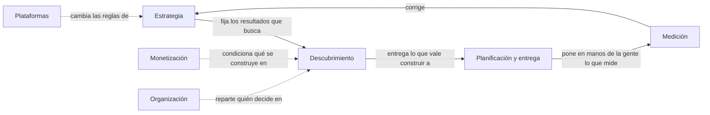

# Producto

Producto es el trabajo de decidir qué construir, para quién y por qué en un producto digital que dura, y de comprobar que lo construido le resuelve algo a quien lo usa y le sirve al negocio que lo paga.

La palabra que ordena el tema es *durar*. Un proyecto se define por un alcance y una fecha, y termina cuando se entrega. Un producto se define por un problema que sigue ahí, y lo atiende un equipo que también sigue. Fowler lo dice así: el modo producto usa "durable, ideate-build-run teams working on a persistent business issue", mientras que en el modo proyecto la plata se asigna a un alcance fijo y el equipo suele disolverse al entregar. Cagan agrega que el financiamiento por proyecto está "designed for predictability, but undermine[s] outcomes". Ninguno de los dos trae datos comparativos, así que es un argumento y no un hallazgo. La diferencia con un servicio y qué cambia para una consultora que vende proyectos están en [Qué es producto](Fundamentos/que-es-producto.md).

El nombre del tema es "producto" y no "diseño de producto". Un producto digital lo hacen juntos producto, diseño e ingeniería. Diseño responde por que se pueda usar, y eso vive en [UX](../UX/ux.md). Ingeniería responde por que se pueda construir. Producto responde por que valga la pena y le sirva al negocio. Ese reparto de dueños es una interpretación común de fuentes secundarias sobre los cuatro riesgos de Cagan; no se confirmó en Cagan.

El tema termina donde empiezan tres vecinos. Validar si una empresa nueva tiene un problema por el que alguien paga, el producto mínimo viable y el encaje producto-mercado son de [Emprender](../Emprender/emprender.md). Producto empieza cuando ese encaje existe o se busca dentro de una empresa que ya funciona. Quién compra, el posicionamiento y los canales, incluido el product-led growth como forma de adquirir clientes, son de [Marketing](../Marketing/marketing.md). Cómo se analizan las cohortes y el churn es de [Datos](../Datos/datos.md).

## De qué está hecho un producto

Un producto tiene siete partes. Cuatro forman un ciclo que se repite: la estrategia fija a dónde va el producto, el descubrimiento decide qué conviene construir, la planificación ordena qué sale primero y la medición cierra el ciclo y corrige la estrategia. Las otras tres cruzan el ciclo: cómo cobra el producto, qué cambia si tiene dos o más lados y quién hace el trabajo.

Las flechas llenas son el ciclo; las punteadas, las partes que lo cruzan.

- [Estrategia](Estrategia/estrategia.md): a dónde va el producto y qué no va a hacer. Incluye la visión a años, la estrategia que elige dónde jugar y la diferencia entre medir resultados y medir entregables.
- [Descubrimiento](Descubrimiento/descubrimiento.md): cómo se decide qué construir antes de construirlo. Incluye hablar con clientes cada semana, los cuatro riesgos de toda idea y las pruebas chicas que los reducen.
- [Planificación y entrega](Planificacion-y-entrega/planificacion-y-entrega.md): qué se hace primero y cómo llega a la gente. Incluye priorizar, el roadmap, Shape Up como alternativa al backlog y el lanzamiento.
- [Medición](Medicion/medicion-de-producto.md): si el producto funciona. Incluye la métrica que resume el valor entregado, la activación y los experimentos controlados.
- [Monetización](Monetizacion/monetizacion.md): cómo cobra el producto, con el precio, los planes y la opción de regalar una parte para vender el resto.
- [Plataformas](Plataformas/plataformas.md): qué cambia cuando el producto junta a dos o más grupos que se necesitan entre sí, como comerciantes, compradores y desarrolladores de apps.
- [Organización](Organizacion/organizacion.md): quién hace producto, con los roles y lo que se le delega a un equipo y lo que no.

La división en siete partes es de esta base. El marco de ISPMA, por ejemplo, corta el campo en cuatro áreas: estrategia de producto, planificación de producto, gestión estratégica y orquestación.

## Qué leer según la decisión de producto que tengas delante

- Si tenés que poner un precio o armar los planes: [pricing y empaquetado](Monetizacion/pricing-y-empaquetado.md), para la unidad de cobro y qué entra en cada plan, y [precios de la competencia](Monetizacion/precios-de-la-competencia.md) como punto de partida y no como respuesta. Si cobrás por proyecto o por hora, [cómo cobra una consultora o una agencia](Monetizacion/pricing-y-empaquetado.md#cómo-cobra-una-consultora-o-una-agencia).
- Si tenés que decidir si conviene un plan gratis o una prueba: [freemium y prueba gratuita](Monetizacion/freemium-y-prueba-gratuita.md), y después [activación](Medicion/activacion.md), porque lo gratis vende solo si el usuario llega al valor.
- Si tenés que decidir qué construir a continuación: [cuatro riesgos](Descubrimiento/cuatro-riesgos.md), [árbol de oportunidades](Descubrimiento/arbol-de-oportunidades.md) y [prueba de supuestos](Descubrimiento/prueba-de-supuestos.md).
- Si tenés que diseñar una funcionalidad: [dar forma a una solución](Descubrimiento/dar-forma-a-una-solucion.md) antes de las pantallas, y para las pantallas, [UX](../UX/ux.md#qué-leer-según-lo-que-tengas-que-diseñar-o-revisar).
- Si tenés que ordenar el trabajo o armar un roadmap: [priorización](Planificacion-y-entrega/priorizacion.md), [roadmap](Planificacion-y-entrega/roadmap.md) y [Shape Up](Planificacion-y-entrega/shape-up.md) como alternativa al backlog.
- Si tenés que elegir qué métrica seguir o probar un cambio: [North Star](Medicion/north-star.md), [activación](Medicion/activacion.md) y [experimento A/B](Medicion/experimento-ab.md), que exige volumen.
- Si tu producto vive dentro de la plataforma de otro, como una app para tiendas: [ecosistema de terceros](Plataformas/ecosistema-de-terceros.md) y [competencia con la plataforma](Plataformas/competencia-con-la-plataforma.md); si el producto es la plataforma, [mercado de dos lados](Plataformas/mercado-de-dos-lados.md) y [efecto de red](Plataformas/efecto-de-red.md).
- Si vas a proponerle a un cliente un producto o un proyecto de software: [qué cambia en una consultora que vende proyectos](Fundamentos/que-es-producto.md#qué-cambia-en-una-consultora-que-vende-proyectos) y la [bibliografía para una consultora](Fundamentos/bibliografia-de-producto.md#consultora-de-software). Cómo se arma y se presenta la propuesta en sí está en [Ventas](../Ventas/ventas.md), empezando por [la propuesta](../Ventas/La-propuesta/la-propuesta.md).

## La idea que cruza todo el tema

La mayoría de las ideas no mejora lo que se quería mejorar. Es la afirmación con más evidencia del campo y viene de experimentos controlados a gran escala. Kohavi y Thomke lo resumen así en Harvard Business Review (2017): "At Google and Bing, only about 10% to 20% of experiments generate positive results. At Microsoft as a whole, one-third prove effective, one-third have neutral results, and one-third have negative results." Son empresas con muchísimo tráfico; en un producto chico no se puede medir igual, y ninguna fuente leída dice cuántas ideas aciertan ahí.

Lectura de esta base: de ahí salen las otras partes. Si construir es caro y la mayoría de las ideas falla, conviene [descubrir](Descubrimiento/descubrimiento.md) antes de construir. También conviene juzgar al equipo por los [resultados](Estrategia/resultados-y-entregables.md) que mueve y no por lo que entrega, y [medir](Medicion/medicion-de-producto.md) después de lanzar. La escuela que ordena este tema es la de los [equipos empoderados](Organizacion/equipo-empoderado.md): Marty Cagan, Teresa Torres y Melissa Perri. Esa escuela defiende lo mismo, aunque ninguna fuente leída dice que se apoye en los datos de Kohavi y Thomke. Las escuelas que discrepan, con su evidencia, están en [Escuelas de producto](Fundamentos/escuelas-de-producto.md).

> [!IMPORTANT]
> Casi todo lo demás del campo es opinión de practicantes. No se encontraron estudios con método que comparen equipos empoderados con equipos de funcionalidades, ni roadmaps por resultados con roadmaps por fechas. Las cifras que se citan a favor del "modelo de producto" son correlaciones publicadas por consultoras y vendedores de herramientas. Las notas dicen, en cada caso, de qué escuela sale una afirmación y con qué la sostiene.

## Por dónde empezar a leer

1. [Qué es producto](Fundamentos/que-es-producto.md), para fijar el vocabulario: producto, proyecto, servicio y los roles vecinos.
2. [Resultados y entregables](Estrategia/resultados-y-entregables.md), la distinción de la que depende casi todo el resto.
3. [Descubrimiento continuo](Descubrimiento/descubrimiento-continuo.md) y [Cuatro riesgos](Descubrimiento/cuatro-riesgos.md), cómo se decide qué construir.
4. [Roadmap](Planificacion-y-entrega/roadmap.md) y [Priorización](Planificacion-y-entrega/priorizacion.md), lo que más se pide en la práctica.
5. Las demás partes, según la necesidad. La [bibliografía](Fundamentos/bibliografia-de-producto.md) ordena las lecturas por tipo de empresa: plataforma de comercio, consultora de software y agencia de marketing digital.

[Fundamentos](Fundamentos/fundamentos-de-producto.md) reúne lo que cruza todas las partes: qué es producto, su historia, las escuelas, la bibliografía por necesidad, el peso de cada tipo de fuente, los mitos y el glosario.
