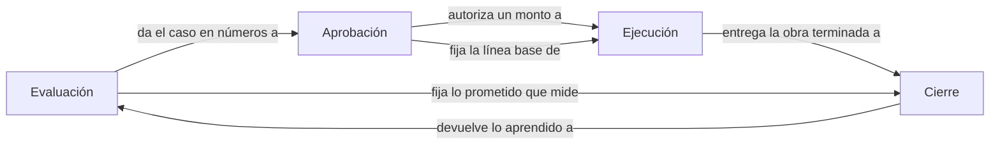

# Proyectos de inversión

Un proyecto de inversión es la decisión de una empresa en marcha de poner plata hoy en un activo propio (una máquina, una línea, una obra, un sistema) para recibir beneficios durante años, y el ciclo que sigue esa decisión: se evalúa, se aprueba dentro del presupuesto de capital, se sigue mientras se ejecuta y se cierra con el paso a activo y la revisión de lo logrado.

La idea que ordena el tema: una inversión cambia plata de hoy por plata futura, se decide una vez y se paga durante años. Por eso las cuatro etapas miran lo mismo desde momentos distintos. La evaluación estima el flujo de fondos y lo compara con lo que rendiría la plata en otro lado; la aprobación decide si entra en el presupuesto; el seguimiento compara lo gastado con lo aprobado; la revisión posterior compara lo logrado con lo prometido. Si la estimación del principio no se guarda, las últimas dos etapas no tienen contra qué medir.

El tema empieza en una empresa que ya opera. Fundar una empresa y conseguir su capital inicial está en [Emprender](../Emprender/emprender.md). Las finanzas de una empresa grande (valuación, fusiones, estructura de capital) quedan afuera, igual que la evaluación social de proyectos que hace el Estado con precios sociales.

## De qué está hecho un proyecto de inversión

El tema se divide en cuatro etapas, que son los estados por los que pasa la misma inversión. APQC las pone casi en ese orden dentro de 9.4 «Manage fixed-asset project accounting»: primero 9.4.1 «Perform capital planning and project approval» y después 9.4.2 «Perform capital project accounting», que termina en 9.4.2.4 «Close/capitalize projects» y 9.4.2.5 «Measure financial returns on completed capital projects». La guía de la GAO sobre decisiones de capital tiene la misma secuencia, desde el marco de revisión y aprobación (práctica 4) hasta evaluar los resultados (práctica 11).

- [Evaluación](Evaluacion/evaluacion-de-la-inversion.md): armar el flujo de fondos del proyecto, descontarlo con una tasa de corte y decidir con el valor actual neto, la tasa interna de retorno y el repago, sabiendo cuánto aguanta cada supuesto. Entrá acá cuando alguien trae una idea y hay que saber si conviene.
- [Aprobación](Aprobacion/aprobacion-de-la-inversion.md): el ciclo del presupuesto de capital, cómo se ordenan las propuestas cuando la plata no alcanza y quién firma qué según el monto. Entrá acá cuando hay que diseñar el circuito de autorización o armar el plan anual de inversiones.
- [Ejecución](Ejecucion/ejecucion-de-la-inversion.md): seguir lo aprobado, lo comprometido y lo gastado, ver el desvío antes de que pase y ampliar la autorización cuando hace falta; y la obra hecha por la propia empresa. Entrá acá cuando la inversión ya está en marcha.
- [Cierre](Cierre/cierre-de-la-inversion.md): cuándo la obra pasa a ser un activo, qué pasa con lo que llega tarde y cómo se revisa si la inversión rindió lo que prometía. Entrá acá cuando la obra está por terminar o ya terminó.

## La práctica no es la del libro

Los libros de texto recomiendan decidir por el valor actual neto. Las empresas lo usan, pero no solo ni siempre. En la encuesta a 392 directores financieros de Graham y Harvey, «74.9% of CFOs always or almost always used NPV», y el repago le seguía con 56,7 %. En la repetición de 2022, entre las empresas con ventas de menos de mil millones de dólares, el repago (66,40 %) aparece mucho más que el valor actual neto (40,22 %); Graham lo atribuye, por los comentarios escritos, a «constraints on funding, time, or financial sophistication». Las mismas encuestas muestran tasas de corte unos seis puntos por encima del costo de capital. Lo que eso significa y lo que dice cada bando está en [periodo de repago](Evaluacion/periodo-de-repago.md) y [tasa de corte](Evaluacion/tasa-de-corte.md).

La otra brecha está en los números de la propuesta. Quien la presenta quiere que se apruebe, y los directivos encuestados creen que los pronósticos de ventas vienen inflados; la evidencia, que es flaca, está en [aprobación](Aprobacion/aprobacion-de-la-inversion.md#por-qué-los-números-llegan-inflados) y en [revisión posterior](Cierre/revision-posterior.md).

## Dónde termina el tema

El límite con cada vecino sigue la regla del área: cada dominio es dueño de un objeto y un verbo. La tabla completa está en el [alcance del tema](ALCANCE.md). Lo que más se confunde:

- **Con la contabilidad.** Acá se decide la inversión y se dice cuándo la obra está lista; el asiento del alta, la cuenta de obra en curso y la amortización son de Contabilidad, en [activo construido por la propia empresa](../Contabilidad/Operaciones/activo-construido.md) y [activos fijos y amortización](../Contabilidad/Operaciones/activos-fijos-y-amortizacion.md). Si conviene arrendar en lugar de comprar, el registro del arrendamiento está en [arrendamientos](../Contabilidad/Operaciones/arrendamientos.md).
- **Con la tesorería.** El flujo de fondos del proyecto y la tasa con que se descuenta son de acá. Cómo se consigue la plata y cuánto cuesta un préstamo están en [financiamiento](../Tesoreria/Financiamiento/financiamiento.md) y [costo del financiamiento](../Tesoreria/Financiamiento/costo-del-financiamiento.md).
- **Con el mantenimiento.** [Reparar o reemplazar](../Activos-y-mantenimiento/Desempeno-de-los-activos/reparar-o-reemplazar.md) un equipo que ya anda es una decisión de Activos y mantenimiento, con el costo anual equivalente. Cuando la respuesta es reemplazar, el reemplazo entra acá como una propuesta más.
- **Con la gestión de proyectos.** El método para llevar cualquier proyecto está en [Gestión de proyectos](../Gestion-de-proyectos/gestion-de-proyectos.md): la [justificación](../Gestion-de-proyectos/Encuadre/justificacion.md), [medir el avance](../Gestion-de-proyectos/Seguimiento/medir-el-avance.md), el [control de cambios](../Gestion-de-proyectos/Seguimiento/control-de-cambios.md) y el [portafolio](../Gestion-de-proyectos/Gobierno-y-cierre/portafolio.md). Acá se toma lo propio de una inversión: el caso escrito en flujos de fondos, la autorización por monto y la activación.
- **Con el recorrido entero.** La vida del activo de la compra a la baja es un recorrido de [Procesos de negocio](../Procesos-de-negocio/de-la-compra-a-la-baja-del-activo.md); su primer paso, «decidir la inversión», es este tema.

## Qué leer según lo que estés haciendo

- Si tenés que decidir si conviene comprar una máquina o hacer una obra: [flujo de fondos del proyecto](Evaluacion/flujo-de-fondos-del-proyecto.md), [valor actual neto](Evaluacion/valor-actual-neto.md) y [tasa de corte](Evaluacion/tasa-de-corte.md); para ver cuánto aguanta, [análisis de sensibilidad](Evaluacion/analisis-de-sensibilidad.md).
- Si el directorio pregunta «en cuánto se recupera» o compara porcentajes: [periodo de repago](Evaluacion/periodo-de-repago.md) y [tasa interna de retorno](Evaluacion/tasa-interna-de-retorno.md).
- Si tenés que elegir entre dos alternativas de distinto tamaño o duración: [valor actual neto](Evaluacion/valor-actual-neto.md#elegir-entre-alternativas) y [tasa interna de retorno](Evaluacion/tasa-interna-de-retorno.md#cuándo-la-tir-elige-mal); para reemplazar un equipo en uso, [reparar o reemplazar](../Activos-y-mantenimiento/Desempeno-de-los-activos/reparar-o-reemplazar.md).
- Si tenés que armar el plan anual de inversiones o repartir un monto fijo: [presupuesto de capital](Aprobacion/presupuesto-de-capital.md).
- Si tenés que diseñar el circuito de pedido y autorización de un sistema: [solicitud de inversión](Aprobacion/solicitud-de-inversion.md) y, para quién firma, [autorizaciones](../Contabilidad/Control-interno/autorizaciones.md).
- Si tenés que construir el seguimiento de una obra o un proyecto de capital: [seguimiento de la inversión](Ejecucion/seguimiento-de-la-inversion.md) y [obra propia](Ejecucion/obra-propia.md); el valor ganado, en [medir el avance](../Gestion-de-proyectos/Seguimiento/medir-el-avance.md).
- Si la obra se está pasando de lo aprobado: [seguimiento de la inversión](Ejecucion/seguimiento-de-la-inversion.md#cuando-se-pasa-de-lo-aprobado).
- Si la obra está por terminar y hay que darla de alta: [activación de la obra](Cierre/activacion-de-la-obra.md) y, para el asiento, [activo construido](../Contabilidad/Operaciones/activo-construido.md).
- Si tenés que saber si una inversión rindió lo prometido: [revisión posterior](Cierre/revision-posterior.md).
- Si la empresa opera en Argentina: [proyectos de inversión en Argentina](proyectos-de-inversion-en-argentina.md), con la inflación en la evaluación, pesos o dólares, el ajuste por inflación impositivo y los regímenes de promoción.
- Si tenés que conseguir la plata para la inversión: no es de este tema; está en [financiamiento](../Tesoreria/Financiamiento/financiamiento.md).

## Orden de lectura

Para quien no es financista: esta entrada, [evaluación](Evaluacion/evaluacion-de-la-inversion.md) para ver la decisión entera, [flujo de fondos del proyecto](Evaluacion/flujo-de-fondos-del-proyecto.md) y [valor actual neto](Evaluacion/valor-actual-neto.md) para la cuenta, y después las otras tres etapas en orden.

- [Proyectos de inversión en Argentina](proyectos-de-inversion-en-argentina.md): inflación y moneda en la evaluación, ajuste por inflación, amortización impositiva y regímenes de promoción de inversiones.
- [Fundamentos](Fundamentos/fundamentos-de-proyectos-de-inversion.md): de dónde viene el presupuesto de capital, las tradiciones que lo estudian, los errores comunes y lo que falta saber.
- [Glosario de proyectos de inversión](Fundamentos/glosario-de-proyectos-de-inversion.md): cada término del tema en una línea, con su nombre en inglés y la nota que lo explica.
