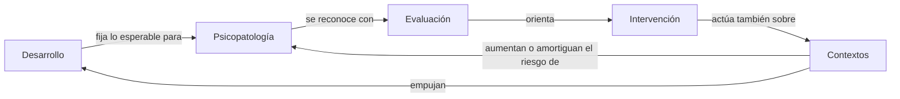

# Psicología infantil

La psicología infantil estudia cómo se forma y cambia la mente de un chico, qué puede desviarse en ese camino, cómo se evalúa lo que le pasa y qué tratamientos ayudan; esta base lo explica para madres y padres de chicos de 0 a 12 años, con la evidencia de cada idea.

Es la mirada de la disciplina, no la de la casa. Lo que se hace todos los días con un chico de 0 a 6 (el vínculo, los límites, los berrinches, el juego, el jardín) vive en [Crianza](../Crianza/crianza.md), y este tema lo enlaza sin repetirlo. Los mecanismos generales de la mente, estudiados casi siempre en adultos (motivación, aprendizaje, inteligencia, estrés), viven en [Psicología](../Psicologia/psicologia.md). Lo que queda acá es lo que esos dos dejaron afuera: las teorías del desarrollo y la etapa de 6 a 12, los contextos que pesan, los trastornos, la evaluación y los tratamientos ([alcance](ALCANCE.md)).

> [!IMPORTANT]
> Esta base resume manuales de clasificación, guías clínicas, revisiones y consensos, y dice cuál es cuál y cuánto de cada fuente se leyó. Sirve para entender y para hacer mejores preguntas, no para diagnosticar a un chico: una preocupación por su conducta, su ánimo o su aprendizaje se consulta con el pediatra o con un profesional de salud mental infantil.

## De qué está hecha la psicología infantil

El tema tiene cinco partes, que siguen el camino de una pregunta. El desarrollo dice qué es esperable a cada edad, y es la vara con la que se mide todo lo demás: un miedo a la oscuridad es normal a los 4 y puede no serlo a los 11. Los contextos (familia, pares, escuela, adversidad) empujan ese desarrollo para un lado o para el otro. La psicopatología describe cuándo una dificultad se aparta de lo esperable lo suficiente como para tener nombre. La evaluación es cómo se llega a ese nombre, o a descartarlo, y la intervención es lo que se hace después.

- [Desarrollo](Desarrollo/desarrollo-psicologico.md) — cómo cambia la mente con la edad: las teorías que lo explican, el pensamiento, la autoestima, el juicio moral y la niñez media, de 6 a 12. Entrar para saber si algo es propio de la edad.
- [Contextos](Contextos/contextos.md) — lo que rodea al chico y pesa: la familia y el divorcio, los amigos, el acoso escolar, la escuela y la adversidad o el trauma.
- [Psicopatología](Psicopatologia/psicopatologia.md) — cuándo una dificultad es un trastorno: cómo se piensa eso en un chico, los del neurodesarrollo (autismo, TDAH, aprendizaje, lenguaje, discapacidad intelectual), la ansiedad, la depresión, los de conducta y otros.
- [Evaluación](Evaluacion/evaluacion-psicologica.md) — cómo se sabe qué le pasa: quién evalúa, la entrevista y la observación, qué miden los tests y qué no, y el certificado de discapacidad y las prestaciones en Argentina.
- [Intervención](Intervencion/intervencion.md) — qué ayuda: los enfoques de terapia y su evidencia, qué funciona para cada problema, la medicación, los apoyos en la escuela y cómo elegir profesional.

Aparte de las partes, [Fundamentos](Fundamentos/fundamentos-de-psicologia-infantil.md) reúne lo que las cruza: la historia y las escuelas, por qué los estudios con chicos son difíciles de leer, los mitos, las fuentes y el glosario.

## Normal o no depende de la edad

La idea que ordena todo el tema es que en un chico casi ninguna conducta es un problema por sí sola. Llorar al separarse, no quedarse quieto, mentir o tener miedos es esperable a cierta edad y en cierta medida; lo que la disciplina mira es si la conducta es mucho más intensa o duradera que en los chicos de la misma edad y si le impide hacer su vida en casa, en la escuela o con amigos. Por eso cada nota de [Psicopatología](Psicopatologia/psicopatologia.md) empieza por el lado normal de lo que describe, y muchas veces ese lado vive en Crianza: los [berrinches](../Crianza/Emociones-y-caracter/berrinches.md) antes del trastorno oposicionista, la [adaptación](../Crianza/Escuela/adaptacion.md) antes de la ansiedad de separación, las [funciones ejecutivas](../Crianza/Emociones-y-caracter/funciones-ejecutivas.md) antes del TDAH.

## Más diagnósticos no siempre es más trastorno

Los números de algunos diagnósticos crecieron mucho, y la investigación separa cuánto es más problema y cuánto es más detección. En Estados Unidos, la vigilancia de la CDC encontró autismo en 32,2 de cada 1.000 chicos de 8 años en 2022, y dice que no puede probar por qué sube. Un estudio sueco encontró síntomas estables en la población y diagnósticos en aumento, y atribuye buena parte del aumento a cambios administrativos y de criterio (Lundström 2015). Con el TDAH pasa algo parecido: en estados de Estados Unidos con corte de ingreso escolar el 1 de septiembre, los nacidos en agosto, los más chicos del grado, recibían el diagnóstico más seguido que los nacidos en septiembre (85,1 contra 63,6 cada 10.000; Layton 2018). Eso no prueba que los diagnósticos estén mal hechos, y un análisis posterior no encontró que esos diagnósticos se disiparan más con el tiempo. La lectura prudente es doble: hay chicos con un trastorno real, y la edad, la escuela y el acceso a servicios influyen en quién llega a un diagnóstico. La discusión entera está en [Fundamentos](Fundamentos/fundamentos-de-psicologia-infantil.md).

## Dos tradiciones en el consultorio

Esta base se escribe desde la psicología científica del desarrollo, que describe, mide y compara tratamientos con ensayos. En Argentina, se dice que buena parte de la atención psicológica infantil sigue la tradición psicoanalítica (no hay datos que lo midan), que lee el síntoma como algo con un sentido que hay que escuchar más que como una conducta a modificar. Las dos se describen en [historia y escuelas](Fundamentos/historia-y-escuelas.md). Su evidencia es distinta: las terapias conductuales y cognitivo-conductuales tienen cientos de ensayos con chicos (239 de los 447 estudios de un metaanálisis de todas las terapias, Weisz 2017), y la psicodinámica tiene pocos, más concentrados en problemas emocionales, en una revisión encargada por su propia asociación (Midgley 2021). Está en [enfoques terapéuticos](Intervencion/enfoques-terapeuticos.md). Saberlo sirve para preguntarle a un profesional cómo trabaja y qué evidencia tiene lo que propone.

## Qué leer según lo que te pase

- Si la maestra o el pediatra nombraron un diagnóstico: [TDAH](Psicopatologia/Neurodesarrollo/tdah.md), [autismo](Psicopatologia/Neurodesarrollo/autismo.md), [trastornos del aprendizaje](Psicopatologia/Neurodesarrollo/trastornos-del-aprendizaje.md) como la dislexia, o los demás en [Neurodesarrollo](Psicopatologia/Neurodesarrollo/neurodesarrollo.md); después [quién evalúa](Evaluacion/quien-evalua.md) y [qué funciona para qué](Intervencion/que-funciona-para-que.md).
- Si un miedo, una preocupación o una tristeza te parecen demasiado: [ansiedad y miedos](Psicopatologia/ansiedad-y-miedos.md), [depresión infantil](Psicopatologia/depresion-infantil.md) y [psicopatología del desarrollo](Psicopatologia/psicopatologia-del-desarrollo.md), que dice cómo se separa lo normal de lo que no.
- Si se porta mal todo el tiempo y los límites no alcanzan: [trastornos de conducta](Psicopatologia/trastornos-de-conducta.md) y, para el tratamiento, los [programas para padres](../Crianza/Limites-y-autonomia/programas-para-padres.md) de Crianza.
- Si te recomendaron terapia: [enfoques terapéuticos](Intervencion/enfoques-terapeuticos.md), [qué funciona para qué](Intervencion/que-funciona-para-que.md) y [elegir profesional](Intervencion/elegir-profesional.md).
- Si te propusieron medicación: [medicación](Intervencion/medicacion.md).
- Si le hacen tests o te dieron un informe con puntajes: [tests psicológicos](Evaluacion/tests-psicologicos.md).
- Si necesitás el certificado de discapacidad, una maestra integradora o un acompañante: [CUD y prestaciones](Evaluacion/cud-y-prestaciones.md) y [apoyos en la escuela](Intervencion/apoyos-en-la-escuela.md).
- Si lo molestan en la escuela o le cuesta tener amigos: [acoso escolar](Contextos/acoso-escolar.md) y [pares y amistad](Contextos/pares-y-amistad.md).
- Si la familia pasa por una separación o algo grave: [familia](Contextos/familia.md) y [adversidad y trauma](Contextos/adversidad-y-trauma.md); para el día a día, [cambios difíciles](../Crianza/Emociones-y-caracter/cambios-dificiles.md) en Crianza.
- Si querés entender qué cambia entre los 6 y los 12: [niñez media](Desarrollo/ninez-media.md).
- Si es un chico de menos de 6 y te preguntás si su desarrollo va bien: [señales de alarma](../Crianza/Desarrollo/senales-de-alarma.md) en Crianza.
- Si una nota usa un término que no conocés: [glosario](Fundamentos/glosario-de-psicologia-infantil.md).

## Por dónde empezar

Para leer de corrido: [desarrollo](Desarrollo/desarrollo-psicologico.md), [psicopatología del desarrollo](Psicopatologia/psicopatologia-del-desarrollo.md), [evaluación](Evaluacion/evaluacion-psicologica.md) e [intervención](Intervencion/intervencion.md). Con eso se entiende el resto, que se lee según la pregunta.
