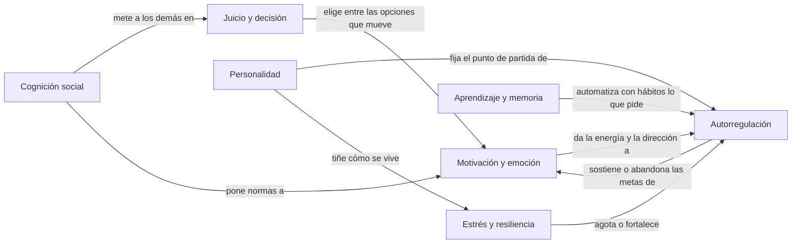

# Psicología

La psicología es el estudio científico de la mente y la conducta. En esta base es el lugar donde se explica por qué la gente hace lo que hace (qué la mueve, cómo aprende, cómo decide, en qué difiere, cómo aguanta la presión y cómo la influyen los demás) y cuánta evidencia tiene cada explicación.

El APA Dictionary la define hoy como «the scientific study of the mind and behavior», y el texto abierto OpenStax usa casi las mismas palabras. La palabra viene del griego *psyche* (alma o mente) y *-logia* (estudio). Lo que la separa de la psicología popular es el método: una afirmación vale lo que vale el estudio que la sostiene, y desde 2015 se sabe que muchos estudios famosos sostenían menos de lo que decían.

Psicología es la base de otros tres temas del área «Personas». [Desarrollo personal](../Desarrollo-personal/desarrollo-personal.md) dice cómo se practica un hábito o se maneja el estrés; [Liderazgo y dirección](../Liderazgo-y-direccion/liderazgo-y-direccion.md), cómo se motiva a un equipo o se decide en grupo; [Comunicación](../Comunicacion/comunicacion.md), cómo se convence, se da feedback o se negocia. Los tres enlazan acá el mecanismo en lugar de explicarlo de nuevo.

El tema termina donde empieza la clínica. Los trastornos, el diagnóstico y la psicoterapia quedan afuera, salvo como límite: cuando una nota toca la salud mental, dice cuándo hace falta un profesional, y ninguna nota lo reemplaza.

## De qué está hecha la conducta

Los libros de texto dividen el campo por temas. OpenStax Psychology 2e tiene 16 capítulos: introducción, métodos, biopsicología, conciencia, sensación y percepción, aprendizaje, pensamiento e inteligencia, memoria, desarrollo, motivación y emoción, personalidad, psicología social, psicología del trabajo, estrés y salud, trastornos y terapia. Esta base toma siete partes de ese mapa, las que usan los temas que se apoyan en ella. La selección y el corte son de esta base, no del campo.

- [Motivación y emoción](Motivacion-y-emocion/motivacion-y-emocion.md): por qué hacemos lo que hacemos y qué sentimos al hacerlo. Entrá acá para entender qué sostiene las ganas a largo plazo, por qué un premio puede bajarlas y qué predice el bienestar.
- [Aprendizaje y memoria](Aprendizaje-y-memoria/aprendizaje-y-memoria.md): cómo cambia la conducta con la experiencia, qué queda guardado y cómo se forma un hábito.
- [Juicio y decisión](Juicio-y-decision/juicio-y-decision.md): cómo decidimos con poca información y dónde nos equivocamos de forma predecible.
- [Autorregulación](Autorregulacion/autorregulacion.md): cómo una persona se dirige hacia una meta contra el impulso del momento, y por qué se posterga.
- [Personalidad](Personalidad/personalidad.md): en qué difieren las personas de forma estable, cuánto cambia eso de adulto y qué tests sirven para medirlo.
- [Estrés y resiliencia](Estres-y-resiliencia/estres-y-resiliencia.md): qué le pasa a una persona bajo presión, cómo se recupera y qué es el burnout.
- [Cognición social](Cognicion-social/cognicion-social.md): cómo pensamos sobre los demás y cuánto nos influyen.

Quedan afuera la biopsicología, la conciencia y el desarrollo a lo largo de la vida, que aparecen solo como mención dentro de cada mecanismo; el desarrollo y la clínica de los chicos de 0 a 12 viven en [Psicología infantil](../Psicologia-infantil/psicologia-infantil.md). La sensación y la percepción aplicadas a pantallas viven en [UX](../UX/ux.md), y la psicología del trabajo se reparte entre [Liderazgo y dirección](../Liderazgo-y-direccion/liderazgo-y-direccion.md) y esta base.

## Por qué cada nota dice qué se sostuvo

En 2015 la Open Science Collaboration repitió 100 estudios publicados en tres revistas de psicología. El 97 % de los originales tenía resultados significativos; el 36 % de las réplicas los tuvo, y los efectos de las réplicas fueron la mitad de los originales. En Many Labs 2, que repitió 28 hallazgos clásicos en 36 países con 15.305 participantes, el 54 % se reprodujo y el tamaño de efecto mediano bajó de d = 0,60 a d = 0,15.

Por eso cada nota del tema marca el estado de lo que afirma: qué se sostuvo en réplicas grandes, qué se achicó, qué cayó y qué está en disputa. Varios hallazgos que circulan en libros de divulgación y charlas cayeron: la fuerza de voluntad como recurso que se agota, el priming social, las poses de poder como cambio hormonal (esta última, según un resumen de la réplica que no se leyó entera). Las cifras que dan las notas (d, r, g, ρ) son tamaños de efecto y se leen como explica [cómo leer un estudio](Fundamentos/como-leer-un-estudio.md); los términos del campo están en el [glosario](Fundamentos/glosario-de-psicologia.md). Cómo se llegó a eso y cómo se lee un estudio está en [Fundamentos](Fundamentos/fundamentos-de-psicologia.md).

> [!IMPORTANT]
> **La crisis cambió el campo (Open Science Collaboration y Many Labs).** Los efectos publicados están inflados y una parte de los clásicos no se reproduce.
>
> **La crisis se exagera (Gilbert et al., 2016).** Sostienen que el estudio de 2015 tiene tres errores estadísticos y que los datos son compatibles con una reproducibilidad «quite high». La respuesta de los autores (Anderson et al., 2016) dice que con esos datos ni la lectura optimista ni la pesimista están justificadas todavía. Los datos posteriores apuntan a efectos más chicos: cerca de la mitad del original en Camerer et al. (2018) y un d mediano de 0,15 contra 0,60 en Many Labs 2.

## Qué leer según lo que estés haciendo

- Si tenés que decidir algo importante con poca información: [heurísticas y sesgos](Juicio-y-decision/heuristicas-y-sesgos.md), [sobreconfianza](Juicio-y-decision/sobreconfianza.md) y [cuándo confiar en la intuición](Juicio-y-decision/intuicion-experta.md).
- Si querés armar o cortar un hábito: [formación de hábitos](Aprendizaje-y-memoria/formacion-de-habitos.md), [intenciones de implementación](Autorregulacion/intenciones-de-implementacion.md) y [autocontrol](Autorregulacion/autocontrol.md).
- Si tenés que motivar a alguien, o a vos mismo, a largo plazo: [autodeterminación](Motivacion-y-emocion/autodeterminacion.md) y [establecimiento de metas](Motivacion-y-emocion/establecimiento-de-metas.md).
- Si postergás algo que sabés que tenés que hacer: [procrastinación](Autorregulacion/procrastinacion.md).
- Si tenés que elegir un test para contratar o para conocerte: [tests de personalidad](Personalidad/tests-de-personalidad.md), [Cinco Grandes](Personalidad/cinco-grandes.md) e [inteligencia](Personalidad/inteligencia.md).
- Si estás bajo presión sostenida o sospechás burnout: [burnout](Estres-y-resiliencia/burnout.md), [afrontamiento](Estres-y-resiliencia/afrontamiento.md) y [respuesta de estrés](Estres-y-resiliencia/respuesta-de-estres.md). Ninguna reemplaza a un profesional.
- Si un libro, un curso o una charla te vende un hallazgo de psicología: [crisis de replicación](Fundamentos/crisis-de-replicacion.md) y [cómo leer un estudio](Fundamentos/como-leer-un-estudio.md).
- Si tenés que entender por qué un grupo decide peor que sus miembros: [sesgos de grupo](Cognicion-social/sesgos-de-grupo.md) e [influencia social](Cognicion-social/influencia-social.md).

## Por dónde empezar a leer

1. [Cómo leer un estudio](Fundamentos/como-leer-un-estudio.md) y [crisis de replicación](Fundamentos/crisis-de-replicacion.md), para saber cuánto creerle a cada nota.
2. [Motivación y emoción](Motivacion-y-emocion/motivacion-y-emocion.md) y [Autorregulación](Autorregulacion/autorregulacion.md), que explican la distancia entre querer algo y hacerlo.
3. [Juicio y decisión](Juicio-y-decision/juicio-y-decision.md), para los errores que se repiten al decidir.
4. Las demás partes, según la necesidad.

[Fundamentos](Fundamentos/fundamentos-de-psicologia.md) reúne lo que cruza todas las partes: las escuelas y su historia, la crisis de replicación, cómo leer un estudio, la bibliografía y el glosario.
