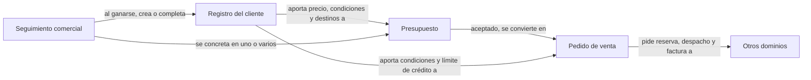

# Relación con clientes

La relación con clientes, como dominio de negocio, es lo que una empresa registra de quienes le compran y de las ventas en curso: quién es el cliente y en qué condiciones se le vende, qué ventas posibles hay abiertas, qué se le ofreció con precio y qué se comprometió a entregar. Es lo que lleva un CRM y la parte de ventas de un ERP, pero existe antes del software: una libreta de clientes, un presupuesto en papel y una nota de pedido hacen lo mismo.

Este tema trata el **registro**: qué datos, qué estados y qué reglas tiene cada objeto. Cómo se vende (prospectar, calificar, armar una propuesta que convenza, negociar) es el método, y está en [Ventas](../Ventas/ventas.md); el embudo comercial se define ahí. Si conviene invertir en que el cliente se quede, y cómo juzga el servicio, está en [Servicio y relación](../Marketing/Servicio-y-relacion/servicio-y-relacion.md), dentro de Marketing. Lo que pasa después del pedido (reservar la mercadería, despacharla, facturarla y cobrarla) es de otros dominios: [Inventario y depósitos](../Inventario-y-depositos/inventario-y-depositos.md), [Cadena de suministro y logística](../Cadena-de-suministro-y-logistica/cadena-de-suministro-y-logistica.md), [Contabilidad](../Contabilidad/contabilidad.md), [Impuestos](../Impuestos/impuestos.md) y [Tesorería](../Tesoreria/tesoreria.md). El recorrido entero está en [del pedido al cobro](../Procesos-de-negocio/del-pedido-al-cobro.md), en Procesos de negocio.

La palabra CRM se usa para dos cosas. Para Payne y Frow (2005) es una estrategia de toda la empresa, con cinco procesos, de los que el manejo de la información es uno solo; para quien construye o implementa software, es el sistema que guarda clientes y oportunidades. Este tema usa la segunda lectura y la llama por su nombre de dominio, relación con clientes; la primera se discute en [Fundamentos](Fundamentos/fundamentos-de-relacion-con-clientes.md).

## Los cuatro objetos del dominio

El tema se divide en los cuatro objetos que registra, en el orden en que aparecen en una venta: el cliente, la venta posible, la oferta con precio y el compromiso de entregar.

- [Registro del cliente](Registro-del-cliente/registro-del-cliente.md): quién es el cliente (empresa o persona, sus contactos, quién compra, quién paga y a dónde se entrega) y en qué condiciones se le vende (lista de precios, condición de pago, límite de crédito, vendedor). Es el dato maestro del dominio.
- [Seguimiento comercial](Seguimiento-comercial/seguimiento-comercial.md): las ventas posibles antes del pedido: el interesado que todavía no es cliente, la oportunidad con su monto, etapa y probabilidad, y las actividades (llamadas, visitas, correos) que dejan la historia.
- [Presupuesto](Presupuesto/presupuesto.md): la oferta formal, con renglones, precios, descuentos y una fecha hasta la que vale. Incluye cómo se pone el precio de cada renglón, cómo se presupuesta un producto con opciones y cómo se acepta.
- [Pedido de venta](Pedido-de-venta/pedido-de-venta.md): el compromiso de entregar algo a un cliente en una fecha y a un precio. Es el último objeto del dominio y el primero del recorrido del pedido al cobro: dispara la reserva, el despacho y la factura en los dominios vecinos.

Lo propio de la Argentina (la clave fiscal y la condición frente al IVA del cliente, el presupuesto en la ley, las leyendas de los documentos que no son factura, los datos personales) está en [Relación con clientes en la Argentina](relacion-con-clientes-en-argentina.md).

## Por qué el corte es por objeto

Las fuentes no dividen el dominio así. APQC no tiene una categoría de relación con clientes: reparte el registro de cuentas, los interesados, los presupuestos y los pedidos dentro de la categoría 3 (comercializar y vender), y la atención en otra (6.0 en las versiones 7 y 8, según el buscador). Los libros de texto de CRM que se pudieron consultar se ordenan por estrategia, procesos, tecnología y análisis, y casi no tratan el presupuesto ni el pedido. La división por objetos es la de los sistemas abiertos: uno de ellos encadena interesado, oportunidad, cliente, presupuesto y pedido; otro separa el CRM (antes del pedido) de Ventas (el pedido en adelante).

La base corta por objeto porque su lector principal construye software de gestión, y un objeto es lo que se modela: tiene datos, estados y reglas. Ese corte deja dos costuras a la vista. El interesado nace en el seguimiento y, al convertirse, crea registros del cliente. Y el presupuesto queda en la frontera con [la propuesta](../Ventas/La-propuesta/la-propuesta.md) de Ventas: el mismo papel puede ser las dos cosas, y cada nota dice qué parte mira.

## Ideas que cruzan todo el tema

- **Un documento cambia de estado; no se borra.** El presupuesto y el pedido pasan de borrador a confirmado y de ahí a completado, cerrado o anulado. Lo que se anula queda registrado. Es una pieza común a todo software de gestión, explicada en [documento y estados](../Software-de-gestion/Columnas-tecnicas/documento-y-estados.md); acá se ve cómo se aplica a la venta.
- **Hay dos diseños para el paso de presupuesto a pedido.** En algunos sistemas el mismo registro cambia de estado (el presupuesto confirmado *es* el pedido); en otros se crea un pedido nuevo que guarda la referencia al presupuesto. Quien construye software elige uno, y el resto del tema funciona con cualquiera de los dos.
- **Un dato, un lugar.** El cliente es el caso típico de dato maestro: se registra una vez y se usa en ventas, cobranzas y despacho. Lograrlo entre varios sistemas es el problema del [registro de oro](../Datos/Gobierno-y-calidad/datos-maestros.md); acá se ve qué tiene adentro ese registro.
- **Quien carga no siempre es quien aprovecha.** El vendedor carga la oportunidad y la actividad; el que lee el embudo es su jefe. Esa asimetría explica buena parte de los sistemas que nadie usa, y se discute en [mitos del CRM](Fundamentos/mitos-del-crm.md).

## Qué leer según lo que estés haciendo

- Si tenés que diseñar la ficha del cliente de un sistema: [cuenta y contacto](Registro-del-cliente/cuenta-y-contacto.md) y [condiciones comerciales](Registro-del-cliente/condiciones-comerciales.md); si es para la Argentina, también [Relación con clientes en la Argentina](relacion-con-clientes-en-argentina.md).
- Si tenés que modelar el embudo de ventas en un sistema: [oportunidad](Seguimiento-comercial/oportunidad.md) para los datos y [medición comercial](../Ventas/Medicion-comercial/medicion-comercial.md) para las etapas como método.
- Si tenés que decidir si separar interesados de clientes: [interesado](Seguimiento-comercial/interesado.md).
- Si tenés que diseñar el módulo de presupuestos: [presupuesto](Presupuesto/presupuesto.md), [precio y descuentos](Presupuesto/precio-y-descuentos.md) y [vigencia y aceptación](Presupuesto/vigencia-y-aceptacion.md); si lo que se vende tiene opciones, [productos configurables](Presupuesto/productos-configurables.md).
- Si tenés que diseñar el módulo de pedidos: [pedido de venta](Pedido-de-venta/pedido-de-venta.md), [fecha prometida](Pedido-de-venta/fecha-prometida.md), [tipos de pedido](Pedido-de-venta/tipos-de-pedido.md) y [cambios y cancelaciones](Pedido-de-venta/cambios-y-cancelaciones.md).
- Si vas a implementar un CRM en una empresa y te dicen que la mayoría fracasa: [mitos del CRM](Fundamentos/mitos-del-crm.md).
- Si tenés que armar la propuesta que convence al cliente: no es de acá; está en [la propuesta](../Ventas/La-propuesta/la-propuesta.md) de Ventas.
- Si tenés que tomar pedidos de un mayorista: [pedido B2B](../Comercio-electronico/Comercio-B2B/pedido-b2b.md) y [precio por cliente](../Comercio-electronico/Comercio-B2B/precio-por-cliente.md), que aplican este tema a la venta entre empresas.

Los términos con su nombre en inglés están en el [glosario de relación con clientes](Fundamentos/glosario-de-relacion-con-clientes.md).

## Orden de lectura

Para quien construye software de gestión y no conoce el dominio: esta entrada, después [Registro del cliente](Registro-del-cliente/registro-del-cliente.md), [Presupuesto](Presupuesto/presupuesto.md) y [Pedido de venta](Pedido-de-venta/pedido-de-venta.md), que son lo que toda empresa que vende registra aunque no tenga vendedores. [Seguimiento comercial](Seguimiento-comercial/seguimiento-comercial.md) importa cuando hay un equipo que sale a vender.

- [Fundamentos](Fundamentos/fundamentos-de-relacion-con-clientes.md): qué es el CRM según quién lo define, de dónde viene, qué se sabe de si funciona, fuentes y glosario.
