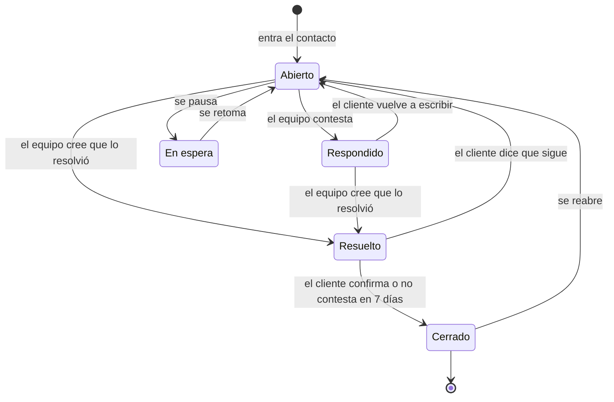

# Caso

El caso es el registro de lo que un cliente pidió después de la venta (una consulta, un pedido, un incidente o un reclamo), con sus datos, sus estados y un dueño, desde que entra hasta que se cierra. Junta todos los contactos sobre un mismo asunto, aunque lleguen por canales distintos, y es lo que las demás partes de la atención escalan, cronometran y miden.

Es el centro del [servicio al cliente](../servicio-al-cliente.md). Los [canales de atención](../Canales-de-atencion/canales-de-atencion.md) lo abren y lo actualizan; el [escalamiento](../Escalamiento/escalamiento.md) lo pasa a quien sabe o puede más; los [niveles de servicio](../Niveles-de-servicio/niveles-de-servicio.md) le ponen el reloj; la [calidad del servicio](../Calidad-del-servicio/calidad-del-servicio.md) mide lo que deja. El campo lo llama caso, ticket o issue: tres nombres para casi lo mismo, que en la práctica se reparten (como lectura de esta base) entre un CRM, una mesa de ayuda y el seguimiento de trabajo. Ninguna norma lo define como objeto de datos; sale de la práctica.

## Qué hace la empresa con un caso

APQC, en una copia de su marco de procesos sin versión declarada, separa dos procesos. El 6.2.2 «Manage customer service problems, requests, and inquiries» tiene cinco pasos: recibir, analizar, resolver, responder e identificar oportunidades de venta cruzada. El 6.2.3 «Manage customer complaints» trata aparte el reclamo: recibir, enrutar, resolver, responder y analizar. La base sigue ese corte: el caso es el registro común, y el [reclamo](reclamo.md) es un tipo de caso con reglas propias, que ISO 10002 norma de la recepción al cierre.

La oportunidad de venta que aparece en un caso no se trabaja acá: se abre una [oportunidad](../../Relacion-con-clientes/Seguimiento-comercial/oportunidad.md) en Relación con clientes, vinculada al caso.

## De qué datos está hecho

Una mesa de ayuda abierta guarda en cada caso el asunto, quién lo planteó, la descripción, el cliente, la prioridad (baja, media y alta por defecto), el tipo, la fecha de apertura, el tiempo hasta la primera respuesta, la fecha y el detalle de la resolución y el tiempo de resolución. Suma comentarios internos que solo ve el equipo. El tipo y la prioridad se deciden en la [clasificación y prioridad](clasificacion-y-prioridad.md); los tiempos se cuentan como dice [tiempos de respuesta y resolución](../Niveles-de-servicio/tiempos-de-respuesta-y-resolucion.md).

El caso apunta al cliente y no lo copia (lectura de esta base). La misma mesa de ayuda lo vincula sola cuando el remitente coincide con un cliente guardado: el cliente y sus contactos viven en [cuenta y contacto](../../Relacion-con-clientes/Registro-del-cliente/cuenta-y-contacto.md). Si el caso viene de una compra, apunta además al [pedido de venta](../../Relacion-con-clientes/Pedido-de-venta/pedido-de-venta.md) o, para un producto, a su número de serie: un sistema abierto trae el artículo y los datos de la garantía desde la serie, como cuenta [garantía y reparación](garantia-y-reparacion.md).

## Los estados del caso

Los estados no son universales: un sistema deja que cada equipo arme sus propias etapas. Lo que se repite, como lectura de esta base sobre dos sistemas, es la distinción entre abierto, en espera, resuelto y cerrado. Una mesa de ayuda abierta usa cinco estados:

El diagrama junta lo que dicen dos sistemas; las vueltas de resuelto y de cerrado a abierto, y la salida de espera, son lectura de esta base. Resuelto y cerrado no son lo mismo. Resuelto es lo que cree el equipo; cerrado, lo que confirma el cliente. Esa mesa de ayuda cierra sola si el cliente no responde en 7 días. El estado en espera importa para el reloj: la misma práctica separa el tiempo de resolución total del tiempo de resolución que excluye la espera del cliente, y reinicia las métricas si el caso se reabre o se divide.

## El dueño del caso

Cada caso tiene un responsable, asignado a mano o por regla. Un sistema reparte por cantidad total de casos o por cantidad de abiertos y saltea a quien está de licencia. Quien atiende puede pasar el caso a otro nivel o a otro equipo, que es [escalar](../Escalamiento/escalamiento.md); el dueño cambia, el caso sigue siendo el mismo (lectura de esta base).

## Un caso aunque haya varios contactos

El cliente que escribe, llama y vuelve a escribir por lo mismo genera tres contactos y un caso. La práctica más simple pone el número del caso en el asunto de cada correo, para que las respuestas caigan en el mismo hilo. Cuando igual se crean dos casos por lo mismo, un sistema permite fusionar duplicados y muestra un puntaje de similitud antes de confirmar. Cómo se une la historia entre canales está en [canales de atención](../Canales-de-atencion/canales-de-atencion.md).

La operación inversa es dividir un caso que trae dos asuntos. La única regla con fuente es la del reloj: una mesa de ayuda reinicia las métricas al dividir.

## Cierre y reapertura

Cerrar el caso termina el reloj y deja el resultado para la medición, y reabrirlo lo devuelve a abierto; ambas cosas son lectura de esta base, y la fuente solo dice que reabrir reinicia las métricas. Las reaperturas son, a la vez, una señal de que el caso se cerró antes de tiempo y una de las [métricas de atención](../Calidad-del-servicio/metricas-de-atencion.md).

> [!NOTE] Sin fuente todavía: reglas de reapertura. No hay norma ni fuente neutral sobre cuánto tiempo puede reabrirse un caso cerrado ni sobre cuándo conviene abrir uno nuevo vinculado al anterior.

## Cómo falla el caso

Como lectura de esta base, el caso falla de tres maneras. Se parte: el mismo asunto queda en varios casos, cada canal con el suyo, y nadie ve la historia entera. Se cierra en falso: el equipo pasa a resuelto lo que el cliente no confirmó, y el tablero mejora mientras el cliente vuelve a llamar. Se pierde el dueño: el caso pasa de equipo en equipo sin que nadie lo tenga, que es el problema que el [escalamiento](../Escalamiento/escalamiento.md) tiene que evitar.

## Qué hay en Caso

- [Clasificación y prioridad](clasificacion-y-prioridad.md) — tipo de caso, categoría, impacto y urgencia: qué es el caso y cuánto apura.
- [Reclamo](reclamo.md) — la queja como tipo de caso normado por ISO 10002, de la recepción al cierre.
- [Garantía y reparación](garantia-y-reparacion.md) — el caso sobre un producto: garantía, autorización de devolución, cambio y reparación.
