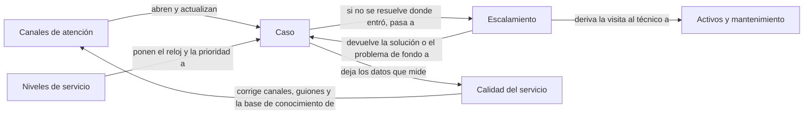

# Servicio al cliente

El servicio al cliente, como dominio de negocio, es cómo una empresa atiende a quienes ya le compraron: por dónde entra cada consulta, pedido o reclamo, cómo se registra como caso, a quién se escala cuando quien atiende no puede resolver, qué tiempos se prometen y cómo se mide si la atención es buena. Es lo que lleva una mesa de ayuda o la parte de atención de un CRM, pero existe antes del software: un cuaderno de reclamos en el mostrador hace lo mismo.

Este tema trata la **operación**: qué se registra, con qué estados, quién decide y contra qué reloj. Por qué el cliente juzga la atención como la juzga, qué conviene prometerle y si vale la pena invertir en que se quede está en [Servicio y relación](../Marketing/Servicio-y-relacion/servicio-y-relacion.md), dentro de Marketing; la [recuperación del servicio](../Marketing/Servicio-y-relacion/recuperacion-del-servicio.md) explica qué espera quien reclama, y este tema, cómo se tramita su reclamo. Quién es el cliente y qué compró está en [Relación con clientes](../Relacion-con-clientes/relacion-con-clientes.md): el caso apunta a ese registro y no lo copia.

El tema termina donde la atención necesita mandar a alguien. El servicio de campo (el técnico que va a la casa del cliente, la orden de trabajo, los repuestos) es del tema [Activos y mantenimiento](../Activos-y-mantenimiento/Servicio-de-campo/servicio-de-campo.md); acá se decide que hace falta y se deriva. Tampoco son de acá el paquete que vuelve en una devolución ([devoluciones](../Comercio-electronico/Operaciones-del-comercio/devoluciones.md), en Comercio electrónico), la mercadería que vuelve al stock (Inventario y depósitos) ni la nota de crédito ([Contabilidad](../Contabilidad/contabilidad.md)). Los retiros de un producto del mercado y los avisos a un regulador, que APQC pone en la misma categoría, quedan fuera del tema.

## De qué está hecha la atención

El tema sigue lo que le pasa a un contacto: entra por un canal, se registra como caso, se escala si quien atiende no puede resolverlo, corre contra un tiempo prometido y, al final, se mide. El caso es el centro: las otras cuatro verticales le agregan algo o lo miran desde afuera.

- [Canales de atención](Canales-de-atencion/canales-de-atencion.md): por dónde entra el contacto (mostrador, teléfono, correo, chat, mensajería, portal), qué se resuelve sin una persona con el [autoservicio](Canales-de-atencion/autoservicio.md) y cuántas personas hacen falta para atender, que es el [dimensionamiento del equipo](Canales-de-atencion/dimensionamiento-del-equipo.md).
- [Caso](Caso/caso.md): el registro de lo que pidió el cliente, con sus datos, sus estados y su dueño, desde que entra hasta que se cierra. Incluye cómo se clasifica y se prioriza, el reclamo como tipo de caso con reglas propias, y el caso sobre un producto en garantía.
- [Escalamiento](Escalamiento/escalamiento.md): qué pasa cuando quien atiende no puede resolver: se pasa a quien sabe más (primer, segundo y tercer nivel) o a quien puede decidir más, se deriva al técnico si hace falta una visita, y los casos que se repiten se juntan en un problema para atacar la causa.
- [Niveles de servicio](Niveles-de-servicio/niveles-de-servicio.md): el acuerdo que fija en cuánto tiempo se responde y se resuelve cada caso según su prioridad, cómo corre el reloj, qué pasa cuando se vence y qué acuerdos internos lo sostienen.
- [Calidad del servicio](Calidad-del-servicio/calidad-del-servicio.md): si la atención es buena, medida de tres formas: las métricas de la operación, las encuestas después de cada caso y la escucha de las conversaciones y los reclamos.

Lo propio de la Argentina (el trato digno, la garantía legal y el servicio técnico, el botón de baja, los plazos de respuesta y las vías de reclamo ante el Estado) está en [Servicio al cliente en la Argentina](servicio-al-cliente-en-argentina.md).

## Por qué el corte es este

Ninguna fuente divide el dominio en estas cinco partes. La categoría de servicio al cliente de APQC (6.0 en la copia consultada) lo parte en estrategia, gestión de los contactos, servicio posventa, retiros de producto y evaluación. La norma ISO 18295-1 de centros de contacto lo parte, según su índice, en requisitos de la relación con el cliente, el liderazgo, el personal, los procesos, la infraestructura y la relación con la empresa contratante. ITIL, que viene de la mesa de ayuda de sistemas, lo reparte en prácticas: mesa de servicio, incidentes, pedidos, problemas y niveles de servicio (según resúmenes de ITIL 4).

La base corta así porque su lector construye software de gestión, y cada vertical es un objeto o una regla que un sistema modela: el canal que abre el caso, el caso con sus estados, la regla de escalamiento, el acuerdo con su reloj y la métrica. El escalamiento es la vertical con menos respaldo: ninguna de esas divisiones lo trata como categoría propia, sino como un paso dentro del incidente (ITIL) o del enrutamiento del reclamo (APQC). Las razones y las otras divisiones están en [Fundamentos](Fundamentos/fundamentos-de-servicio-al-cliente.md).

## Ideas que cruzan todo el tema

- **Un contacto no es un caso.** El cliente puede escribir, llamar y volver a escribir por lo mismo: son tres contactos y un caso. Juntarlos es lo que se llama atención omnicanal, y es la primera decisión de diseño de una mesa de ayuda (lectura de esta base).
- **Resuelto no es cerrado.** Quien atiende cree que resolvió; el cliente lo confirma, o pasa un plazo sin que conteste. Los sistemas leídos separan los dos estados, y el tiempo de resolución cambia según cuál se mire.
- **Nivel tiene tres sentidos.** El nivel de soporte (primer, segundo, tercer nivel) dice quién atiende; el nivel de servicio de un centro de contacto es el porcentaje de llamadas atendidas en un tiempo (por ejemplo, 80% en 20 segundos); el acuerdo de nivel de servicio es lo que se le promete al cliente. El [glosario](Fundamentos/glosario-de-servicio-al-cliente.md) los separa.
- **El tablero puede estar verde con el cliente enojado.** Se puede cumplir el acuerdo, bajar el tiempo de atención y subir la resolución al primer contacto mientras el cliente tiene que volver a llamar. Dixon, Freeman y Toman (2010) encontraron que el 22% de las rellamadas venían de problemas derivados del primero, aunque ese se hubiera resuelto bien. Cómo se mide sin engañarse está en [Calidad del servicio](Calidad-del-servicio/calidad-del-servicio.md).
- **El mejor caso es el que no entra.** Para una corriente de la práctica, cada contacto es la señal de algo que falló antes (una factura confusa, un producto que no se entiende), y la atención tiene que devolver esa señal a quien puede arreglarla. Es el sentido de [problema y causa raíz](Escalamiento/problema-y-causa-raiz.md) y del [monitoreo de calidad](Calidad-del-servicio/monitoreo-de-calidad.md).

## Qué leer según lo que estés haciendo

- Si tenés que diseñar el módulo de casos o la mesa de ayuda de un sistema: [caso](Caso/caso.md), [clasificación y prioridad](Caso/clasificacion-y-prioridad.md) y [tiempos de respuesta y resolución](Niveles-de-servicio/tiempos-de-respuesta-y-resolucion.md); si es para la Argentina, también [Servicio al cliente en la Argentina](servicio-al-cliente-en-argentina.md).
- Si tenés que unir varios canales en un solo lugar: [canales de atención](Canales-de-atencion/canales-de-atencion.md) y [caso](Caso/caso.md).
- Si tenés que armar un libro de reclamos o un circuito de quejas: [reclamo](Caso/reclamo.md), y para qué espera quien reclama, [recuperación del servicio](../Marketing/Servicio-y-relacion/recuperacion-del-servicio.md).
- Si tenés que modelar garantías, cambios o reparaciones: [garantía y reparación](Caso/garantia-y-reparacion.md) y [derivación al técnico](Escalamiento/derivacion-al-tecnico.md); la logística de la devolución está en [devoluciones](../Comercio-electronico/Operaciones-del-comercio/devoluciones.md).
- Si tenés que escribir o vender un acuerdo de nivel de servicio: [niveles de servicio](Niveles-de-servicio/niveles-de-servicio.md), [incumplimiento del acuerdo](Niveles-de-servicio/incumplimiento-del-acuerdo.md) y [acuerdos internos](Niveles-de-servicio/acuerdos-internos.md); para no prometer lo que no se puede cumplir, [gestión de las promesas](../Marketing/Servicio-y-relacion/gestion-de-las-promesas.md).
- Si tenés que decidir cuántas personas atienden o con qué turnos: [dimensionamiento del equipo](Canales-de-atencion/dimensionamiento-del-equipo.md).
- Si tenés que organizar quién atiende qué: [niveles de soporte](Escalamiento/niveles-de-soporte.md) y [escalamiento](Escalamiento/escalamiento.md).
- Si tenés que armar el tablero de la atención o elegir una encuesta: [métricas de atención](Calidad-del-servicio/metricas-de-atencion.md) y [encuestas de satisfacción](Calidad-del-servicio/encuestas-de-satisfaccion.md); la disputa sobre el NPS como predictor está en [boca a boca y referidos](../Marketing/Canales/boca-a-boca-y-referidos.md#cómo-se-mide-y-qué-pasa-con-el-nps).
- Si te proponen un bot o un portal para bajar la carga: [autoservicio](Canales-de-atencion/autoservicio.md) y [mitos del servicio al cliente](Fundamentos/mitos-del-servicio-al-cliente.md).
- Si tenés que mandar un técnico a la casa del cliente: no es de acá; empezá por [derivación al técnico](Escalamiento/derivacion-al-tecnico.md) y seguí en [servicio de campo](../Activos-y-mantenimiento/Servicio-de-campo/servicio-de-campo.md), del tema Activos y mantenimiento.

Los términos con su nombre en inglés están en el [glosario de servicio al cliente](Fundamentos/glosario-de-servicio-al-cliente.md).

## Orden de lectura

Para quien construye software de gestión y no conoce el dominio: esta entrada, después [Caso](Caso/caso.md) y [Niveles de servicio](Niveles-de-servicio/niveles-de-servicio.md), que son lo que toda mesa de ayuda registra. [Escalamiento](Escalamiento/escalamiento.md) importa cuando hay más de un equipo; [Canales de atención](Canales-de-atencion/canales-de-atencion.md), cuando hay más de un canal o un equipo grande; [Calidad del servicio](Calidad-del-servicio/calidad-del-servicio.md), cuando ya hay datos para medir.

- [Fundamentos](Fundamentos/fundamentos-de-servicio-al-cliente.md): cómo divide el campo la atención, sus escuelas, su historia, las cifras que circulan sin fuente, las fuentes y el glosario.
