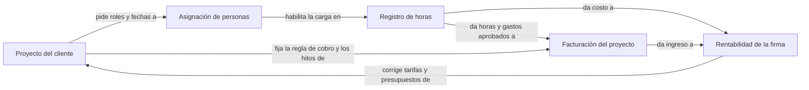

# Servicios profesionales y proyectos

Los servicios profesionales, como dominio de negocio, son lo que registra y gestiona una firma que vende trabajo de personas por proyecto: el proyecto con el cliente y su presupuesto, quién trabaja en qué, las horas que se cargan, cómo ese trabajo se vuelve factura y si el proyecto y la firma ganan plata. Es lo que lleva un PSA (*professional services automation*) o el módulo de proyectos de un ERP, pero existe antes del software: una carpeta por cliente, una planilla de horas y un talonario de facturas hacen lo mismo.

Vale para cualquier firma que vende horas de gente: una consultora, un estudio contable o jurídico, una agencia, un estudio de arquitectura o de ingeniería, una empresa que desarrolla software a medida. Lo que tienen en común es que el inventario es el tiempo de las personas, que no se puede guardar: una hora que nadie cargó a un proyecto no se vende nunca.

## Dónde termina este tema

El tema trata el **registro y la plata** del proyecto con un cliente, no el método de llevarlo. Cómo se encuadra, se planifica, se pronostica y se sigue cualquier proyecto está en [Gestión de proyectos](../Gestion-de-proyectos/gestion-de-proyectos.md); acá entra solo lo que de eso se registra con un precio y un cliente del otro lado. El ciclo con el cliente en un desarrollo de software, y cómo se elige entre precio cerrado y tiempo y materiales según quién carga el riesgo, están en el [encargo](../Desarrollo/Encargo/encargo.md) y en [modelos de contrato y cobro](../Desarrollo/Encargo/modelos-de-contrato-y-cobro.md). Por qué una firma de servicios gana o pierde plata como modelo de negocio (la ecuación de Maister, la pirámide) está en [economía de una firma de servicios](../Emprender/Modelo-de-negocio/economia-de-una-firma-de-servicios.md), y cuánto trabajo entra antes de que el equipo se llene, en [capacidad de un equipo de servicio](../Emprender/Modelo-de-negocio/capacidad-de-un-equipo-de-servicio.md).

Con los otros dominios de la empresa, el límite sigue el documento. El presupuesto y su aceptación son de [Relación con clientes](../Relacion-con-clientes/relacion-con-clientes.md): el presupuesto aceptado o el contrato firmado abre el proyecto. El asiento, el ingreso según la NIIF 15 y el costeo por órdenes son de [Contabilidad](../Contabilidad/contabilidad.md). Cuántas horas trabajó una persona, para pagarle, es del tema Administración de personal y nómina; a qué proyecto se imputan y cuáles se cobran, de acá. El cobro es de Tesorería, la factura electrónica y las retenciones, de Impuestos, y el recorrido entero del proyecto al cobro, de Procesos de negocio; esos tres temas todavía no están escritos. La tabla completa de límites está en el [alcance del tema](ALCANCE.md).

## De qué está hecha la gestión de una firma de servicios

El tema se divide en cinco partes: el proyecto como contrato con el cliente, las personas que se le asignan, las horas que trabajan, la factura que sale de esas horas o de los hitos, y la rentabilidad que resulta.

- [Proyecto del cliente](Proyecto-del-cliente/proyecto-del-cliente.md): el proyecto como registro económico, desde que se acepta la venta hasta el cierre financiero; su presupuesto en horas, costo y precio, los hitos y las órdenes de cambio. Entrá acá para saber qué se registra al firmar y qué cambia cuando cambia el alcance.
- [Asignación de personas](Asignacion-de-personas/asignacion-de-personas.md): quién trabaja en qué proyecto a nivel de la firma: la demanda que viene de la cartera y del embudo, los roles y las habilidades, las reservas tentativas y firmes. Entrá acá cuando dos proyectos se pelean por la misma persona.
- [Registro de horas](Registro-de-horas/registro-de-horas.md): la hora imputada a un proyecto, con quién la carga, quién la aprueba y qué pasa si se corrige; los gastos del proyecto, y por qué el dato sale peor de lo que parece. Entrá acá para diseñar la carga de horas.
- [Facturación del proyecto](Facturacion-del-proyecto/facturacion-del-proyecto.md): las reglas con que el trabajo se vuelve factura según el modelo de cobro (por hora, por hito, por abono o bolsa de horas) y el trabajo en curso, que es la diferencia entre lo hecho, lo facturado y el ingreso. Entrá acá para saber qué se factura y cuándo.
- [Rentabilidad de la firma](Rentabilidad-de-la-firma/rentabilidad-de-la-firma.md): el costo de la hora, el margen del proyecto y del cliente, la utilización y la realización. Entrá acá para saber si un proyecto o la firma ganan plata.

Lo propio de la Argentina (la factura de un servicio, los honorarios con arancel, el ajuste por inflación y las retenciones) está en [Servicios profesionales en la Argentina](servicios-profesionales-en-argentina.md).

## Por qué el corte es este

APQC, un marco de procesos pensado para comparar empresas entre sí, no corta el dominio así. Su categoría 5.0 «Deliver Service» tiene tres partes: el gobierno y la estrategia de la entrega (5.1), los recursos (5.2) y la entrega al cliente (5.3), que va de iniciar a ejecutar y a completar. La facturación no está ahí sino en finanzas (9.2.2 «Invoice customer»), la utilización también (9.5.1.5 «Analyze and report employee utilization») y la oferta con su dotación y su precio, en ventas (3.5.3). La hora imputada a un proyecto no tiene un proceso propio en el marco.

La base corta por objeto, como hace con [Relación con clientes](../Relacion-con-clientes/relacion-con-clientes.md). Su lector principal construye software de gestión, y un objeto es lo que se modela: tiene datos, estados y reglas. Es también como lo corta la documentación de un sistema de gestión de servicios leído para este tema: proyectos, planificación de recursos, horas y la facturación atada a la línea del contrato. El corte junta en un tema lo que APQC reparte en cuatro categorías, y la rentabilidad, que el marco no trata como parte de la entrega, entra porque la firma la mide con indicadores propios del rubro.

## Ideas que cruzan todo el tema

- **La hora es la unidad de todo, aunque no sea la unidad del precio.** Una misma hora cargada sirve para tres cosas: facturar si el contrato es por hora, costear el proyecto aunque sea a precio cerrado, y medir cuánto trabaja la firma para sus clientes. Un sistema que guarda la hora una sola vez, con su proyecto, su tarea, su costo y su tarifa, alimenta las tres; uno que la carga tres veces las hace discrepar.
- **Reconocer el ingreso no es facturar.** La factura sigue el calendario que se pactó con el cliente; el ingreso sigue el trabajo hecho, según la NIIF 15. De esa diferencia nacen el trabajo en curso sin facturar y el cobro por adelantado, que se explican en [trabajo en curso](Facturacion-del-proyecto/trabajo-en-curso.md).
- **El modelo de cobro decide qué registro importa.** En un proyecto por hora, la hora aprobada es la factura; en uno a precio cerrado, la hora es costo y lo que importa es el avance y el hito. El modelo se elige al vender, por [quién carga el riesgo](../Desarrollo/Encargo/modelos-de-contrato-y-cobro.md); este tema dice qué se registra con cada uno.
- **Lo que se mide como meta se deforma.** La utilización y las horas facturables son buenos datos y malas metas: si el objetivo es cargar horas, la gente carga horas. La crítica viene de los estudios jurídicos, donde nació la hora facturable, y está en [Fundamentos](Fundamentos/fundamentos-de-servicios-profesionales.md).

## Qué leer según lo que estés haciendo

- Si tenés que diseñar el módulo de proyectos de un sistema de gestión: [proyecto del cliente](Proyecto-del-cliente/proyecto-del-cliente.md), [presupuesto del proyecto](Proyecto-del-cliente/presupuesto-del-proyecto.md), [hitos y entregables](Proyecto-del-cliente/hitos-y-entregables.md) y [orden de cambio](Proyecto-del-cliente/orden-de-cambio.md); el proyecto como dimensión contable, en [centros de costo](../Contabilidad/Contabilidad-de-gestion/centros-de-costo.md).
- Si tenés que diseñar la carga de horas: [registro de horas](Registro-de-horas/registro-de-horas.md), [hoja de horas](Registro-de-horas/hoja-de-horas.md) y [calidad del registro](Registro-de-horas/calidad-del-registro.md); si se cargan gastos, [gastos del proyecto](Registro-de-horas/gastos-del-proyecto.md).
- Si tenés que facturar proyectos: [facturación del proyecto](Facturacion-del-proyecto/facturacion-del-proyecto.md) y la nota del modelo que te toque: [por hora](Facturacion-del-proyecto/facturacion-por-hora.md), [por hito](Facturacion-del-proyecto/facturacion-por-hito.md) o [abono y bolsa de horas](Facturacion-del-proyecto/abono-y-bolsa-de-horas.md); para el cierre de mes, [trabajo en curso](Facturacion-del-proyecto/trabajo-en-curso.md) e [ingresos y cuentas a cobrar](../Contabilidad/Operaciones/ingresos-y-cuentas-a-cobrar.md).
- Si tenés que decidir a quién poner en un proyecto o si contratar: [asignación de personas](Asignacion-de-personas/asignacion-de-personas.md), [roles y habilidades](Asignacion-de-personas/roles-y-habilidades.md), [reserva de personas](Asignacion-de-personas/reserva-de-personas.md) y [demanda y capacidad](Asignacion-de-personas/demanda-y-capacidad.md); la cuenta de cuántos clientes entran, en [capacidad de un equipo de servicio](../Emprender/Modelo-de-negocio/capacidad-de-un-equipo-de-servicio.md).
- Si tenés que saber si un proyecto o un cliente dejan plata: [costo y margen del proyecto](Rentabilidad-de-la-firma/costo-y-margen-del-proyecto.md), [utilización](Rentabilidad-de-la-firma/utilizacion.md) y [realización](Rentabilidad-de-la-firma/realizacion.md).
- Si tenés que poner el precio de un proyecto: no es de acá; el riesgo del precio cerrado está en [proyecto a precio cerrado](../Producto/Planificacion-y-entrega/proyecto-a-precio-cerrado.md) y cómo cobra una consultora, en [pricing y empaquetado](../Producto/Monetizacion/pricing-y-empaquetado.md#cómo-cobra-una-consultora-o-una-agencia).
- Si tenés que planificar o seguir el avance de un proyecto como método: no es de acá; está en [Gestión de proyectos](../Gestion-de-proyectos/gestion-de-proyectos.md).
- Si facturás servicios en la Argentina: [Servicios profesionales en la Argentina](servicios-profesionales-en-argentina.md).

Los términos con su nombre en inglés están en el [glosario de servicios profesionales](Fundamentos/glosario-de-servicios-profesionales.md).

## Orden de lectura

Para quien construye software de gestión y no conoce el dominio: esta entrada, [Proyecto del cliente](Proyecto-del-cliente/proyecto-del-cliente.md), [Registro de horas](Registro-de-horas/registro-de-horas.md) y [Facturación del proyecto](Facturacion-del-proyecto/facturacion-del-proyecto.md), que es el recorrido de la plata. [Asignación de personas](Asignacion-de-personas/asignacion-de-personas.md) importa cuando la firma tiene más de un puñado de personas, y [Rentabilidad de la firma](Rentabilidad-de-la-firma/rentabilidad-de-la-firma.md), cuando ya hay datos para medir.

- [Fundamentos](Fundamentos/fundamentos-de-servicios-profesionales.md): de dónde vienen la hora facturable y el PSA, las escuelas (las palancas de Maister, el precio por valor, el servicio productizado), lo que se sabe y lo que no, y las fuentes.
