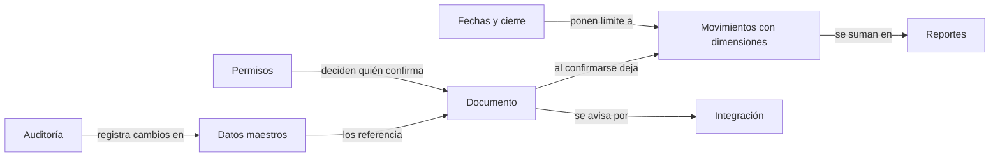

# Columnas técnicas

Las columnas técnicas son las once piezas de diseño que comparte todo software de gestión, sea cual sea el dominio que lleve: datos maestros, documento con estados, registro de movimientos, fechas, cantidades y monedas, estructura de la organización, permisos, auditoría, integración, configuración y reportes. Resueltas una vez, sirven igual para ventas, compras, stock, producción o nómina.

Son el esqueleto de las [categorías de producto](../Categorias-de-producto/categorias-de-producto.md): un ERP, un CRM o un sistema de mantenimiento llevan dominios distintos sobre las mismas piezas. También ponen el límite a lo que se adapta en la [implementación](../Implementacion/implementacion.md), porque lo que una columna no permite configurar hay que programarlo. El saber de cada dominio (qué es un asiento, una orden de compra, una liquidación) no está acá: vive en su tema del área Gestión de la empresa, y los recorridos que cruzan dominios, en [Procesos de negocio](../../Procesos-de-negocio/procesos-de-negocio.md).

## Qué hace que una pieza sea columna

Con el criterio de esta base, una pieza es columna si cumple tres condiciones: aparece en todos los dominios, la reconoce una fuente de diseño y la documentación de los productos la resuelve como algo propio. La fuente de diseño principal son los patrones de análisis de Martin Fowler. Según el índice de *Analysis Patterns*, tratan la contabilidad y el inventario con las mismas piezas. Además cubren la parte con roles, la jerarquía de la organización, el nivel de conocimiento y el tiempo. Hohpe y Woolf aportan la integración; Soh, Sia y Tay-Yap (2000), los desajustes que aparecen cuando una columna del producto no calza con la empresa.

La prueba es la de un dominio cualquiera. El [pedido de venta](../../Relacion-con-clientes/Pedido-de-venta/pedido-de-venta.md), la [orden de compra](../../Compras-y-abastecimiento/Orden-de-compra/orden-de-compra.md), la [orden de producción](../../Produccion/Ejecucion-en-planta/orden-de-produccion.md), la [orden de trabajo](../../Activos-y-mantenimiento/Orden-de-trabajo/orden-de-trabajo.md) y la [hoja de horas](../../Servicios-profesionales-y-proyectos/Registro-de-horas/hoja-de-horas.md) son, para el software, el mismo problema: un documento con estados que referencia maestros, deja movimientos con fecha, cantidad y moneda, y lo confirma alguien con permiso.

## Las once columnas y dónde se pisan

| Columna | Qué resuelve | Dónde se pisa con otra |
|---|---|---|
| [Datos maestros y partes](datos-maestros-y-partes.md) | un solo registro por cliente, proveedor, artículo o cuenta, con la parte que tiene varios roles | qué maestros se comparten entre empresas (estructura); quién los cambió (auditoría) |
| [Documento y estados](documento-y-estados.md) | borrador, confirmado y anulado; numeración; aprobaciones | al confirmarse produce movimientos; quién confirma es de permisos |
| [Registro de movimientos y dimensiones](registro-de-movimientos-y-dimensiones.md) | filas que no se editan, reglas de contabilización, partida doble frente a REA, dimensiones | la fecha de cada fila (fechas); las dimensiones existen para el reporte |
| [Fechas, vigencias y cierre](fechas-vigencias-y-cierre.md) | fecha del hecho y de registro, datos con vigencia, fecha de bloqueo | la fecha de registro es la de la auditoría; el cierre lo protegen los permisos |
| [Cantidades, unidades y monedas](cantidades-unidades-y-monedas.md) | un número siempre con su unidad o su moneda; conversión, redondeo, diferencia de cambio | la unidad vive en el maestro; el tipo de cambio depende de la fecha |
| [Estructura de la organización](estructura-de-la-organizacion.md) | varias empresas, sucursales y depósitos; qué se comparte | una sucursal puede ser dimensión o empresa; restringe los permisos |
| [Permisos y separación de funciones](permisos-y-separacion-de-funciones.md) | rol sobre documento, restricción por registro, incompatibilidades | las acciones son los estados del documento; lo permitido deja rastro en la auditoría |
| [Auditoría de cambios](auditoria-de-cambios.md) | quién cambió qué en lo que se edita: maestros, configuración, permisos | lo que no se edita ya es su propia pista (movimientos) |
| [Integración y migración](integracion-y-migracion.md) | qué sistema manda en cada dato, estilos de integración, carga inicial | la carga inicial es de maestros y saldos; leer tablas por afuera es personalizar |
| [Configurar o personalizar](configurar-o-personalizar.md) | comportamiento como datos, extensión, modificación y su costo al actualizar | casi todo lo de las otras columnas es configurable o no; ahí se decide |
| [Reportes operativos y legales](reportes-operativos-y-legales.md) | los listados del día y los libros con corte a una fecha | dependen del cierre (fechas) y de las dimensiones (movimientos) |

## Una venta que pasa por todas

Una venta muestra cómo se encadenan (ejemplo de esta base). El vendedor arma un pedido en borrador para un cliente, que es una parte con rol de cliente, y un artículo que se vende por caja. El pedido es de una de las dos empresas del grupo y lleva su sucursal como dimensión. El precio sale de la lista vigente a la fecha del pedido, en la moneda del cliente.

Al confirmarlo, el sistema verifica que el vendedor puede confirmar pedidos de su zona y le asigna el número de la serie. El remito deja una salida de stock convertida a unidades, y la factura deja un asiento con su centro de costo y la cuenta corriente del cliente, todo con fecha dentro de un período abierto. Un aviso sale hacia la tienda online para bajar el stock publicado. Esa noche, el listado de pedidos pendientes ya no lo muestra, y a fin de mes la factura aparece en el libro de IVA.

## Lo que no es columna

Algunas piezas parecen columnas y son de otra capa o atributos de una columna:

- Multi-tenancy es cómo se aloja un software vendido como servicio, no cómo se modela el negocio: [multi-tenancy](../../Arquitectura/Sistemas-distribuidos/multi-tenancy.md).
- La saga, el outbox y la clave de idempotencia son patrones de Arquitectura que la integración usa: [saga](../../Arquitectura/Sistemas-distribuidos/saga.md), [outbox](../../Arquitectura/Sistemas-distribuidos/outbox.md) y [clave de idempotencia](../../Arquitectura/Sistemas-distribuidos/clave-de-idempotencia.md).
- Las [transacciones](../../Bases-de-datos/Transacciones/transacciones.md) de la base de datos son de Bases de datos.
- La parte con roles, la numeración, las aprobaciones, las dimensiones y la carga inicial son atributos de otras columnas (datos maestros, documento, movimientos e integración) y viven adentro de ellas.

## Cómo falla una columna

Una columna mal resuelta falla en todos los dominios a la vez: un sistema que edita movimientos lo hace con el stock, la cuenta corriente y el asiento.

Soh, Sia y Tay-Yap (2000) dan el mapa de un producto que se compra y no calza. Según los extractos de su estudio de un hospital de Singapur, los desajustes entre el paquete y la organización son de tres tipos, y cada uno cae sobre una columna. Los de datos (formato o relaciones del modelo) tocan los [datos maestros](datos-maestros-y-partes.md) y son los más caros, porque obligan a reestructurar tablas del núcleo. Los funcionales de acceso y de control tocan los [permisos](permisos-y-separacion-de-funciones.md). Los de salida tocan los [reportes](reportes-operativos-y-legales.md) y fueron los más frecuentes en ese caso. Cómo se decide qué hacer con cada desajuste es del [análisis de brechas](../Implementacion/analisis-de-brechas.md).

## Qué hay en las columnas técnicas

Para construir un sistema, el orden de lectura es el de la venta de arriba: primero el documento, los movimientos y los maestros, después el resto.

- [Documento y estados](documento-y-estados.md) — el ciclo borrador, confirmado y anulado, cuándo se numera y cómo se aprueba; la unidad de trabajo de todo el sistema.
- [Registro de movimientos y dimensiones](registro-de-movimientos-y-dimensiones.md) — de documento a movimiento por reglas, partida doble frente a REA, y las dimensiones de cada fila.
- [Datos maestros y partes](datos-maestros-y-partes.md) — la parte con roles, qué es maestro y qué transacción, qué copia el documento del maestro.
- [Fechas, vigencias y cierre](fechas-vigencias-y-cierre.md) — las dos fechas de cada hecho, los datos que valen desde y hasta, la fecha de bloqueo.
- [Cantidades, unidades y monedas](cantidades-unidades-y-monedas.md) — conversiones, redondeo y varias monedas en un mismo documento.
- [Estructura de la organización](estructura-de-la-organizacion.md) — varias empresas y sucursales, qué se comparte, y por qué no es multi-tenancy.
- [Permisos y separación de funciones](permisos-y-separacion-de-funciones.md) — las tres capas de permisos y la incompatibilidad como dato configurable.
- [Auditoría de cambios](auditoria-de-cambios.md) — la pista de lo que se edita: maestros, configuración y permisos.
- [Integración y migración](integracion-y-migracion.md) — qué sistema manda en cada dato, los cuatro estilos de Hohpe y Woolf y la carga inicial.
- [Configurar o personalizar](configurar-o-personalizar.md) — el nivel de conocimiento de Fowler, configurar, extender o modificar, y lo que cuesta cada uno al actualizar.
- [Reportes operativos y legales](reportes-operativos-y-legales.md) — los listados del día y los libros con corte a una fecha; el análisis va a Datos.
