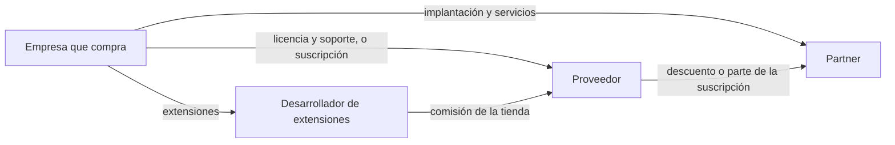

# Mercado y economía

Mercado y economía es la parte del software de gestión que trata cómo se vende y quién gana qué: el proveedor cobra licencia, soporte o suscripción, los partners revenden e implantan, los terceros venden extensiones, y quien compra paga todo eso más su propio tiempo. Explica por qué el negocio del proveedor es la base instalada y por qué la licencia es la parte menor del costo para el cliente.

Es la última de las verticales de [Software de gestión](../software-de-gestion.md). Cobra los productos que define [Categorías de producto](../Categorias-de-producto/categorias-de-producto.md) y decide quién hace la [implementación](../Implementacion/implementacion.md) y cuánto cuesta. El modelo de negocio del software en general (SaaS, software con servicios) es de [Emprender](../../Emprender/Modelo-de-negocio/saas.md), las plataformas y su ecosistema son de [Producto](../../Producto/Plataformas/ecosistema-de-terceros.md) y los costos de cambio, de [Estrategia competitiva](../../Estrategia-competitiva/Fuentes-de-ventaja/costos-de-cambio.md). Acá va lo propio de este mercado: el mantenimiento, el canal, la localización y el costo de implantar.

## Quién cobra qué

Alrededor de cada venta de un software de gestión circula plata entre cuatro actores:

El proveedor cobra el derecho de uso, con licencia perpetua más un mantenimiento de alrededor de un quinto por año o con una suscripción ([licencia y suscripción](licencia-y-suscripcion.md)). El partner se queda con una parte de eso y cobra la implantación ([canal de partners](canal-de-partners.md)). Los desarrolladores venden lo que el producto no trae y le dejan una comisión al proveedor ([ecosistema de extensiones](ecosistema-de-extensiones.md)).

## La base instalada es el negocio

Un software de gestión, una vez implantado, se cambia poco: el cliente migró datos, adaptó procesos y entrenó gente. Eso vuelve recurrente el negocio del proveedor aun con licencia perpetua, porque el cliente sigue pagando soporte para recibir las versiones nuevas y los cambios de la norma. En el informe anual 2024 de uno de los proveedores de ERP más grandes, el soporte de lo ya vendido pesó unas ocho veces la licencia nueva, y la nube más el soporte fueron el 83 % de los ingresos ([economía del proveedor](economia-del-proveedor.md)).

La nube no cambia esa lógica: la profundiza. El cliente deja de comprar una licencia y pasa a pagar todos los años por el uso, el soporte y la operación. Para el proveedor establecido, el plan es pasar su propia base a la suscripción; para uno nuevo, el problema es que no tiene base y tiene que conseguirla contra [costos de cambio](../../Estrategia-competitiva/Fuentes-de-ventaja/costos-de-cambio.md) altos.

## Para el cliente, el software es la parte menor

Lo que paga una empresa por un software de gestión es mucho más que la licencia: implantación, personalización y su costo en cada actualización, infraestructura, soporte y el tiempo de su propia gente. Las tres cifras que circulan sobre la proporción discrepan, y la más citada en lo académico (Hitt, Wu y Zhou, 2002) pone la licencia en 16 % del proyecto y la consultoría en 60 %. El detalle, con sus debilidades, está en [costo total para quien compra](costo-total-para-quien-compra.md). La consecuencia práctica es que comparar ofertas por el precio de la licencia elige mal.

## Cómo entra un producto nuevo

Un software nuevo no le gana a un sistema implantado por ser mejor: le gana a quien no tiene sistema o está por cambiar. Las puertas son un escalón de tamaño desatendido, un rubro sin cobertura, un módulo que se conecta al sistema del cliente y la normativa de un país ([dónde entra un software nuevo](donde-entra-un-software-nuevo.md)). Leerlas con la teoría de la [disrupción](../../Estrategia-competitiva/Dinamica-competitiva/disrupcion.md) es inferencia de esta base.

## Cómo falla un negocio de software de gestión

En lectura de esta base, a partir de las notas de la vertical:

- **Venderse como consultora.** Un proveedor que factura más servicios que software tiene el margen de una consultora, no el de un producto.
- **Pelear con el canal.** El proveedor que cambia el descuento o atiende directo a los clientes del partner pierde a quien vende e implanta por él.
- **Prometer la implantación barata.** La estimación del proveedor sobre una demo se queda corta, el proyecto se pasa y el cliente culpa al producto.
- **Quedar sin localización.** Un producto que no sigue los cambios de la norma de un país pierde a sus clientes en ese país, por bueno que sea el resto.

## Lo que hay adentro de Mercado y economía

- [Licencia y suscripción](licencia-y-suscripcion.md) — las formas de cobrar (licencia perpetua más mantenimiento, o suscripción) y las unidades de cobro (usuario, tipo de usuario, módulo, empresa, comprobante). Leer para poner precio.
- [Canal de partners](canal-de-partners.md) — revendedores, integradores y centros de servicio: qué hace cada uno y cuánto se queda. Leer para armar o evaluar un canal.
- [Ecosistema de extensiones](ecosistema-de-extensiones.md) — los módulos de terceros, la comisión de la tienda y por qué una extensión de gestión pesa más que una app. Corta: la teoría está en Producto.
- [Economía del proveedor](economia-del-proveedor.md) — la mezcla de ingresos y el margen de cada línea en los informes anuales de proveedores grandes. Leer para entender de qué vive quien hace el software.
- [Costo total para quien compra](costo-total-para-quien-compra.md) — de qué está hecho el costo del cliente, las tres cifras de licencia frente a implantación y cómo se arma la cuenta. Leer antes de elegir un sistema.
- [Dónde entra un software nuevo](donde-entra-un-software-nuevo.md) — las cuatro puertas de entrada y la localización como barrera, con lo que es inferencia marcado. Leer antes de lanzar un producto.
- [Mercado en la Argentina](mercado-en-argentina.md) — lo propio del mercado local: localización fiscal, canal de centros de servicio, precio por comprobante; lo fiscal, en [Impuestos](../../Impuestos/impuestos.md).
