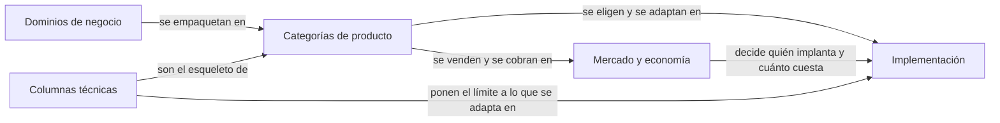

# Software de gestión

El software de gestión es el software que lleva los dominios de una empresa (la contabilidad, las ventas, las compras, el stock, la producción, la gente) sobre registros compartidos; ERP, CRM, HCM o MES son formas de empaquetarlo. Este tema explica cómo se clasifica, qué piezas de diseño comparte todo producto de la clase, cómo se elige y se implanta en una empresa y cómo se vende, sin nombrar productos; el saber de cada dominio vive en su propio tema.

La idea que ordena todo el tema es que **ERP y CRM no son un saber: son una forma de empaquetar software**. Una empresa registra asientos, pedidos y liquidaciones desde mucho antes de que existiera una computadora, y ese saber está en los doce temas del área «Gestión de la empresa», de [Contabilidad](../Contabilidad/contabilidad.md) a [Activos y mantenimiento](../Activos-y-mantenimiento/activos-y-mantenimiento.md), y en los recorridos que los cruzan, en [Procesos de negocio](../Procesos-de-negocio/procesos-de-negocio.md). Lo que agrega el software es otra cosa: decidir qué dominios van juntos en un producto, resolver con las mismas piezas problemas que todos los dominios comparten, llevar ese producto a una empresa que ya trabaja de otra manera y cobrarlo. Esas cuatro cosas son las verticales del tema; de dónde viene la idea y qué se discute, en [fundamentos](Fundamentos/fundamentos-de-software-de-gestion.md). Los límites con cada vecino están en el [alcance](ALCANCE.md).

## De qué está hecho el software de gestión

Un producto de software de gestión tiene un corte hacia afuera (qué dominios lleva y para qué empresa) y un esqueleto hacia adentro (las piezas que se repiten en cualquier dominio). Se vuelve útil cuando una empresa lo implanta, y existe porque alguien lo vende.

- [Categorías de producto](Categorias-de-producto/categorias-de-producto.md): cómo corta el mercado este software: ERP, CRM, HCM, cadena de suministro, MES, mesa de ayuda y servicio de campo, PSA, mantenimiento, el [software por rubro](Categorias-de-producto/software-por-rubro.md) y los [escalones por tamaño](Categorias-de-producto/escalones-por-tamano.md). Entrá acá para saber qué es cada sigla y dónde termina.
- [Columnas técnicas](Columnas-tecnicas/columnas-tecnicas.md): las once piezas de diseño que comparte todo software de gestión, sea cual sea el dominio: datos maestros, documento y estados, registro de movimientos, fechas y cierre, cantidades y monedas, estructura de la organización, permisos, auditoría, integración, configuración y reportes. Entrá acá si vas a construir uno.
- [Implementación](Implementacion/implementacion.md): llevar un producto a una empresa: elegirlo, comparar lo que trae con lo que la empresa necesita, migrar los datos, ponerlo en marcha y sostenerlo después. Entrá acá si vas a cambiar de sistema o a implantar uno.
- [Mercado y economía](Mercado-y-economia/mercado-y-economia.md): cómo se vende y quién gana qué: licencia o suscripción, canal de partners, extensiones, la economía del proveedor, el costo total para quien compra y por dónde entra un software nuevo.
- [Software de gestión en la Argentina](software-de-gestion-en-argentina.md): lo que la normativa argentina le exige a un sistema: el comprobante electrónico, el controlador fiscal, los libros y registros digitales, los padrones de percepciones y retenciones.

## Ideas que cruzan todo el tema

- El dominio existe antes que el módulo. Un módulo de compras modela lo que [Compras y abastecimiento](../Compras-y-abastecimiento/compras-y-abastecimiento.md) ya define: el proveedor, la orden, la recepción contra lo pedido. Quien construye un módulo sin leer el dominio reinventa reglas que ya tienen nombre.
- Cada producto corta distinto. No hay una lista fija de módulos que haga a un ERP: dos productos de la misma categoría ponen la nómina, el mantenimiento o las reparaciones en lugares distintos. Por eso el tema clasifica por el dominio que lleva cada categoría y no por los menús de un producto ([categorías de producto](Categorias-de-producto/categorias-de-producto.md)).
- Las mismas piezas en todos lados. El pedido, la factura, el remito y la orden de trabajo son el mismo problema de diseño: un [documento con estados](Columnas-tecnicas/documento-y-estados.md) que, al confirmarse, deja [movimientos que no se editan](Columnas-tecnicas/registro-de-movimientos-y-dimensiones.md). Quien resuelve bien esas piezas una vez las reusa en cada dominio.
- Integrar es decidir quién manda en cada dato. Un software de gestión casi nunca está solo: convive con una tienda, un banco, el fisco o un sistema de planta. La pregunta de fondo es qué sistema es la fuente de verdad del cliente, del stock o del precio ([integración y migración](Columnas-tecnicas/integracion-y-migracion.md)).
- La licencia es la parte menor del costo. Las tres cifras que circulan, ninguna medida con método, ponen la licencia en menos de la mitad del costo de un proyecto (un sexto y un cuarto en dos de ellas); el resto es implantar, adaptar, migrar y el tiempo del personal propio ([costo total para quien compra](Mercado-y-economia/costo-total-para-quien-compra.md)). Cuánto fallan esos proyectos se sabe menos de lo que se repite ([implementación](Implementacion/implementacion.md), [mitos](Fundamentos/mitos-del-software-de-gestion.md)).

## Qué leer según lo que estés haciendo

- Si tenés que construir un sistema de gestión desde cero: [columnas técnicas](Columnas-tecnicas/columnas-tecnicas.md), empezando por [documento y estados](Columnas-tecnicas/documento-y-estados.md), [registro de movimientos y dimensiones](Columnas-tecnicas/registro-de-movimientos-y-dimensiones.md) y [datos maestros y partes](Columnas-tecnicas/datos-maestros-y-partes.md); después el tema de dominio de cada módulo y [Procesos de negocio](../Procesos-de-negocio/procesos-de-negocio.md) para los recorridos que cruzan módulos.
- Si tenés que proponer o diseñar el sistema de un mayorista o distribuidor (factura, stock y cuenta corriente): las mismas tres columnas, después [del pedido al cobro](../Procesos-de-negocio/del-pedido-al-cobro.md), [cuentas corrientes](../Contabilidad/Registro/cuentas-corrientes.md), [condiciones comerciales](../Relacion-con-clientes/Registro-del-cliente/condiciones-comerciales.md) y [comercio B2B](../Comercio-electronico/Comercio-B2B/comercio-b2b.md), con [cuenta corriente y crédito](../Comercio-electronico/Comercio-B2B/cuenta-corriente-y-credito.md) y [factura entre empresas](../Comercio-electronico/Comercio-B2B/factura-entre-empresas.md); el stock, en [existencias](../Inventario-y-depositos/Existencias/existencias.md), y la caja contra la unidad, en [cantidades, unidades y monedas](Columnas-tecnicas/cantidades-unidades-y-monedas.md); si es en la Argentina, [software de gestión en la Argentina](software-de-gestion-en-argentina.md); para ubicar el producto, [escalones por tamaño](Categorias-de-producto/escalones-por-tamano.md).
- Si tenés que decidir qué módulos o categorías necesita una empresa: [categorías de producto](Categorias-de-producto/categorias-de-producto.md) y [escalones por tamaño](Categorias-de-producto/escalones-por-tamano.md).
- Si tenés que ayudar a elegir un sistema: [elegir un sistema](Implementacion/elegir-un-sistema.md), [análisis de brechas](Implementacion/analisis-de-brechas.md) y [costo total para quien compra](Mercado-y-economia/costo-total-para-quien-compra.md); quién lo implanta, en [partners de implementación](Implementacion/partners-de-implementacion.md); en la Argentina, las [preguntas para el proveedor](software-de-gestion-en-argentina.md#qué-preguntarle-a-un-proveedor).
- Si tenés que migrar o poner en marcha un sistema: [migración de datos](Implementacion/migracion-de-datos.md) y [puesta en marcha](Implementacion/puesta-en-marcha.md); lo que sigue, en [después de la puesta en marcha](Implementacion/despues-de-la-puesta-en-marcha.md).
- Si tenés que decidir si se adapta el proceso o el software: [configurar o personalizar](Columnas-tecnicas/configurar-o-personalizar.md) y [análisis de brechas](Implementacion/analisis-de-brechas.md).
- Si tenés que conectar el sistema con una tienda, un banco o el fisco: [integración y migración](Columnas-tecnicas/integracion-y-migracion.md); el caso del comercio, en [integración con tiendas y marketplaces](../Comercio-electronico/Operaciones-del-comercio/Sistemas-de-gestion/integracion-con-tiendas-y-marketplaces.md).
- Si tenés que poner precio a un software de gestión o armar su canal: [licencia y suscripción](Mercado-y-economia/licencia-y-suscripcion.md), [canal de partners](Mercado-y-economia/canal-de-partners.md) y [economía del proveedor](Mercado-y-economia/economia-del-proveedor.md).
- Si tenés que analizar por dónde entrar a este mercado con un producto nuevo: [dónde entra un software nuevo](Mercado-y-economia/donde-entra-un-software-nuevo.md) y [software por rubro](Categorias-de-producto/software-por-rubro.md); el método de análisis de competidores es de [Estrategia competitiva](../Estrategia-competitiva/estrategia-competitiva.md).
- Si el sistema es para empresas en la Argentina: [software de gestión en la Argentina](software-de-gestion-en-argentina.md) y [mercado en la Argentina](Mercado-y-economia/mercado-en-argentina.md); en qué paso de cada recorrido cae cada control, en [procesos de negocio en la Argentina](../Procesos-de-negocio/procesos-de-negocio-en-argentina.md), y el remito y los traslados, en [inventario y depósitos en Argentina](../Inventario-y-depositos/inventario-y-depositos-en-argentina.md).
- Si tenés que armar tableros o un almacén de datos sobre el sistema: no es de acá; es de [Visualización y BI](../Datos/Visualizacion-y-BI/visualizacion-y-bi.md). Lo que el sistema entrega de su propia base está en [reportes operativos y legales](Columnas-tecnicas/reportes-operativos-y-legales.md).
- Si tenés que elegir el sistema de un comercio que vende online: [sistemas de gestión en el comercio](../Comercio-electronico/Operaciones-del-comercio/Sistemas-de-gestion/sistemas-de-gestion.md), con las fichas de los sistemas argentinos.

## Orden de lectura

Para quien construye software de gestión: esta entrada, [categorías de producto](Categorias-de-producto/categorias-de-producto.md) para ubicar el producto, y [columnas técnicas](Columnas-tecnicas/columnas-tecnicas.md) entera, que es el núcleo del tema. Después [implementación](Implementacion/implementacion.md), porque lo que se construye se paga o se sufre al implantarlo, y [mercado y economía](Mercado-y-economia/mercado-y-economia.md). Para quien vende o implementa, el orden se invierte: implementación y mercado primero.

- [Fundamentos](Fundamentos/fundamentos-de-software-de-gestion.md): de dónde viene (de MRP a ERP y a la nube), las posiciones en disputa, la [historia](Fundamentos/historia-del-software-de-gestion.md), el [glosario](Fundamentos/glosario-de-software-de-gestion.md), las [fuentes](Fundamentos/fuentes-de-software-de-gestion.md) y los [mitos](Fundamentos/mitos-del-software-de-gestion.md).
