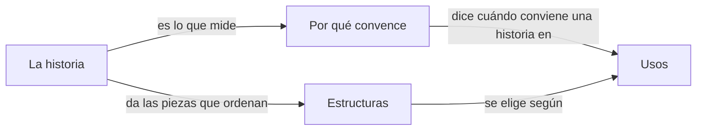

# Storytelling

El storytelling es contar una historia (alguien que quiere algo, un obstáculo y un cambio) para que otro entienda, recuerde o actúe. Convence menos de lo que promete la divulgación: el efecto medido es chico y depende de qué se busca mover, del público y de si va junto con datos.

La palabra se usa para casi cualquier cosa: un aviso, el "sobre nosotros" de una web, un deck de ventas, un informe con gráficos. Acá se usa en el sentido que le da la investigación: un relato con un personaje, una intención, un conflicto sin resolver y un desenlace. Un texto que ordena beneficios en viñetas no es una historia, aunque lo llamen así. La persuasión en general y los sesgos están en [Comunicación](../Marketing/Comunicacion/comunicacion.md) y en [Psicología](../Psicologia/psicologia.md); este tema se ocupa de la forma narrativa.

## De qué está hecho el storytelling

El tema se divide en cuatro partes: de qué está hecha una historia, por qué convence, cómo se ordena y para qué se cuenta.

- [La historia](La-historia/la-historia.md): personaje, intención, conflicto y cambio, y la escena concreta que deja ver. Entrá acá para saber si lo que escribiste es una historia o una lista.
- [Por qué convence](Por-que-convence/por-que-convence.md): el transporte narrativo, qué se recuerda y cuánto persuade una historia frente a los datos, con los tamaños de efecto. Entrá acá antes de prometer que una historia "vende".
- [Estructuras](Estructuras/estructuras.md): el arco, el viaje del héroe y StoryBrand, el ABT y la columna de Pixar, y la pirámide de Minto, cada una con la evidencia que tiene. Entrá acá para elegir una forma.
- [Usos](Usos/usos.md): cómo cambia la historia en la marca, la venta y el pitch, la presentación de ideas y la conducción de un cambio. La venta está más desarrollada.

## Cuánto convence una historia

Una historia persuade, pero poco. El meta-análisis de Braddock y Dillard (2016), según resúmenes, da correlaciones de entre .17 y .19 sobre creencias, actitudes e intenciones; es un efecto chico. Frente a datos, la historia no gana siempre: Zebregs y colegas (2015) encontraron que la evidencia estadística pesa más sobre lo que la gente cree y la narrativa, sobre lo que dice que va a hacer, aunque solo la diferencia en creencias fue significativa y otro meta-análisis no halló diferencias. Las cifras y sus límites están en [Por qué convence](Por-que-convence/por-que-convence.md).

Casi todo lo medido viene de laboratorio y de comunicación de salud, con relatos largos. Para la venta B2B hay muy poco: un experimento con estudiantes y un estudio que, según una fuente secundaria, es cualitativo, con entrevistas en profundidad y observación de campo. Las recetas de practicantes (el viaje del héroe, StoryBrand, el ABT) no tienen ningún experimento detrás. Las cifras que circulan ("una historia se recuerda 22 veces más") no tienen fuente: están en [mitos de storytelling](Fundamentos/mitos-de-storytelling.md).

## Historia o respuesta primero

El choque práctico de todo el tema es entre contar en orden narrativo y poner la respuesta primero. La [pirámide de Minto](Estructuras/piramide-y-scqa.md) pide la conclusión arriba, y la [estructura de la propuesta](../Ventas/La-propuesta/estructura-de-la-propuesta.md) la sigue. Las dos cosas se combinan más de lo que parece. En lectura de esta base, la introducción de Minto (situación, complicación, pregunta) es una historia mínima, y la respuesta viene después de ella. Ninguna fuente encontrada mide cuál de las dos formas rinde más con quien decide; la regla de uso está en [historia en la venta](Usos/historia-en-la-venta.md).

## Qué leer según lo que estés armando

- Si tenés que armar una propuesta o un pitch para un comercio: [historia en la venta](Usos/historia-en-la-venta.md), después [pirámide y SCQA](Estructuras/piramide-y-scqa.md) para el orden, y [estructura de la propuesta](../Ventas/La-propuesta/estructura-de-la-propuesta.md) y [prueba y confianza](../Ventas/La-propuesta/prueba-y-confianza.md) en Ventas.
- Si tenés que contar un caso de cliente: [historia en la venta](Usos/historia-en-la-venta.md) y [personaje y conflicto](La-historia/personaje-y-conflicto.md); lo que no se debe inventar está en [prueba y confianza](../Ventas/La-propuesta/prueba-y-confianza.md).
- Si tenés que escribir la historia de una marca, un "sobre nosotros" o un aviso: [historia de marca](Usos/historia-de-marca.md) y [viaje del héroe](Estructuras/viaje-del-heroe.md), que trata StoryBrand.
- Si tenés que presentar resultados o una idea en una reunión: [presentar ideas](Usos/presentar-ideas.md) y, para los gráficos, [contar con datos](../Datos/Visualizacion-y-BI/contar-con-datos.md).
- Si tenés que explicar un cambio al equipo: [historia del cambio](Usos/historia-del-cambio.md) y [gestión del cambio](../Liderazgo-y-direccion/Ejecucion/gestion-del-cambio.md).
- Si necesitás una historia en tres líneas (un post, la apertura de una charla): [estructuras cortas](Estructuras/estructuras-cortas.md).
- Si tenés que armar un pitch oral de pocos minutos: no hay nota todavía, ni fuente con método; lo más cercano es la apertura con [ABT](Estructuras/estructuras-cortas.md) y el orden de [historia en la venta](Usos/historia-en-la-venta.md).
- Si tenés que decidir entre una historia y un dato: [historia o argumento](Por-que-convence/historia-o-argumento.md).
- Si tenés que contar tu propia carrera en un CV o una entrevista: [historia profesional](../Presentacion-profesional/Posicionamiento/historia-profesional.md), en Presentación profesional.
- Si alguien te cita una cifra sobre historias y memoria: [mitos de storytelling](Fundamentos/mitos-de-storytelling.md).

## Orden de lectura

Para quien no se formó en narrativa: esta entrada, [La historia](La-historia/la-historia.md) para saber qué es y qué no es una historia, [Por qué convence](Por-que-convence/por-que-convence.md) para calibrar cuánto esperar, y después [Estructuras](Estructuras/estructuras.md) y el uso que toque.

- [Fundamentos](Fundamentos/fundamentos-de-storytelling.md): de dónde viene el storytelling de negocios, sus escuelas y críticas, qué leer, los mitos y el glosario.
