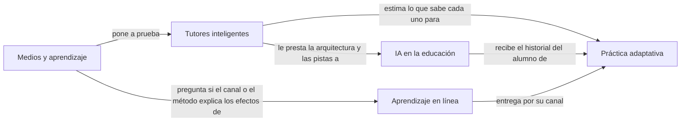

# Tecnología educativa

La tecnología educativa estudia qué aportan los medios digitales a enseñar y aprender: el aprendizaje en línea, los tutores inteligentes, la IA y el software de práctica, separando lo que cambia el aprendizaje de lo que solo cambia el canal.

Es un medio para la [didáctica](../Didactica/didactica.md) y el [diseño instruccional](../Diseno-instruccional/diseno-instruccional.md), no un sustituto. La pregunta que ordena todo el tema la planteó Richard Clark en 1983: si el medio enseña o solo transporta un método de enseñanza. El buscador la describe como no resuelta. La evidencia que reúne esta base apunta, como lectura propia, hacia la segunda opción con un matiz. Los efectos aparecen cuando la tecnología cambia lo que hace quien aprende (practicar con pistas, recuperar de memoria, recibir retroalimentación paso a paso) y desaparecen cuando solo pone el mismo contenido en otra pantalla.

El tema termina donde empiezan sus vecinos. El mecanismo de la memoria y la práctica vive en [Aprendizaje y memoria](../Psicologia/Aprendizaje-y-memoria/aprendizaje-y-memoria.md); cómo funciona un modelo de lenguaje, en [IA](../IA/ia.md); la [tutoría](../Didactica/Tutoria-y-mentoria/tutoria.md) humana y la [escalera de pistas](../Didactica/Retroalimentacion/escalera-de-pistas.md) del docente, en Didáctica; medir lo aprendido, en [Evaluación educativa](../Evaluacion-educativa/evaluacion-educativa.md). Es uno de los cinco temas del área Pedagogía, junto a [Ciencias del aprendizaje](../Ciencias-del-aprendizaje/ciencias-del-aprendizaje.md).

## De qué está hecha la tecnología educativa

El tema se divide en cinco partes. Una es el debate de fondo sobre el medio; las otras cuatro son las familias de tecnología con evidencia propia, cada una con su pregunta: si el curso en línea enseña igual que el presencial, si un programa puede tutorear, qué cambia con un modelo de lenguaje y si conviene que el software decida qué practicar.

- [Medios y aprendizaje](Medios-y-aprendizaje/medios-y-aprendizaje.md): el debate de Clark y Kozma sobre si el medio influye, y por qué dar más dispositivos no subió los resultados. Conviene leerlo antes de creerle a cualquier promesa de una herramienta.
- [Aprendizaje en línea](Aprendizaje-en-linea/aprendizaje-en-linea.md): cuánto rinde un curso en línea frente al presencial, por qué casi nadie termina un curso abierto masivo y qué se sabe del video.
- [Tutores inteligentes](Tutores-inteligentes/tutores-inteligentes.md): los programas que guían paso a paso, sus cuatro piezas, la escalera de pistas y la distancia entre los metaanálisis y el ensayo a escala.
- [IA en la educación](IA-en-la-educacion/ia-en-la-educacion.md): el modelo de lenguaje como tutor, como ayuda de quien enseña y como atajo que reemplaza el esfuerzo de aprender.
- [Práctica adaptativa](Practica-adaptativa/practica-adaptativa.md): el software que programa repasos y elige el próximo ejercicio según lo que cada uno sabe.

[Fundamentos](Fundamentos/fundamentos-de-tecnologia-educativa.md) reúne la historia de las promesas incumplidas, los mitos (nativos digitales, multitarea), las fuentes y el glosario.

## El uso decide más que el acceso

Las revisiones de experimentos dividen el campo por mecanismo. Escueta, Nickow, Oreopoulos y Quan (2020) separan acceso a la tecnología, aprendizaje asistido por computadora, intervenciones conductuales con tecnología y aprendizaje en línea. Esta base no leyó sus conclusiones por categoría, pero los estudios que sí leyó repiten un patrón: el acceso solo no mueve los resultados y el diseño del uso sí.

Tres casos lo muestran. En la OCDE (2015), los países que más invirtieron en computadoras en la escuela no mejoraron de forma apreciable en lectura, matemática ni ciencia. En Bastani et al. (2025), el mismo modelo de lenguaje dañó lo aprendido con una interfaz de chat abierta y no lo dañó con un tutor que no regalaba respuestas. En Oreopoulos y Low (2026), casi todos los alumnos probaron el tutor de IA, pero lo usaron poco, y los autores concluyen que lo difícil es que lo usen, no darles acceso.

## Lo que la evidencia de este tema no cubre

Casi toda la evidencia del tema es escolar o universitaria, de matemática, física, inglés y programación inicial. Ningún estudio leído es de adultos que aprenden un oficio técnico en su trabajo. Cuando una nota lleva un hallazgo a ese caso, lo dice como inferencia. Además, buena parte de lo nuevo sobre IA son preprints o documentos de trabajo sin revisión por pares, y cada nota lo marca.

## Qué leer según lo que estés haciendo

- Si tenés que decidir si comprar o adoptar una herramienta educativa: [debate de los medios](Medios-y-aprendizaje/debate-de-los-medios.md), [acceso y uso de la tecnología](Medios-y-aprendizaje/acceso-y-uso-de-la-tecnologia.md) y [fuentes de tecnología educativa](Fundamentos/fuentes-de-tecnologia-educativa.md) para leer la evidencia del proveedor.
- Si tenés que armar un curso en línea: [en línea y presencial](Aprendizaje-en-linea/en-linea-y-presencial.md), [finalización de los MOOC](Aprendizaje-en-linea/finalizacion-de-mooc.md) y [video educativo](Aprendizaje-en-linea/video-educativo.md). Qué sostiene a la gente hasta el final no tiene nota todavía; lo más cercano es la finalización de los MOOC.
- Si tenés que elegir una plataforma para un curso: [plataformas de aprendizaje](Aprendizaje-en-linea/plataformas-de-aprendizaje.md), una ficha fechada.
- Si tenés que diseñar un asistente o tutor con IA para alumnos: [la IA como tutor](IA-en-la-educacion/ia-como-tutor.md), [escalera de pistas](Tutores-inteligentes/pistas-de-un-tutor-inteligente.md) y [arquitectura de un tutor inteligente](Tutores-inteligentes/arquitectura-de-un-tutor-inteligente.md).
- Si enseñás programación y tus alumnos usan IA: [aprender a programar con IA](IA-en-la-educacion/aprender-a-programar-con-ia.md) y [la IA como atajo](IA-en-la-educacion/ia-como-atajo.md).
- Si estudiás con IA y querés que te enseñe en vez de resolverte: [la IA como atajo](IA-en-la-educacion/ia-como-atajo.md) y la ficha de [modos de estudio de la IA](IA-en-la-educacion/modos-de-estudio-de-la-ia.md).
- Si querés usar tarjetas de repaso o un programa de práctica: [repaso espaciado con software](Practica-adaptativa/repaso-espaciado-con-software.md) y [herramientas de práctica adaptativa](Practica-adaptativa/herramientas-de-practica-adaptativa.md).
- Si alguien te dice que los jóvenes aprenden distinto por ser nativos digitales: [mitos de tecnología educativa](Fundamentos/mitos-de-tecnologia-educativa.md).

## Del debate a las herramientas

1. [Debate de los medios](Medios-y-aprendizaje/debate-de-los-medios.md) y [promesas incumplidas de la tecnología educativa](Fundamentos/promesas-incumplidas-de-la-tecnologia-educativa.md), para leer todo lo demás con la pregunta correcta.
2. [Tutores inteligentes](Tutores-inteligentes/tutores-inteligentes.md), una de las familias con más evidencia reunida en esta base, que ayuda a entender (lectura de esta base) por qué un tutor con IA funciona o falla.
3. [IA en la educación](IA-en-la-educacion/ia-en-la-educacion.md) y [Práctica adaptativa](Practica-adaptativa/practica-adaptativa.md).
4. [Aprendizaje en línea](Aprendizaje-en-linea/aprendizaje-en-linea.md), según la necesidad.
