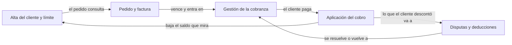

# Crédito y cobranzas

Crédito y cobranzas es la parte de la tesorería que hace entrar la plata que deben los clientes: decide a quién se le vende a plazo y hasta cuánto, reclama lo vencido y aplica cada cobro a las facturas que cancela.

Es la vertical que alimenta a [Caja y liquidez](../Caja-y-liquidez/caja-y-liquidez.md): la [proyección de caja](../Caja-y-liquidez/proyeccion-de-caja.md) toma de acá cuándo se espera cobrar, y los días de cobro son uno de los tres términos del [capital de trabajo](../Caja-y-liquidez/capital-de-trabajo.md). Cuando la cobranza no alcanza, la diferencia se pide al [Financiamiento](../Financiamiento/financiamiento.md), que incluye vender o descontar las mismas facturas.

## Vender a plazo es prestar

Una venta con condición de pago a 30 o 60 días es un préstamo del vendedor al cliente por ese plazo. Petersen y Rajan, con datos de pequeñas empresas de Estados Unidos de 1987, encuentran que las empresas usan más crédito de sus proveedores «when credit from financial institutions is not available». Explican por qué el proveedor presta cuando el banco no: «they may have a comparative advantage in getting information about buyers cheaply, they have a better ability to liquidate goods, and they have a greater implicit equity stake in the firm's long term survival».

De ahí sale la lógica de la vertical. Quien da crédito asume un riesgo de que no le paguen y financia con su propia caja el tiempo hasta cobrar. Las tres notas de adentro responden a eso: acotar el riesgo antes de vender, acortar la espera después de facturar y saber con precisión qué se cobró.

## El ciclo del crédito al cobro

El recorrido tiene cinco momentos, y cada uno deja un dato que usa el siguiente:

1. El crédito. Antes de la primera venta a plazo se evalúa al cliente y se le fija un límite y una condición de pago. Se guardan en sus [condiciones comerciales](../../Relacion-con-clientes/Registro-del-cliente/condiciones-comerciales.md), y el pedido que lo pasa se [bloquea](../../Relacion-con-clientes/Pedido-de-venta/cambios-y-cancelaciones.md#bloquear-un-pedido).
2. La factura. Desde que se emite hay una cuenta a cobrar, que la contabilidad registra en la [cuenta corriente](../../Contabilidad/Registro/cuentas-corrientes.md) del cliente.
3. La cobranza. Lo vencido se reclama con una secuencia de recordatorios, se negocia, y si no se paga se pasa a legales o se da por incobrable.
4. La aplicación. Cada cobro que llega al banco se identifica y se imputa a las facturas que cancela. Hasta que eso pasa, el saldo del cliente y la antigüedad de su deuda están mal.
5. Las diferencias. Lo que el cliente descontó al pagar (una devolución, una diferencia de precio, una retención) abre una deducción que se acepta, se reclama o se discute.

APQC descompone el mismo ciclo en cuatro procesos: 9.2.1 «Process customer credit», 9.2.3 «Process accounts receivable (AR)», que incluye 9.2.3.3 «Apply cash remittances», 9.2.4 «Manage and process collections» y 9.2.5 «Manage and process adjustments/deductions». Las tres notas de la vertical siguen esa división; las deducciones van con la cobranza y el aviso de pago con la aplicación.

## Por qué está en tesorería y no en contabilidad

APQC pone el crédito y la cobranza dentro de la contabilidad de ingresos (9.2) y deja en la tesorería solo la exposición por cliente: en 9.7.5.4 están «Determine current customer exposures and limit exceptions», «Manage customer collateral» y «Perform annual customer credit reviews». Esta base los pone en Tesorería porque el mapa del área le dio a la tesorería los verbos cobrar y pagar, y a la [contabilidad](../../Contabilidad/contabilidad.md) el de registrar.

Que en las empresas grandes lo haga una función de crédito dentro de finanzas o de un centro de servicios compartidos es lectura del informe de investigación de esta base, sin fuente que lo mida. La frontera práctica queda así:

| Parte | Es de Tesorería | Es del vecino |
|---|---|---|
| El límite de crédito | quién lo fija y con qué criterio | Relación con clientes lo guarda y el pedido lo consulta |
| La cuenta a cobrar | cobrarla | Contabilidad la registra, lleva la antigüedad de saldos y la previsión para incobrables ([ingresos y cuentas a cobrar](../../Contabilidad/Operaciones/ingresos-y-cuentas-a-cobrar.md)) |
| El cobro | identificarlo y aplicarlo a facturas | Contabilidad registra el asiento y hace la [conciliación bancaria](../../Contabilidad/Control-interno/conciliaciones.md) |
| El castigo de una deuda | decidir cuándo y quién lo autoriza | Contabilidad registra la baja contra la previsión |

APQC respalda el corte del cobro: separa aplicar el cobro (9.2.3.3) de pasarlo al mayor (9.2.3.5 «Post AR activity to the general ledger»).

## Cómo se mide si la vertical funciona

La medida más usada es el DSO (días de venta pendientes de cobro), que en esta base corresponde a los días de cobro del capital de trabajo. La Credit Research Foundation lo llama «one of the most often misused and misunderstood performance measures» y pide leerlo junto con el DSO mejor posible, los días de atraso promedio y el índice de eficacia de cobranza (CEI). Las fórmulas y la crítica están en [gestión de la cobranza](gestion-de-la-cobranza.md).

## Cómo se ve en la venta entre empresas argentina

La cuenta corriente de un distribuidor, el cheque electrónico como medio de cobro dominante y la Factura de Crédito Electrónica MiPyME están contados en [cuenta corriente y crédito](../../Comercio-electronico/Comercio-B2B/cuenta-corriente-y-credito.md). Los instrumentos locales (ECHEQ, retenciones que el cliente descuenta al pagar) están en [tesorería en Argentina](../tesoreria-en-argentina.md). Cobrar online con tarjeta, QR o billetera, y los contracargos, están en [Pagos](../../Comercio-electronico/Pagos/pagos.md).

## Qué hay adentro de crédito y cobranzas

- [Crédito a clientes](credito-a-clientes.md): por qué se da crédito, la política de crédito, la evaluación del cliente, el límite, las garantías, el seguro de crédito y lo que dice la ley europea sobre plazos. Leela antes de modelar el alta de un cliente o el bloqueo de pedidos.
- [Gestión de la cobranza](gestion-de-la-cobranza.md): la secuencia de recordatorios, la mora, las disputas y deducciones, los acuerdos, el paso a legales y cómo se mide con DSO, DSO mejor posible y CEI. Leela para construir la cobranza o su tablero.
- [Aplicación de cobros](aplicacion-de-cobros.md): el aviso de pago, cómo se imputa un cobro a facturas, los parciales, los anticipos, los cobros sin identificar y las diferencias. Leela para diseñar la pantalla de cobros.
