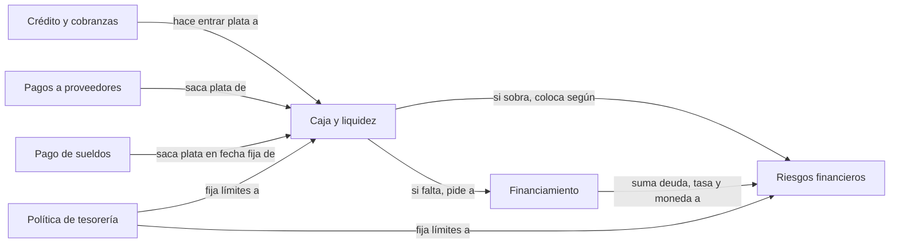

# Tesorería

La tesorería es la parte de la administración de una empresa en marcha que maneja su plata real: sabe cuánta hay y dónde, proyecta cuánta va a haber, cobra lo que le deben, paga lo que debe, consigue la que falta, coloca la que sobra y acota los riesgos financieros.

La idea que ordena el tema es la diferencia entre resultado y caja. La contabilidad registra cada hecho cuando pasa, por el [devengado](../Contabilidad/Registro/devengado.md): una venta a 60 días es ingreso hoy y plata dentro de dos meses. La tesorería vive en el otro reloj, el de la plata que entra y sale de la cuenta. Por eso, en lectura de esta base, una empresa con ganancia se puede quedar sin plata para pagar los sueldos. OpenStax dice de las empresas que crecen que necesitan más capital de trabajo «even if they are extremely profitable» (*Principles of Finance*, 19.1).

En una pyme casi nunca hay un tesorero. Según el informe de fundamentos de esta base, el dueño o un administrativo hace la tarea, el contador registra y la política es una página o un acuerdo de palabra (lectura de esta base, sin fuente con método). Con el tamaño cambian los instrumentos y la formalidad. Las preguntas siguen siendo las mismas: cuánta plata hay, cuánta va a haber y qué se hace con la diferencia.

## De qué está hecha la tesorería

El tema se divide en seis partes: saber y prever la caja, hacer entrar la plata que deben los clientes, hacer salir la que se debe a los proveedores y la que se debe a los empleados, conseguir la que falta y acotar lo que puede salir mal. La [política de tesorería](politica-de-tesoreria.md) las gobierna a todas: fija quién decide, con qué límites y con qué bancos.

- [Caja y liquidez](Caja-y-liquidez/caja-y-liquidez.md): la posición de caja de hoy, las cuentas bancarias, los medios por los que la plata entra y sale, la proyección de las próximas semanas, el capital de trabajo y dónde se pone lo que sobra. Entrá acá primero: las otras cuatro partes mueven los números que esta mira.
- [Crédito y cobranzas](Credito-y-cobranzas/credito-y-cobranzas.md): a quién se le vende a plazo y con qué límite, cómo se cobra lo vencido y cómo se aplica cada cobro a las facturas. Entrá acá cuando la pregunta sea cuándo entra la plata de los clientes.
- [Pagos a proveedores](Pagos-a-proveedores/pagos-a-proveedores.md): qué se paga cuándo, cómo se arma y se aprueba la corrida de pagos y cómo se evita pagarle a quien no corresponde. Entrá acá cuando la pregunta sea cuándo y cómo sale la plata.
- [Pago de sueldos](Pago-de-sueldos/pago-de-sueldos.md): la cuenta de la que sale el sueldo y la del empleado, el fondeo antes de la hora de corte, el calendario del año con las cargas y el desvío de sueldos. Entrá acá cuando la pregunta sea cómo y cuándo le llega la plata a cada empleado.
- [Financiamiento](Financiamiento/financiamiento.md): el descubierto, el descuento de documentos, el factoring, el financiamiento de la cadena, los préstamos y cuánto cuesta cada uno de verdad. Entrá acá cuando la proyección muestra un pozo.
- [Riesgos financieros](Riesgos-financieros/riesgos-financieros.md): liquidez, tasa, contraparte y tipo de cambio, y cómo se cubren. Entrá acá cuando la empresa debe, cobra o paga en otra moneda, o tiene plata en un solo banco.

APQC pone la política primera dentro de la tesorería (9.7.1), y después la caja (9.7.2), la deuda y las inversiones (9.7.4) y el riesgo (9.7.5). El crédito y la cobranza los pone en la contabilidad de ingresos (9.2), los pagos en cuentas a pagar (9.6) y el pago de sueldos en la nómina (9.5). Esta base los pone acá porque el mapa del área le dio a la tesorería los verbos cobrar y pagar, y a la [contabilidad](../Contabilidad/contabilidad.md) el de registrar; en una empresa grande, la frontera depende de cómo esté organizada.

## Dónde termina la tesorería

El límite con cada vecino sigue una regla: cada dominio es dueño de un objeto y un verbo, y los demás lo enlazan. La tabla completa está en el [alcance del tema](ALCANCE.md). Lo que más se confunde:

- **Con la contabilidad.** La tesorería ejecuta el cobro y el pago; la contabilidad los registra, lleva las [cuentas corrientes](../Contabilidad/Registro/cuentas-corrientes.md) de clientes y proveedores y hace la [conciliación bancaria](../Contabilidad/Control-interno/conciliaciones.md), que es de ella. La tesorería se apoya en esa conciliación para saber que su posición de caja es cierta.
- **Con las finanzas de una empresa que empieza.** La pista, el consumo mensual y el capital inicial están en [Finanzas de Emprender](../Emprender/Finanzas/finanzas.md), con su [plan financiero mínimo](../Emprender/Finanzas/plan-financiero-minimo.md) de doce meses. Acá la pregunta es de semanas y la empresa ya vende.
- **Con el cliente.** El límite de crédito y la condición de pago se guardan en la [ficha del cliente](../Relacion-con-clientes/Registro-del-cliente/condiciones-comerciales.md); quién los fija y cómo se cobra es de acá.
- **Con los pagos online.** Cuánto cuesta cobrar con tarjeta, con QR o con una billetera, y cómo funcionan los contracargos, está en [Pagos](../Comercio-electronico/Pagos/pagos.md), dentro de Comercio electrónico.
- **Con la nómina.** Cuánto cobra cada empleado, su recibo y las cargas que se declaran son de [Administración de personal y nómina](../Administracion-de-personal-y-nomina/administracion-de-personal-y-nomina.md); acá, que la plata esté en su cuenta el día que corresponde ([pago de sueldos](Pago-de-sueldos/pago-de-sueldos.md)).
- **Con las compras y los impuestos.** Compras aprueba que la factura se deba; Impuestos dice qué se paga y cuándo vence. Los dos temas todavía no están escritos; acá llegan como pagos para programar.

## Qué leer según lo que estés haciendo

- Si tenés que diseñar la pantalla de saldos o el tablero de caja de un sistema: [posición de caja](Caja-y-liquidez/posicion-de-caja.md), [cuentas bancarias](Caja-y-liquidez/cuentas-bancarias.md) y [medios de cobro y pago](Caja-y-liquidez/medios-de-cobro-y-pago.md), que compara en general cuándo se acredita cada medio (lo de Argentina, en [tesorería en Argentina](tesoreria-en-argentina.md)); la conciliación, en [conciliaciones](../Contabilidad/Control-interno/conciliaciones.md).
- Si tenés que armar una proyección de caja de las próximas semanas: [proyección de caja](Caja-y-liquidez/proyeccion-de-caja.md) y [capital de trabajo](Caja-y-liquidez/capital-de-trabajo.md); para una empresa que recién empieza, el [plan financiero mínimo](../Emprender/Finanzas/plan-financiero-minimo.md).
- Si la empresa da ganancia y no le alcanza la plata: [capital de trabajo](Caja-y-liquidez/capital-de-trabajo.md), [gestión de la cobranza](Credito-y-cobranzas/gestion-de-la-cobranza.md) y [programación de pagos](Pagos-a-proveedores/programacion-de-pagos.md).
- Si tenés que modelar el crédito a clientes y el bloqueo de pedidos: [crédito a clientes](Credito-y-cobranzas/credito-a-clientes.md) y las [condiciones comerciales](../Relacion-con-clientes/Registro-del-cliente/condiciones-comerciales.md) del cliente.
- Si tenés que construir la cobranza de un sistema (recordatorios, mora, aplicación de cobros): [gestión de la cobranza](Credito-y-cobranzas/gestion-de-la-cobranza.md) y [aplicación de cobros](Credito-y-cobranzas/aplicacion-de-cobros.md); el asiento del cobro y los incobrables, en [ingresos y cuentas a cobrar](../Contabilidad/Operaciones/ingresos-y-cuentas-a-cobrar.md).
- Si tenés que construir la corrida de pagos a proveedores: [programación de pagos](Pagos-a-proveedores/programacion-de-pagos.md), [corrida de pagos](Pagos-a-proveedores/corrida-de-pagos.md) y [seguridad de los pagos](Pagos-a-proveedores/seguridad-de-los-pagos.md); quién aprueba, en [autorizaciones](../Contabilidad/Control-interno/autorizaciones.md) y [separación de funciones](../Contabilidad/Control-interno/separacion-de-funciones.md).
- Si tenés que decidir si conviene tomar un descuento por pronto pago: [programación de pagos](Pagos-a-proveedores/programacion-de-pagos.md) y [costo del financiamiento](Financiamiento/costo-del-financiamiento.md).
- Si tenés que comparar formas de conseguir plata (descubierto, descuento de cheques, factoring, préstamo): [financiamiento](Financiamiento/financiamiento.md), [financiamiento de corto plazo](Financiamiento/financiamiento-de-corto-plazo.md), [préstamos](Financiamiento/prestamos.md) y [costo del financiamiento](Financiamiento/costo-del-financiamiento.md).
- Si la empresa compra o vende en dólares: [riesgo de tipo de cambio](Riesgos-financieros/riesgo-de-tipo-de-cambio.md); el registro de la diferencia de cambio, en [moneda extranjera](../Contabilidad/Operaciones/moneda-extranjera.md).
- Si tenés que escribir las reglas de quién mueve la plata y dónde se coloca: [política de tesorería](politica-de-tesoreria.md) y [colocación de excedentes](Caja-y-liquidez/colocacion-de-excedentes.md).
- Si la empresa opera en Argentina: [tesorería en Argentina](tesoreria-en-argentina.md), con los medios locales, el financiamiento pyme y dónde se pone la plata con inflación, y las [tasas de referencia](tasas-de-referencia-en-argentina.md) de una fecha.
- Si tenés que pagar los sueldos (la cuenta, el archivo, cuándo tiene que estar la plata, el cambio de cuenta de un empleado): [pago de sueldos](Pago-de-sueldos/pago-de-sueldos.md), [cuentas y acreditación](Pago-de-sueldos/cuentas-y-acreditacion.md) y [fondeo y calendario](Pago-de-sueldos/fondeo-y-calendario.md); en Argentina, [pago de sueldos en Argentina](Pago-de-sueldos/pago-de-sueldos-en-argentina.md). Cuánto cobra cada uno es de la [liquidación de sueldos](../Administracion-de-personal-y-nomina/Liquidacion-de-sueldos/liquidacion-de-sueldos.md), y el recorrido entero, de [de la contratación a la baja](../Procesos-de-negocio/de-la-contratacion-a-la-baja.md).
- Si tenés que pagar impuestos: qué se paga y cuándo vence es del tema [Impuestos](../Impuestos/impuestos.md); acá entran como salidas en la [proyección de caja](Caja-y-liquidez/proyeccion-de-caja.md) y la [programación de pagos](Pagos-a-proveedores/programacion-de-pagos.md).

## Orden de lectura

Para quien no es tesorero ni contador: esta entrada, [devengado](../Contabilidad/Registro/devengado.md) para separar caja de resultado, [capital de trabajo](Caja-y-liquidez/capital-de-trabajo.md) para ver por qué se traba la plata, y [posición de caja](Caja-y-liquidez/posicion-de-caja.md) y [proyección de caja](Caja-y-liquidez/proyeccion-de-caja.md) para ver cómo se la mira. Después, la vertical que te toque.

- [Política de tesorería](politica-de-tesoreria.md): el documento que fija quién decide, con qué límites, en qué bancos y en qué se puede colocar.
- [Tesorería en Argentina](tesoreria-en-argentina.md): cheques y cheques electrónicos, transferencias, descuento en el mercado de capitales, avales, colocaciones con inflación y acceso al mercado de cambios.
- [Tasas de referencia en Argentina](tasas-de-referencia-en-argentina.md): ficha fechada con las tasas de descubierto, plazo fijo y descuento de cheques, y la inflación, de noviembre de 2026.
- [Fundamentos](Fundamentos/fundamentos-de-tesoreria.md): cómo se divide el campo, la tesorería frente a la contabilidad, la pyme frente a la empresa grande y los mitos de la caja.
- [Glosario de tesorería](Fundamentos/glosario-de-tesoreria.md): cada término del tema en una línea, con su nombre en inglés y la nota que lo explica.
- [Fuentes de tesorería](Fundamentos/fuentes-de-tesoreria.md): dónde se produce el saber de tesorería y qué leer para cada parte.
