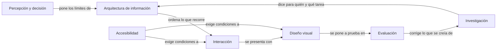

# UX

El diseño de experiencia de usuario (UX) es el trabajo de decidir cómo percibe, entiende y usa la gente un producto digital, y de comprobar con personas reales que esas decisiones funcionan; la interfaz (UI) es solo una de las causas de la experiencia.

La norma ISO 9241-210 define la experiencia de usuario como las "percepciones y respuestas del usuario que resultan del uso o del uso previsto de un sistema, producto o servicio" (traducción propia), antes, durante y después de usarlo. La experiencia no se reduce a la interfaz: la nota 2 de la definición suma la imagen de marca, la presentación, la funcionalidad, el rendimiento del sistema y el estado de quien lo usa, con sus experiencias previas. La definición tampoco la reduce al diseño visual. La usabilidad (eficacia, eficiencia y satisfacción en un contexto dado) es una calidad medible dentro de la experiencia, no la experiencia entera. Dónde termina cada término (UX, UI, diseño de interacción, HCI, experiencia de cliente) está en [Qué es UX](Fundamentos/que-es-ux.md).

El tema termina donde empiezan otros tres. Por qué persuade un mensaje y cómo se construye una marca son del tema [Marketing](../Marketing/marketing.md); cómo se programa una interfaz es de [Desarrollo](../Desarrollo/desarrollo.md); qué producto conviene construir y si alguien lo paga es de [Emprender](../Emprender/emprender.md). UX los toca a los tres: decide cómo se presenta lo que Marketing promete, qué tiene que construir Desarrollo y si lo construido se puede usar.

## De qué está hecha una experiencia

Son siete partes. Cuatro son capas de lo que se decide: cómo se organiza el contenido, cómo se usa, cómo se ve y si lo puede usar cualquiera. Se parecen a los niveles del diagrama de Garrett, que van de lo abstracto a lo concreto, pero la división en siete partes es de esta base. Las otras tres sostienen a las capas: lo que se sabe de cómo percibe y decide la gente, la investigación que se hace antes de diseñar y la evaluación que se hace después.

- [Percepción y decisión](Percepcion-y-decision/percepcion-y-decision.md): cómo ve, recuerda y decide la gente frente a una pantalla. Reúne lo que se sabe de qué es fácil y qué es caro para una mente, y dónde termina la persuasión legítima.
- [Investigación](Investigacion/investigacion.md): quién usa el producto, para qué tarea y en qué contexto. Se hace antes de diseñar y cada vez que una evaluación desmiente lo que se creía.
- [Arquitectura de información](Arquitectura-de-informacion/arquitectura-de-informacion.md): cómo se organiza, se nombra y se encuentra el contenido, es decir, la estructura que la interacción recorre.
- [Interacción](Interaccion/interaccion.md): cómo se usa, con flujos, controles, respuesta del sistema, formularios.
- [Diseño visual](Diseno-visual/diseno-visual.md): cómo se ve, con jerarquía, tipografía, color, grilla y el sistema de diseño que los vuelve repetibles. Es la parte más visible de la UI; ISO incluye además en la interfaz los controles, que se diseñan en Interacción, y [Qué es UX](Fundamentos/que-es-ux.md) traza ese límite.
- [Accesibilidad](Accesibilidad/accesibilidad.md): que la pueda usar cualquiera, con o sin discapacidad. Pone requisitos verificables a la interacción y al diseño visual.
- [Evaluación](Evaluacion/evaluacion.md): si funciona, con pruebas con personas, revisión contra principios y medición.

El diagrama de Garrett (2000) avisa que el modelo "does not describe a development process, nor does it define roles within a user experience development team": no describe un proceso de desarrollo ni define roles en un equipo. Ordena qué se decide, no en qué orden se trabaja. Los nombres de los cinco planos del libro (estrategia, alcance, estructura, esqueleto y superficie) solo se conocen por resúmenes de terceros. Las siete partes de arriba tampoco son etapas.

## Qué leer según lo que tengas que diseñar o revisar

- Si tenés que comparar tu producto con el de rivales, como un checkout o un alta: [evaluación competitiva](Evaluacion/evaluacion-competitiva.md), con las mismas tareas y métricas para dos a cuatro rivales; si es un checkout, después [usabilidad del checkout](../Comercio-electronico/Checkout-y-conversion/usabilidad-del-checkout.md#al-analizar-el-checkout-de-un-competidor) y [checkout por plataforma](../Comercio-electronico/Checkout-y-conversion/checkout-por-plataforma.md).
- Si tenés que revisar una pantalla sin usuarios a mano: [principios de interacción](Interaccion/principios-de-interaccion.md) y [evaluación heurística](Evaluacion/evaluacion-heuristica.md).
- Si tenés que probar un diseño con personas: [test de usabilidad](Evaluacion/test-de-usabilidad.md) y [métricas de UX](Evaluacion/metricas-de-ux.md).
- Si tenés que ver el recorrido entero de una persona, o de cada rol de un servicio: [mapa del recorrido del cliente](Investigacion/mapa-del-recorrido-del-cliente.md) y, para lo que hace la organización detrás, [plano de servicio](../Marketing/Propuesta/plano-de-servicio.md).
- Si tenés que entender a los usuarios antes de diseñar: [métodos de investigación](Investigacion/metodos-de-investigacion.md), [entrevista de usuario](Investigacion/entrevista-de-usuario.md), [entrevista de cambio](Investigacion/entrevista-de-cambio.md) y [análisis de reseñas](Investigacion/analisis-de-resenas.md), que sirve también para un producto ajeno.
- Si tenés que diseñar un formulario o un checkout: [formularios](Interaccion/formularios.md), [carga cognitiva](Percepcion-y-decision/carga-cognitiva.md) y [usabilidad del checkout](../Comercio-electronico/Checkout-y-conversion/usabilidad-del-checkout.md).
- Si tenés que ordenar el menú o el contenido: [arquitectura de información](Arquitectura-de-informacion/arquitectura-de-informacion.md) y [navegación](Arquitectura-de-informacion/navegacion.md).
- Si tenés que cumplir accesibilidad: [WCAG](Accesibilidad/wcag.md) y [normativa de accesibilidad](Accesibilidad/normativa-de-accesibilidad.md).
- Si querés empujar una conversión sin engañar a nadie: [patrón oscuro](Percepcion-y-decision/patron-oscuro.md).

## El ciclo que une las partes

La columna de esta base es el diseño centrado en el usuario de ISO 9241-210. La norma lo llama "centrado en el ser humano" y aclara que en la práctica los dos nombres se usan como sinónimos. Propone cuatro actividades que se repiten: entender y especificar el contexto de uso, especificar los requisitos del usuario, producir soluciones de diseño y evaluarlas contra esos requisitos. Lo que sale de la evaluación vuelve a corregir el contexto, los requisitos y las soluciones.

La norma "no supone ningún proceso de diseño en particular" y se presenta como complemento de los métodos ágiles o en cascada. Fija seis principios: el diseño se basa en un entendimiento explícito de los usuarios, sus tareas y su entorno; los usuarios participan durante todo el desarrollo; la evaluación centrada en el usuario guía y refina el diseño; el proceso es iterativo; el diseño atiende la experiencia entera; y el equipo reúne perfiles multidisciplinarios.

En el diagrama de arriba, las actividades se reparten así: entender el contexto y los requisitos es [Investigación](Investigacion/investigacion.md); producir soluciones son las cuatro capas; evaluar es [Evaluación](Evaluacion/evaluacion.md). La correspondencia entre las actividades de la norma y las capas de Garrett es una síntesis de esta base, no de ninguna de las dos fuentes.

## Dónde discrepan las escuelas

Las escuelas difieren en cómo organizar el trabajo y en qué cuenta como prueba. Según Gibbons (NN/g), el design thinking es una ideología con un proceso de seis fases. Lean UX, de Gothelf y Seiden, se centra en el Lean UX Canvas y en el producto como experiencia. Norman defendió en 2005 diseñar alrededor de la actividad y no de la persona. La optimización por experimentos (CRO) decide con experimentos controlados y no con opinión. Qué sostiene cada una y con qué evidencia está en [Escuelas de UX](Fundamentos/escuelas-de-ux.md).

Hay dos desacuerdos que cruzan todo el tema. El primero es cuánto se puede decidir con pocos usuarios observados y cuánto exige medir a escala: el debate de los cinco usuarios en [Test de usabilidad](Evaluacion/test-de-usabilidad.md) y el límite de tráfico de los experimentos en [Métricas de UX](Evaluacion/metricas-de-ux.md). El segundo es cuánto se puede empujar una decisión antes de engañar: [Patrón oscuro](Percepcion-y-decision/patron-oscuro.md).

## Por dónde empezar a leer

1. [Qué es UX](Fundamentos/que-es-ux.md), para fijar el vocabulario.
2. [Percepción y decisión](Percepcion-y-decision/percepcion-y-decision.md) y, adentro, [Modelo mental](Percepcion-y-decision/modelo-mental.md), que describe lo que la persona cree sobre el sistema que tiene delante.
3. [Principios de interacción](Interaccion/principios-de-interaccion.md) y [Evaluación heurística](Evaluacion/evaluacion-heuristica.md), dos formas de revisar una pantalla en busca de problemas.
4. [Test de usabilidad](Evaluacion/test-de-usabilidad.md), el método central de la evaluación.
5. Las demás partes, según la necesidad. Qué leer para [una tienda online](Fundamentos/bibliografia-de-ux.md#e-commerce), [una landing](Fundamentos/bibliografia-de-ux.md#conversión-y-marketing-digital) o [un sistema interno](Fundamentos/bibliografia-de-ux.md#software-de-negocio-sistemas-internos-tablas-y-dashboards) está en la bibliografía, ordenada por necesidad.

[Fundamentos](Fundamentos/fundamentos-de-ux.md) reúne lo que cruza todas las partes: qué es UX, su historia, las escuelas, la bibliografía por necesidad, el peso de cada tipo de fuente, los mitos que la evidencia desmiente y el glosario.
