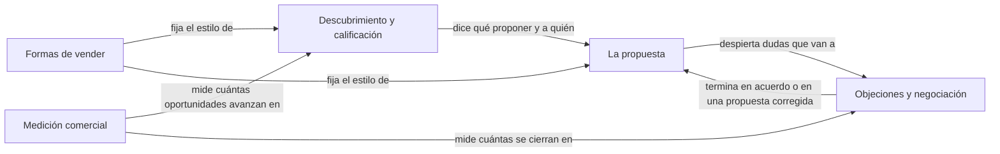

# Ventas

Vender es llevar a un cliente concreto desde un problema que tiene hasta un acuerdo para resolverlo con lo que uno ofrece: entender qué le duele, decidir si vale la pena proponerle, armar y presentar la propuesta, responder sus dudas y negociar. Empieza donde marketing dejó a alguien interesado y termina en el acuerdo y lo que viene después.

Marketing le habla a un mercado; ventas le habla a una persona o a un grupo que decide. Según el resumen que hace INSEAD del artículo de Kotler, Rackham y Krishnaswamy (2006), el reparto depende del tipo de venta: en la transaccional, las herramientas que mueven el negocio "largely come from marketing"; en la consultiva, marketing tiene que darles a los vendedores con qué crear valor para cada cliente. En un comercio chico o en una empresa que empieza, las dos funciones son la misma persona, y la distinción importa recién cuando hay un equipo de ventas.

Lo que se promete, frente a qué alternativas y a quién está en [Marketing](../Marketing/marketing.md); cómo se fija el precio, en [Monetización](../Producto/Monetizacion/monetizacion.md). Este tema toma esas decisiones como dadas y se ocupa de llevarlas a un cliente.

## De qué está hecha una venta

Las partes siguen el recorrido de una venta compleja, la que pide más de una conversación. En una venta simple se comprimen en una charla.

- [Descubrimiento y calificación](Descubrimiento-y-calificacion/descubrimiento-y-calificacion.md): qué preguntar para entender el problema del cliente, a quién vale la pena proponerle y quién decide de verdad. Es la parte más desarrollada, junto con la propuesta.
- [La propuesta](La-propuesta/la-propuesta.md): qué lleva y en qué orden, cómo se presenta el precio y qué prueba se ofrece sin inventar nada.
- [Objeciones y negociación](Objeciones-y-negociacion/objeciones-y-negociacion.md): responder dudas y negociar; cuánto ceder todavía no tiene fuente.
- [Formas de vender](Formas-de-vender/formas-de-vender.md): transaccional, consultiva, de soluciones, Challenger y la venta de servicios profesionales.
- [Medición comercial](Medicion-comercial/medicion-comercial.md): el embudo comercial, la tasa de cierre y el ciclo de venta.

## Cuánta evidencia hay detrás de los métodos de venta

Los métodos más conocidos tienen poca evidencia independiente, y este tema lo dice en cada nota. SPIN sale de observaciones hechas por la empresa que lo enseña, sin réplica independiente encontrada; la venta Challenger, de una encuesta del proveedor que la vende; BANT y MEDDIC no tienen ningún estudio de eficacia. Lo más sólido viene de la investigación académica sobre vendedores, como el meta-análisis de Franke y Park (2006) sobre adaptar la venta a cada cliente, y de la investigación sobre negociación y anclaje, casi toda en laboratorio o en simulaciones.

Para venderle a un comercio chico no se encontró investigación: ninguno de estos métodos fue probado ahí. La regla de uso es tratarlos como listas de preguntas que ordenan una conversación, no como fórmulas que garantizan un cierre. El mapa de escuelas y su evidencia está en [Fundamentos](Fundamentos/fundamentos-de-ventas.md).

## Qué leer según lo que tengas que vender

- Si vas a armar una propuesta para un comercio: [preguntas de descubrimiento](Descubrimiento-y-calificacion/preguntas-de-descubrimiento.md) para la primera charla, después [estructura de la propuesta](La-propuesta/estructura-de-la-propuesta.md), [presentar el precio](La-propuesta/presentar-el-precio.md) y [prueba y confianza](La-propuesta/prueba-y-confianza.md). Del dominio, [Comercio electrónico](../Comercio-electronico/comercio-electronico.md) y [segmentos de comerciantes](../Comercio-electronico/Plataforma-de-tiendas/segmentos-de-comerciantes.md) para ubicar el tamaño del comercio.
- Si vas a proponerle un proyecto a una empresa: [grupo de compra](Descubrimiento-y-calificacion/grupo-de-compra.md) para saber quién lee y quién firma, y después [la propuesta](La-propuesta/la-propuesta.md).
- Si tenés que decidir a quién vale la pena proponerle: [calificación](Descubrimiento-y-calificacion/calificacion.md).
- Si el cliente dice que es caro o que lo tiene que pensar: [objeciones y negociación](Objeciones-y-negociacion/objeciones-y-negociacion.md).
- Si tenés que elegir cómo vender o armar un equipo: [formas de vender](Formas-de-vender/formas-de-vender.md) y [medición comercial](Medicion-comercial/medicion-comercial.md).
- Si alguien te cita un método o una cifra de ventas: [mitos de ventas](Fundamentos/mitos-de-ventas.md) y [fuentes de ventas](Fundamentos/fuentes-de-ventas.md).

Los términos y siglas del tema (BANT, MAAN, pliego, tasa de cierre) están en el [glosario de ventas](Fundamentos/glosario-de-ventas.md).

## Orden de lectura

Para quien no se formó en ventas: esta entrada, después [Descubrimiento y calificación](Descubrimiento-y-calificacion/descubrimiento-y-calificacion.md) y [La propuesta](La-propuesta/la-propuesta.md), que son lo que se usa en cada venta, y después [Objeciones y negociación](Objeciones-y-negociacion/objeciones-y-negociacion.md). Formas de vender y medición se leen cuando hay que elegir un estilo o armar un equipo.

- [Fundamentos](Fundamentos/fundamentos-de-ventas.md): escuelas y su evidencia, historia, bibliografía, fuentes, mitos y glosario.
